# 派德曼（社员叔叔）
> 分类：角色 · 编号 105 · 时期 第一期 · 男
> 来源：https://wiki.biligame.com/starengine/%E6%B4%BE%E5%BE%B7%E6%9B%BC

超自然生物，虽然不会对周围的人产生直接的肉体伤害，但是会不断蚕食周围人的精神，使他们陷入神经质，癫狂，自残的精神状态。表达感情和发声都是通过面部的平板电脑，但有传闻说那些声音只是在模仿某人说话。

## 战斗数值

| 攻击 | 防御 | 生命 |
| --- | --- | --- |
| 2 | 2 | 9 |

## 技能

### 主动技能：真的生气了（冷却 3）

被动技能全取最大值增加，持续1轮。

### 被动技能：毫无主见

在原有的基础上每个回合浮动增加或减少属性；攻击力-2~+2，防御力-2~+2，移动速度-2~+2。

**潜能激发**：攻击骰点为6时，将无视对方的防御力。自己骰点结果小于2时，下次攻击骰点必定为6。

## 基础资料

- 姓名：派德曼
- 英文名：Padman
- 日文名：パッドマン
- 从属组织：未知
- 事件经历：天王落
- 上线时间：202402291000
- 生日：5月20日（发现日）
- 喜欢食物：未知
- 初始骰子：包装盒骰子
- 礼物：智能手机、新款平板电脑、非常牛的电脑配件
- 徽章：山峦、阳炎

## PVE 特性

- 达到1星时攻击力+1
- 达到2星时攻击力+2
- 达到3星时攻击力+1、移动速度+2

## 皮肤（共 3 套）

> 皮肤编号取自素材文件名；「默认」「羁绊皮肤」也是独立皮肤。

### 1. 默认（初始）

- 获取方式：默认
- 素材编号：105
- 立绘：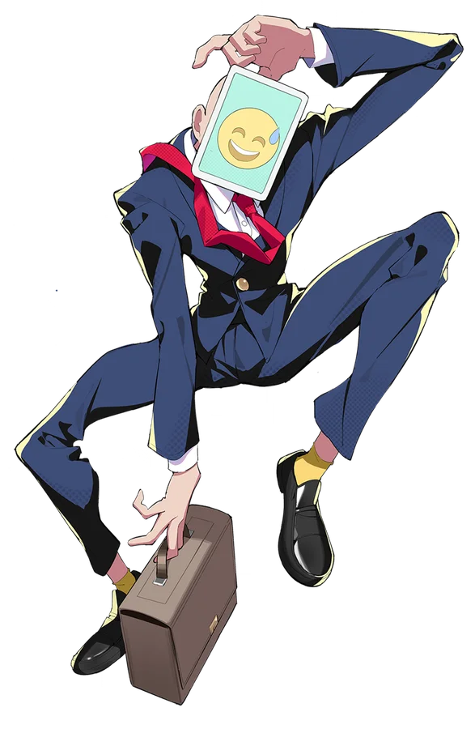
- Q版立绘：
- 头像：
- Q版头像：
- 半身像（星币<20）：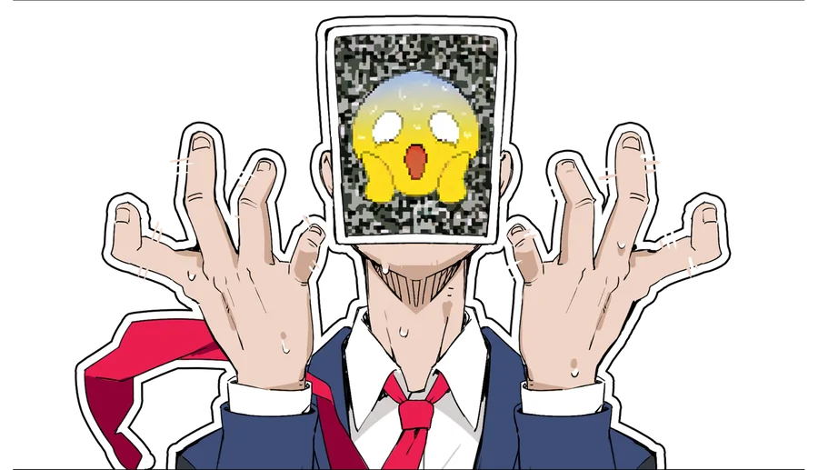
- 半身像（星币≥20）：

### 2. 羁绊皮肤（羁绊解锁）

- 获取方式：派德曼缔结契约后使用
- 素材编号：105_Max
- 立绘：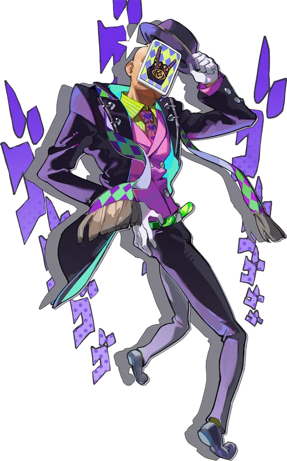
- Q版立绘：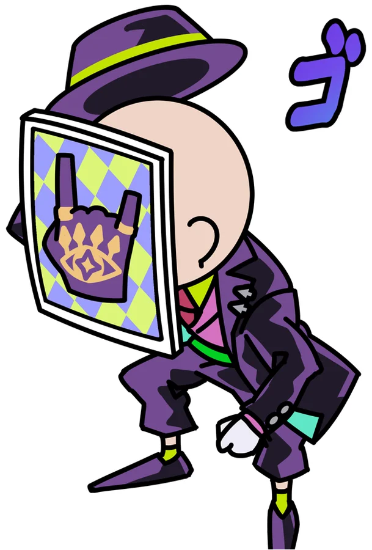
- 头像：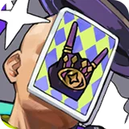
- Q版头像：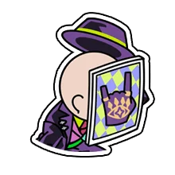
- 半身像（星币<20）：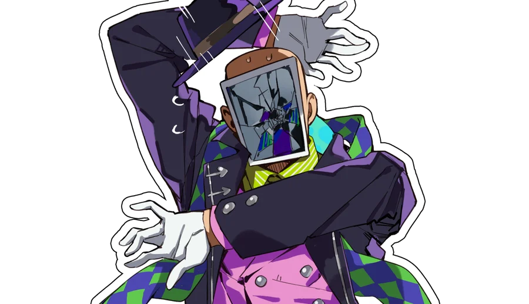
- 半身像（星币≥20）：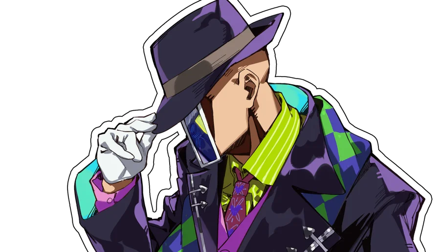

### 3. 酷暑难耐（蓝品质）

- 获取方式：在活动夏日炎炎中以300购入
- 素材编号：105_01
- 立绘：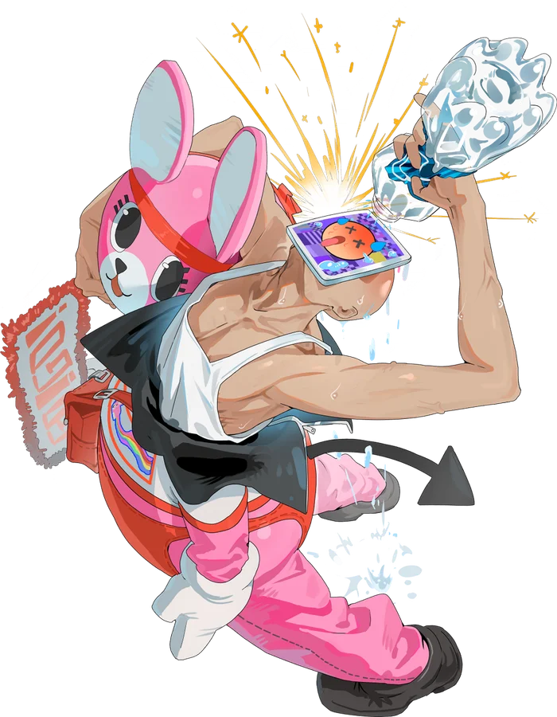
- Q版立绘：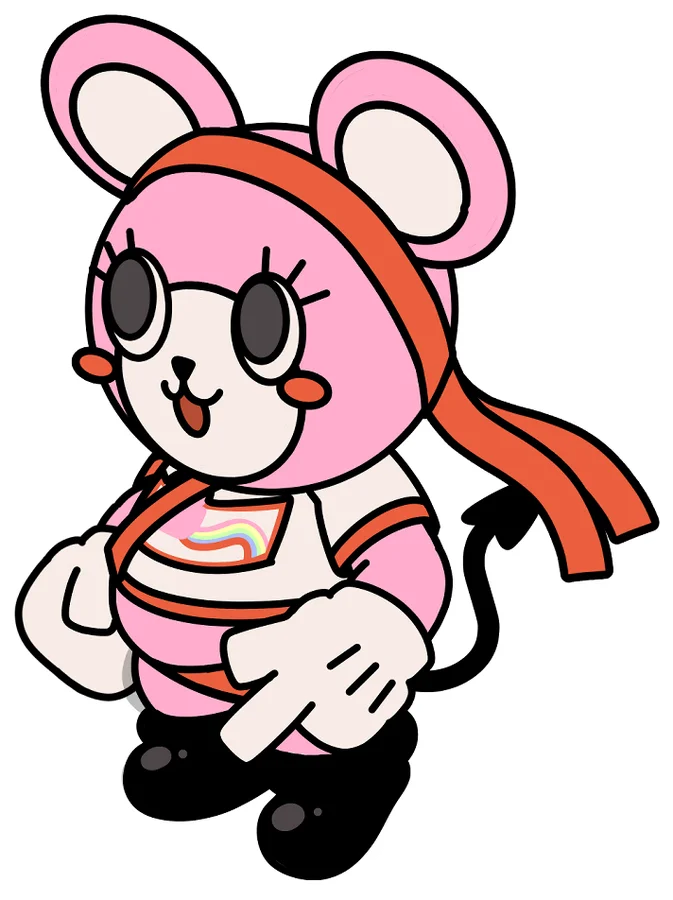
- 头像：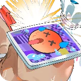
- Q版头像：
- 半身像（星币<20）：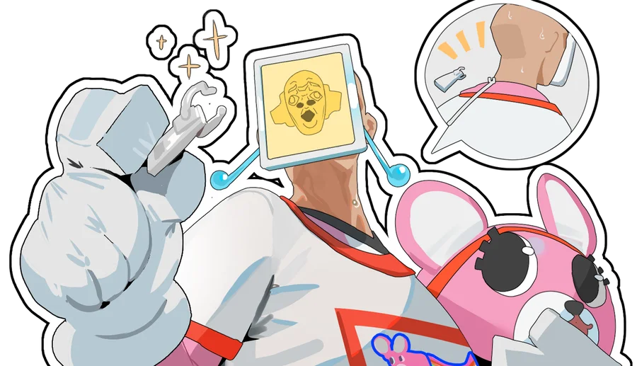
- 半身像（星币≥20）：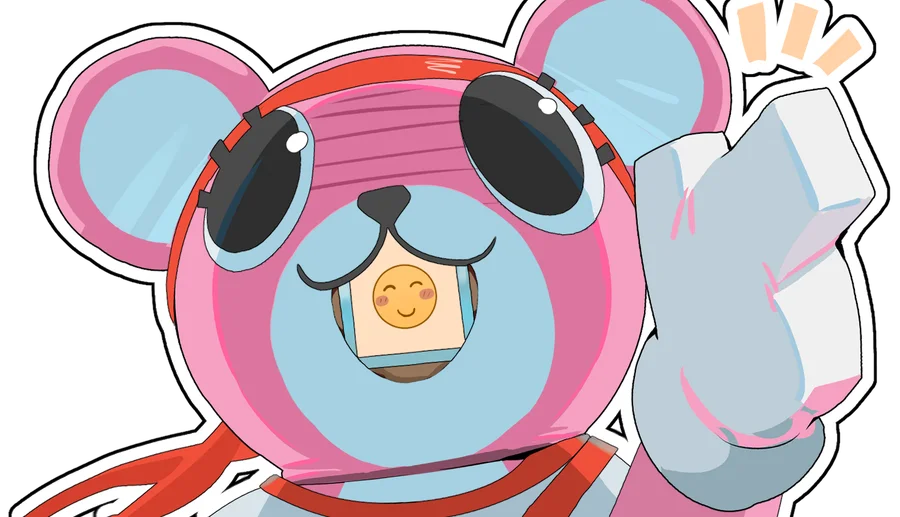

**皮肤故事**：“当时的气温将近40度！你知道吗？40度啊！”

“嗯嗯，知道知道。”回应的人正在仔细检查设备的运转情况。

“我整个身体都被那该死的玩意儿包裹着！就感觉像是在蒸笼里一样！”

“汗水打湿了我的屏幕！表情都不受控制地变来变去！！”

“啊啊啊啊！！那感觉简直像噩梦一样！我差点就热得把一整瓶水直接浇自己脸上了！还好我是防水的！”

“你要多浇点，我们也不至于陪你在这里待着了。”

“你说什么呢！你这不务正业上班看报纸的家伙！怎么能和顶着大太阳在将近40度高温下穿着玩偶服的我相提并论！我可是为了公司的业绩着想！”

“对对对，那你继续好好想想你之前干了什么吧。”安保人员低下头，检查最后一处报警装置。

“你们这些家伙！我只是在拯救之前那个困在玩偶服里的人！我什么都没做！”

“如果没我的话！他早就热死在里面了！我可是为了那个人着想！” 安保并未看向它，也并不想再过多回应它。只是关闭了麦克风，任凭派德曼隔着玻璃窗来回笔划。

它完全不记得自己的罪过。像是从未发生过一样。

## 表情（共 9 个）

| # | 名称 | 品质 | 获取方式 | 图片 |
| --- | --- | --- | --- | --- |
| 1 | 社员叔叔表情1 | 绿 | 获取角色时获取 |  |
| 2 | 社员叔叔表情2 | 绿 | 获取角色时获取 |  |
| 3 | 社员叔叔表情3 | 绿 | 获取角色时获取 |  |
| 4 | 社员叔叔表情4 | 绿 | 获取角色时获取 |  |
| 5 | 社员叔叔表情5 | 绿 | 派德曼羁绊1级解锁后使用 |  |
| 6 | 社员叔叔表情6 | 绿 | 派德曼羁绊2级解锁后使用 |  |
| 7 | 社员叔叔表情7 | 绿 | 派德曼羁绊3级解锁后使用 |  |
| 8 | 社员叔叔表情8 | 绿 | 派德曼羁绊3级解锁后使用 |  |
| 9 | 社员叔叔表情9 | 橙 | 参与众筹 |  |

## 装扮

### 头像（2）

| 名称 | 品质 | 获取方式 |
| --- | --- | --- |
| 头像-鼠鼠派德曼 | 紫 | 派德曼羁绊4级解锁后使用 |
| 头像-像素派德曼 | 紫 | 完成成就“魔神降临” |

### 名片（3）

| 名称 | 品质 | 获取方式 |
| --- | --- | --- |
| 名片-社员叔叔 | 紫 | 派德曼羁绊5级解锁后使用 |
| 名片-派德曼缔结契约 | 橙 | 派德曼缔结契约后使用 |
| 名片-酷暑难耐 | 紫 | 在活动夏日炎炎中以30购入 |

### 卡牌（1）

| 名称 | 品质 | 获取方式 |
| --- | --- | --- |
| 卡牌-像素小人 | 紫 | 抽奖 |

### 骰子（2）

| 名称 | 品质 | 获取方式 |
| --- | --- | --- |
| 包装盒骰子 | 紫 | 派德曼缔结契约后使用 |
| 社员叔叔骰子 | 橙 | 在商城中以399购入 |

### 主页背景（1）

| 名称 | 品质 | 获取方式 |
| --- | --- | --- |
| 背景：暗箱操作-派德曼 | 紫 | 派德曼友情加深后使用 |

## 人物传记

在“天王落”事件后被收容。

## 画廊其他素材

- 起始点：
- 像素头像：
- Lv4羁绊等级奖励：
- Lv5羁绊等级奖励：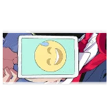
- 缔结契约名片奖励：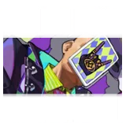
- 酷暑难耐皮肤名片：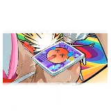
