# 帕帕拉（猩红辣妹）
> 分类：角色 · 编号 106 · 时期 第一期 · 女
> 来源：https://wiki.biligame.com/starengine/%E5%B8%95%E5%B8%95%E6%8B%89

“猩红行者”乐队的主唱兼吉他手，也是联合城地下飙车集团“地窖”的主理人。乐队吉他主唱是她童年的兴趣爱好，飙车才是现在的心头好。她喜欢把车子涂成红色并且贴上各种可爱的贴纸。

## 战斗数值

| 攻击 | 防御 | 生命 |
| --- | --- | --- |
| 2 | 1 | 10 |

## 技能

### 主动技能：嘬你一口（冷却 3）

使用主动技能时，如果当前生命值超过生命值上限的50%则受到3点伤害。战斗造成伤害后，回复伤害量50%的生命值，持续1轮。

### 被动技能：可爱即正义

当前生命值不超过生命值上限的50%时，攻击力+3。

**潜能激发**：使用主动技能不再消耗自身生命值。

主动技能持续时间内，无论当前的生命值为多少，都同时被视为一半以下。

**技能细节**：通常情况下，帕帕拉主动技能回复的生命值满足：

<math>回复的生命值 = \left \lceil \frac{ 伤害量 \times 50 }{ 100 } \right \rceil</math>

但当伤害量大于等于42949673时，此时主动技能回复的生命值应当使用通用公式来进行计算：

<math>回复的生命值 = \left \lceil \frac{ \left

## 基础资料

- 姓名：帕帕拉
- 英文名：Papara
- 日文名：パパラ
- 从属组织：猩红行者乐队,地窖
- 上线时间：202402291000
- 生日：10月31日
- 喜欢食物：番茄酱为辅料的任何东西
- 初始骰子：契约骰子
- 礼物：普通的饮料、精酿的啤酒、陈年的红酒
- 徽章：川河、月光

## PVE 特性

- 达到1星时攻击力+1、移动速度+1
- 达到2星时攻击力+2
- 达到3星时攻击力+1、移动速度+2

## 皮肤（共 4 套）

> 皮肤编号取自素材文件名；「默认」「羁绊皮肤」也是独立皮肤。

### 1. 默认（初始）

- 获取方式：抽奖
- 素材编号：106
- 立绘：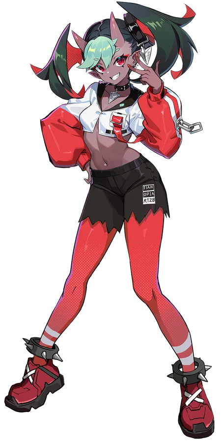
- Q版立绘：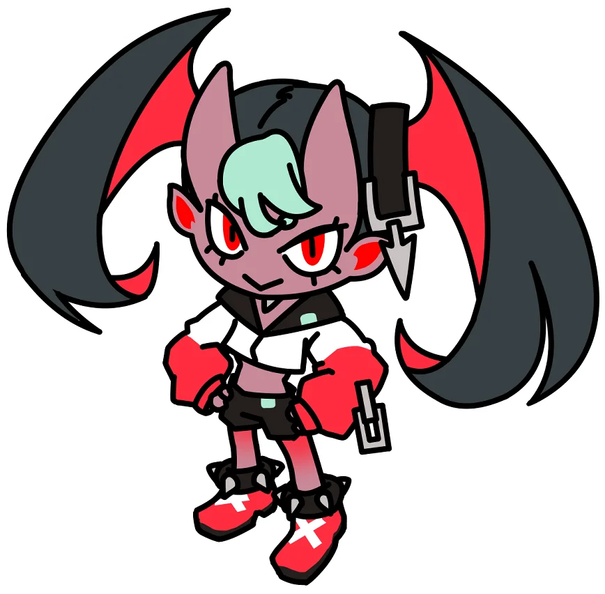
- 头像：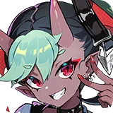
- Q版头像：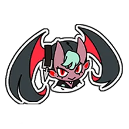
- 半身像（星币<20）：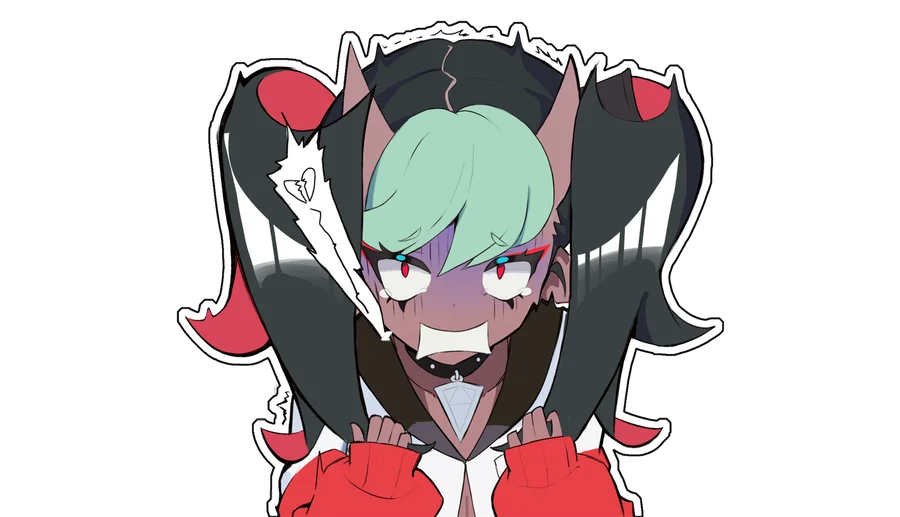
- 半身像（星币≥20）：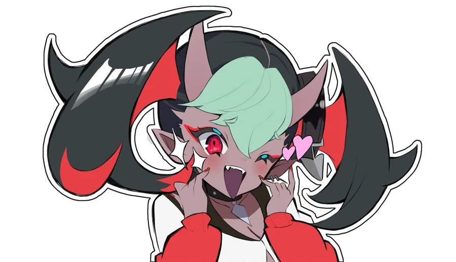

### 2. 羁绊皮肤（羁绊解锁）

- 获取方式：帕帕拉缔结契约后使用
- 素材编号：106_Max
- 立绘：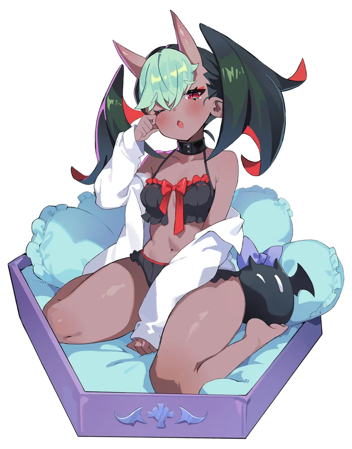
- 立绘（和谐版）：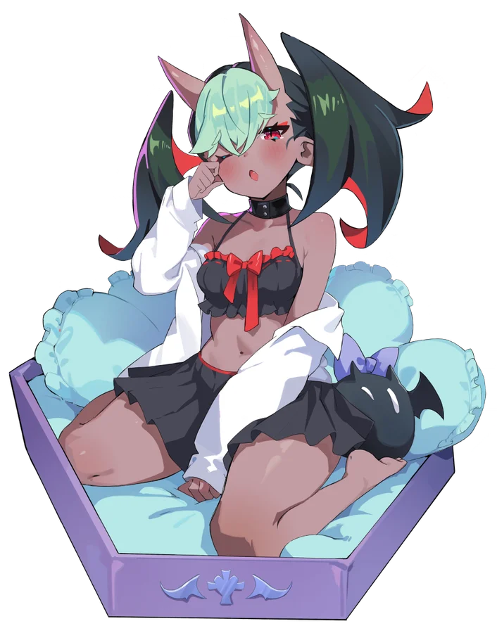
- Q版立绘：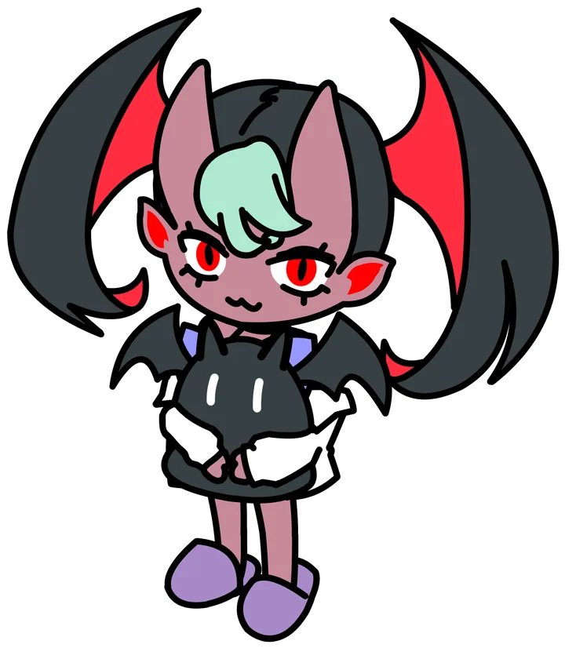
- 头像：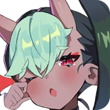
- Q版头像：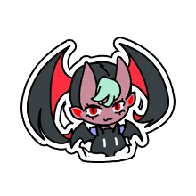
- 半身像（星币<20）：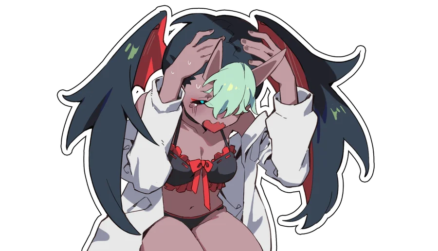
- 半身像（星币≥20）：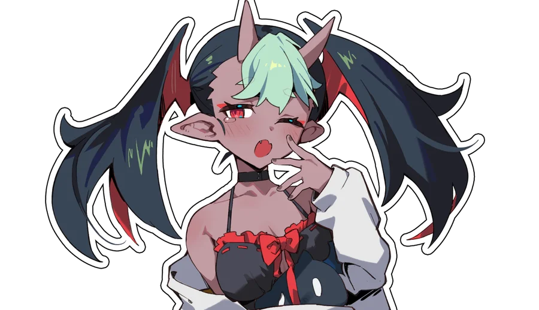

### 3. 护卫队长（蓝品质）

- 获取方式：在商城中以666购入
- 素材编号：106_01
- 立绘：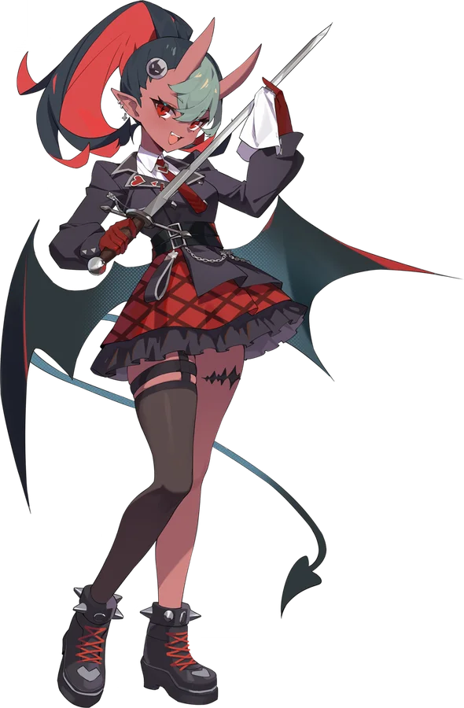
- Q版立绘：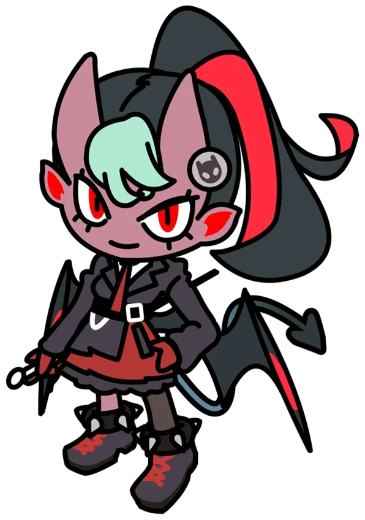
- 头像：
- Q版头像：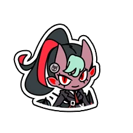
- 半身像（星币<20）：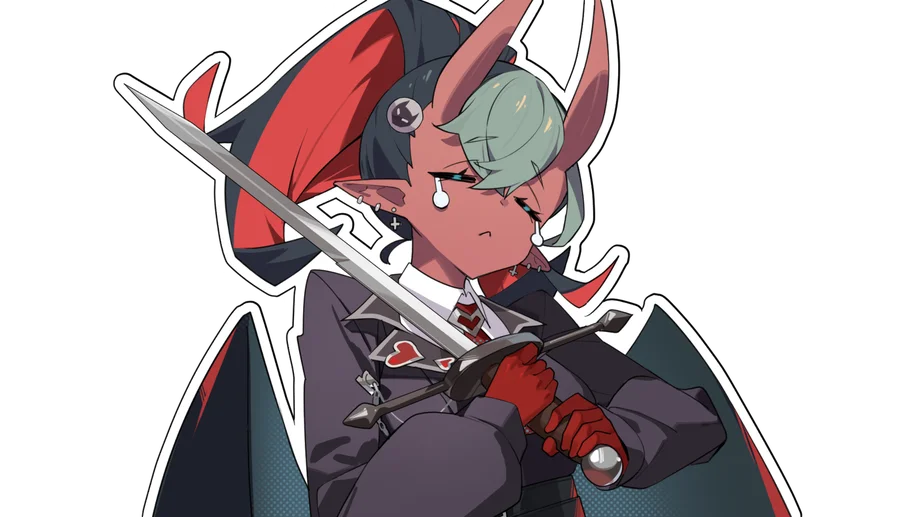
- 半身像（星币≥20）：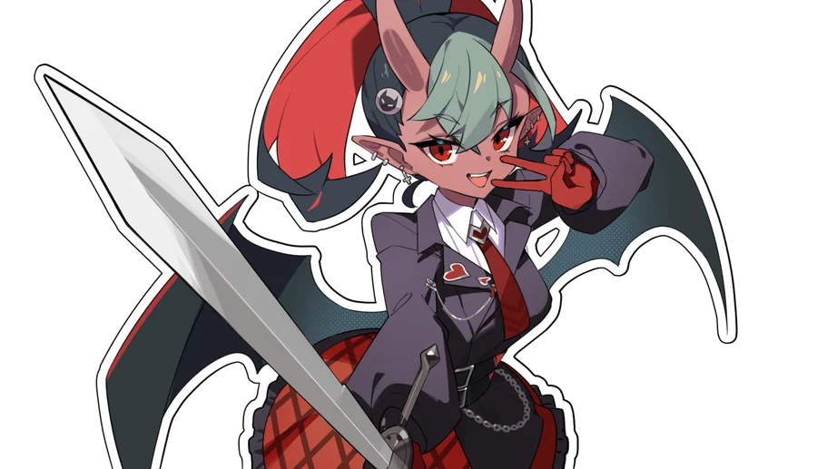

**皮肤故事**：帕帕拉的高中生活可谓是相当的充实。

作为贵族学校，学校的社团活动也是相当丰富，骑马、射击、话剧、乐队各种各样的都有。帕帕拉不但加入了话剧社团，还和朋友们组成了一个小乐队。

不仅如此，他们学校社团的道具也是相当的讲究。就比如这次出演的是一个护卫队员，他们甚至就为这一个剧定制了刀剑和制服，属实是豪气。

当然这可能就是贵族学校的日常吧。

### 4. 入夏露营（紫品质）

- 获取方式：购买通行证并且通行证等级达到40级
- 素材编号：106_02
- 立绘：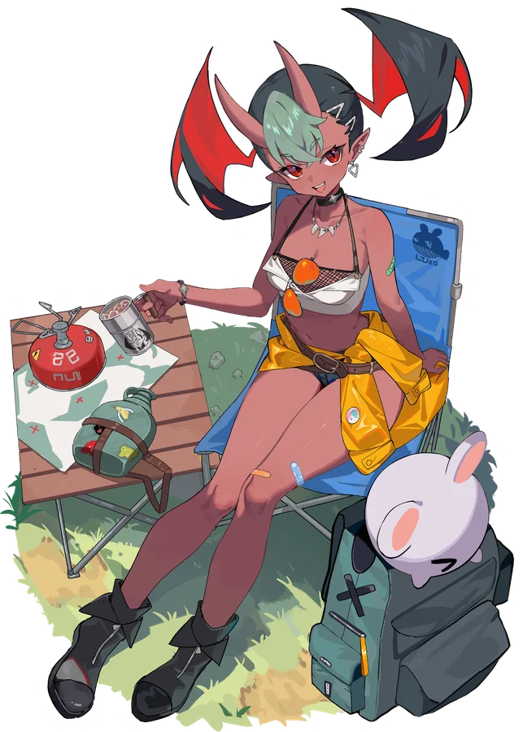
- 立绘（和谐版）：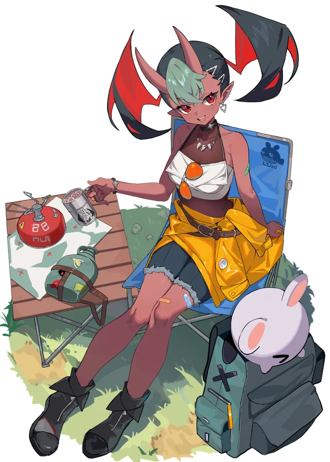
- Q版立绘：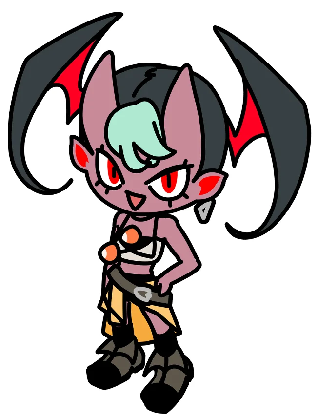
- 头像：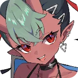
- Q版头像：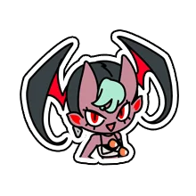
- 半身像（星币<20）：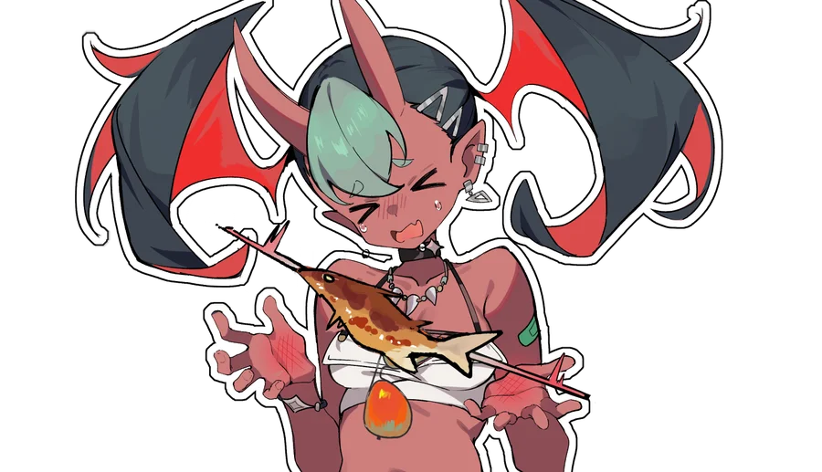
- 半身像（星币≥20）：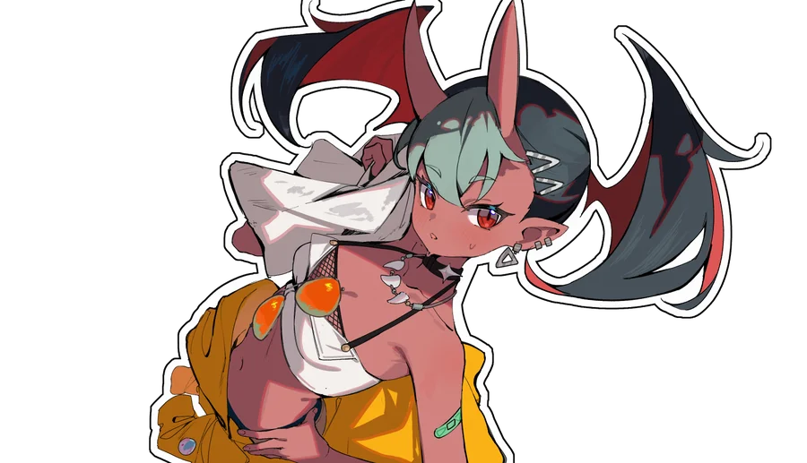

**皮肤故事**：每到春季转为夏季的这段时间，帕帕拉会准时收拾好装备，来一场入夏露营。

这一传统源于她们高中时期的学校。比起其他学校，帕帕拉的高中简直豪横到爆炸。

学校内有一座占地巨大且带有溪流的后山，仅开放给学校里的学生露营。

她和儿时的高中玩伴经常趁着入夏这段气温合适的时间去后山露营。

渐渐地，这种每年一次的行动就固定了下来。虽然长大了，这一传统依旧未改变。

前几次，她都会邀请作为老大的阿尔和作为同僚的露比一起来露营。但老大每次都很忙，而露比则以“去了山里还怎么能好好睡觉呢！”为理由拒绝了。

起初帕帕拉还挺失落的，但渐渐地，自己单人去过几次后，她发现了单人露营的乐趣。

用带来的冰块冲泡一杯冰咖啡，加热型食物只要用燃气瓶简单地烹饪一下就非常美味。在这阳光透过树叶洒下斑驳光影的地方，支起一把椅子慢慢看一本书，入夜后听着虫鸣入眠，其实也蛮惬意的。

这样的露营，渐渐地变成了独属于帕帕拉的安静时光。

## 表情（共 13 个）

| # | 名称 | 品质 | 获取方式 | 图片 |
| --- | --- | --- | --- | --- |
| 1 | 猩红辣妹表情1 | 绿 | 获取角色时获取 | 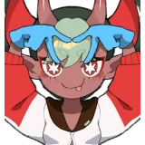 |
| 2 | 猩红辣妹表情2 | 绿 | 获取角色时获取 | 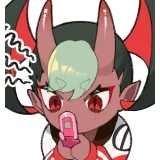 |
| 3 | 猩红辣妹表情3 | 绿 | 获取角色时获取 | 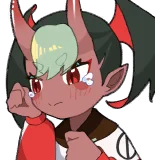 |
| 4 | 猩红辣妹表情4 | 绿 | 获取角色时获取 | 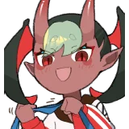 |
| 5 | 猩红辣妹表情5 | 绿 | 帕帕拉羁绊1级解锁后使用 | 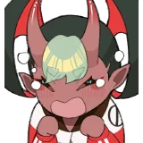 |
| 6 | 猩红辣妹表情6 | 绿 | 帕帕拉羁绊2级解锁后使用 | 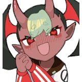 |
| 7 | 猩红辣妹表情7 | 绿 | 帕帕拉羁绊3级解锁后使用 | 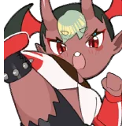 |
| 8 | 猩红辣妹表情8 | 绿 | 帕帕拉羁绊3级解锁后使用 | 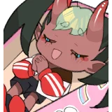 |
| 9 | 猩红辣妹表情9 | 橙 | 参与众筹 |  |
| 10 | 猩红辣妹表情10 | 紫 | 购买通行证并且通行证等级达到15级 | 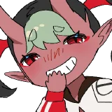 |
| 11 | 猩红辣妹表情11 | 橙 | 购买升级版通行证并且通行证等级达到15级 | 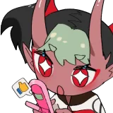 |
| 12 | 猩红辣妹表情12 | 紫 | 购买通行证并且通行证等级达到20级 | 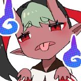 |
| 13 | 猩红辣妹表情13 | 橙 | 购买升级版通行证并且通行证等级达到20级 | 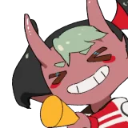 |

## 装扮

### 头像（3）

| 名称 | 品质 | 获取方式 |
| --- | --- | --- |
| 头像-鼠鼠帕帕拉 | 紫 | 帕帕拉羁绊4级解锁后使用 |
| 头像-露营鼠鼠 | 蓝 | 购买通行证并且通行证等级达到10级 |
| 头像-像素帕帕拉 | 紫 | 完成成就“作弊吧？” |

### 名片（6）

| 名称 | 品质 | 获取方式 |
| --- | --- | --- |
| 名片-猩红辣妹 | 紫 | 帕帕拉羁绊5级解锁后使用 |
| 名片-帕帕拉缔结契约 | 橙 | 帕帕拉缔结契约后使用 |
| 名片-护卫队长 | 紫 | 在商城中购入皮肤护卫队长-帕帕拉时获取 |
| 名片-入夏露营 | 紫 | 购买通行证并且通行证等级达到39级 |
| 名片-入夏露营（动态） | 橙 | 购买升级版通行证并且通行证等级达到39级 |
| 名片-挂起 | 紫 | 抽奖 |

### 卡牌（3）

| 名称 | 品质 | 获取方式 |
| --- | --- | --- |
| 卡牌-像素小人 | 紫 | 抽奖 |
| 卡牌-露营 | 紫 | 购买通行证并且通行证等级达到25级 |
| 卡牌-专属时刻（动态） | 橙 | 购买升级版通行证并且通行证等级达到25级 |

### 骰子（2）

| 名称 | 品质 | 获取方式 |
| --- | --- | --- |
| 契约骰子 | 紫 | 帕帕拉缔结契约后使用 |
| 猩红辣妹骰子 | 橙 | 在商城中以399购入 |

### 主页背景（1）

| 名称 | 品质 | 获取方式 |
| --- | --- | --- |
| 背景：储备食物-帕帕拉 | 紫 | 帕帕拉友情加深后使用 |

## 人物传记

现在依然活跃于地下赛车场和各Livehouse。

## 画廊其他素材

- 起始点：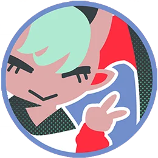
- 像素头像：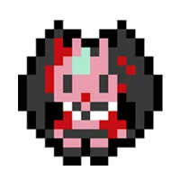
- Lv4羁绊等级奖励：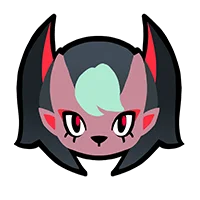
- Lv5羁绊等级奖励：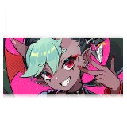
- 缔结契约名片奖励：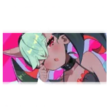
- 护卫队长皮肤名片：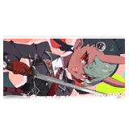
- 入夏露营皮肤名片：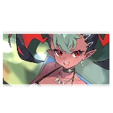
