# Z3000（垃圾箱）
> 分类：角色 · 编号 109 · 时期 第一期 · 男
> 来源：https://wiki.biligame.com/starengine/Z3000

一切都是未知。有传言是疯狂科学家制造的助手机器人，也有人猜测是废旧工破产遗留下来的有意念的幽灵。可以确定的是它会把乱丢垃圾的人吸入自己的身体里好好的教训一番！

## 战斗数值

| 攻击 | 防御 | 生命 |
| --- | --- | --- |
| 1 | 2 | 10 |

## 技能

### 主动技能：过来吧你（冷却 3）

拉取7格内的一个角色到自身所在格，造成1点伤害，并使其移动速度-2，持续1次移动。

**PVE**：拉取7格内的一个怪物到自身所在格，造成5点伤害。

### 被动技能：垃圾分类

使用过期便当、汉堡、巧克力蛋糕、以毒攻毒时，在所在的地块放置【谜之物体】。

**PVE**：击倒怪物后，主动技能冷却时间-2。

**潜能激发**：每击倒2只怪物，攻击力永久+1。

当垃圾箱的攻击力大于6时，可以挑战主动技能拉取的怪物。

## 基础资料

- 姓名：Z3000
- 英文名：Z3000
- 日文名：ゼット3000
- 从属组织：未知
- 上线时间：202402291000
- 生日：未知
- 喜欢食物：任何
- 初始骰子：模型盒骰子
- 礼物：智能手机、新款平板电脑、非常牛的电脑配件
- 徽章：冰原、阳炎

## PVE 特性

- 达到1星时攻击力+1
- 达到2星时攻击力+2
- 达到3星时攻击力+1、移动速度+2

## 皮肤（共 3 套）

> 皮肤编号取自素材文件名；「默认」「羁绊皮肤」也是独立皮肤。

### 1. 默认（初始）

- 素材编号：109
- 立绘：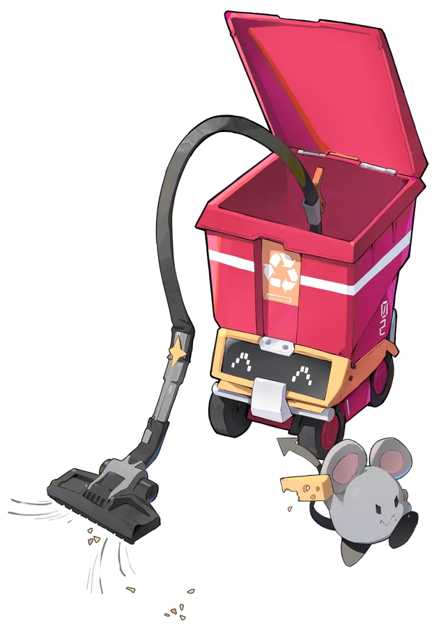
- Q版立绘：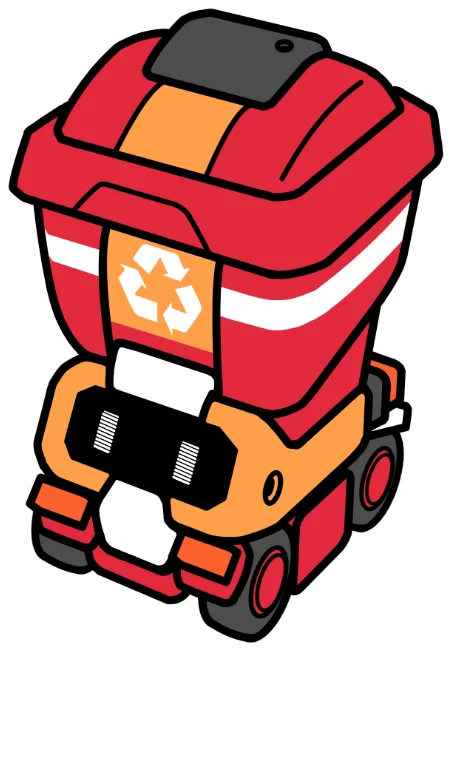
- 头像：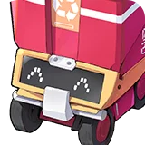
- Q版头像：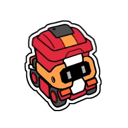
- 半身像（星币<20）：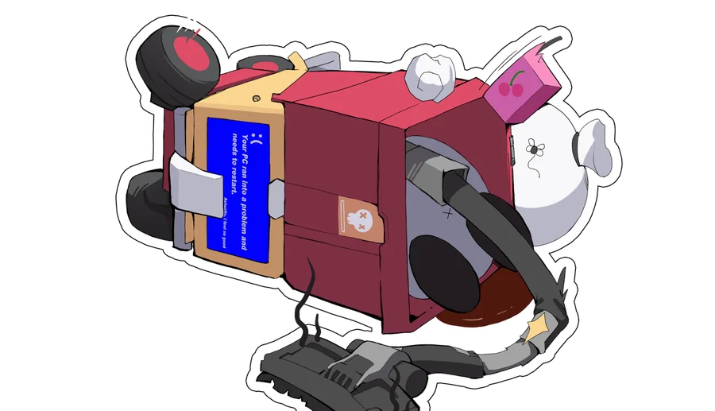
- 半身像（星币≥20）：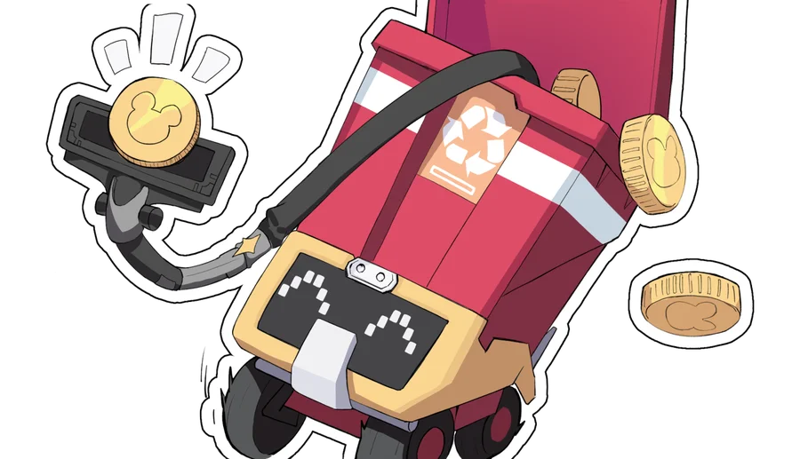

### 2. 羁绊皮肤（羁绊解锁）

- 素材编号：109_Max
- 立绘：
- Q版立绘：
- 头像：
- Q版头像：
- 半身像（星币<20）：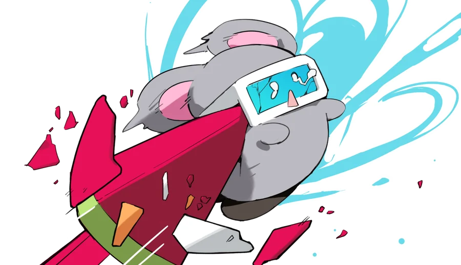
- 半身像（星币≥20）：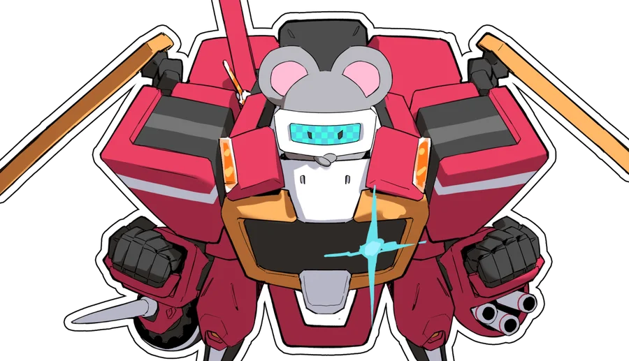

### 3. 探天助手（紫品质）

- 素材编号：109_01
- 立绘：
- Q版立绘：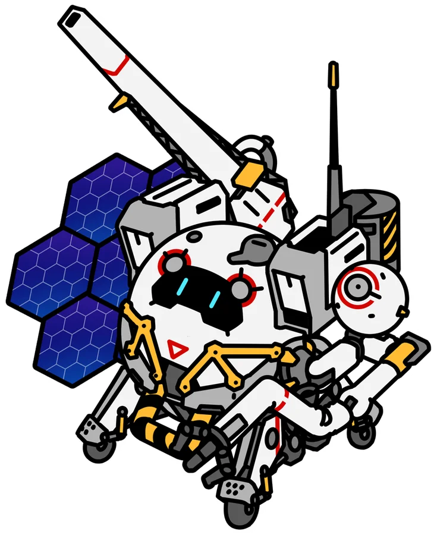
- 头像：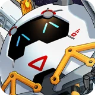
- Q版头像：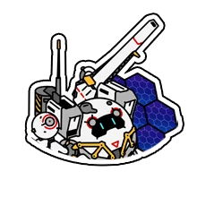
- 半身像（星币<20）：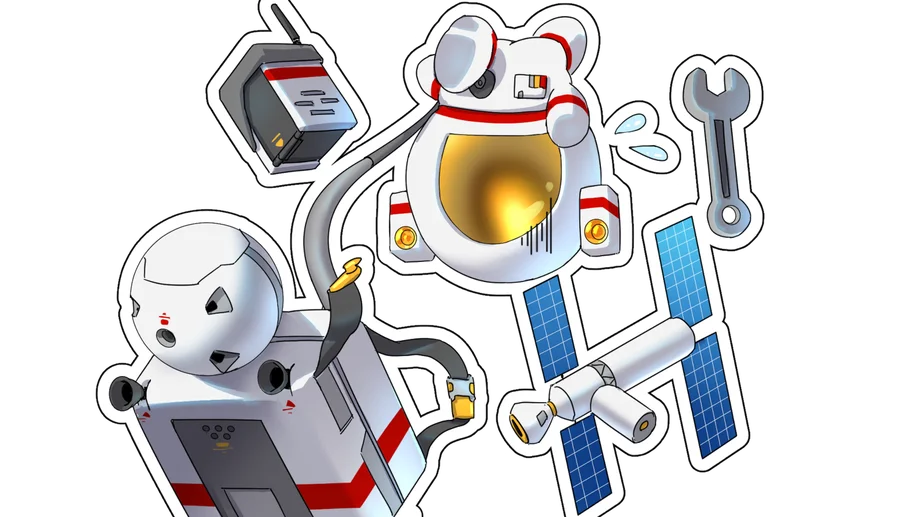
- 半身像（星币≥20）：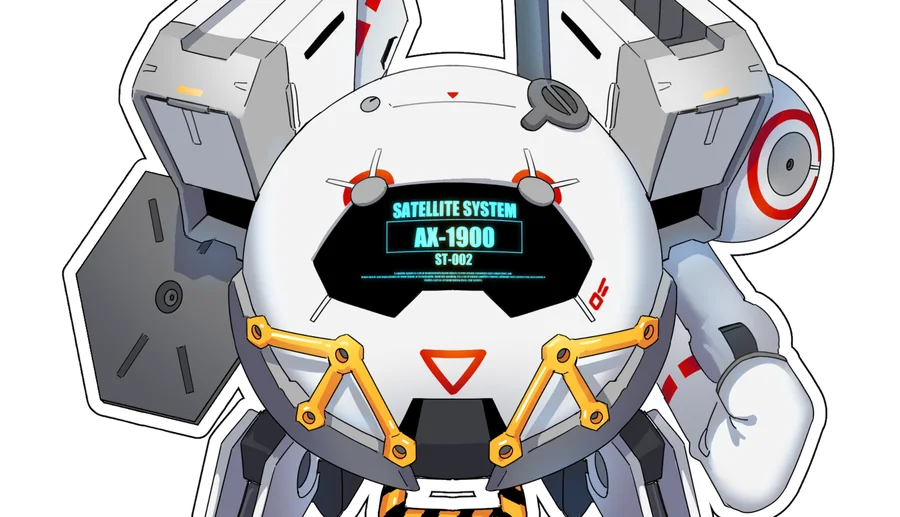

**皮肤故事**：宇宙探索往往面临诸多技术难题和海量未知风险。

当然，如果有一个得力的帮手就再好不过了。如果这个帮手能适应极端环境，甚至在恶劣条件下存活，那就更完美了。

据传，Z3000原本是科学家制造的辅助机器人，其核心目标是作为科学家探索宇宙的工具。作为拥有高级智能的机器人，Z3000的性能堪称强大，能够胜任探空调查的方方面面。

然而，如今的Z3000与探空版本的Z3000在外观上已截然不同，甚至有传言称它们可能并非同一个体。

总之，探空帮手Z3000科学家在宇宙探索中的得力伙伴。

## 表情（共 10 个）

| # | 名称 | 品质 | 获取方式 | 图片 |
| --- | --- | --- | --- | --- |
| 1 | 表情1 |  |  |  |
| 2 | 表情2 |  |  |  |
| 3 | 表情3 |  |  |  |
| 4 | 表情4 |  |  |  |
| 5 | 表情5 |  |  |  |
| 6 | 表情6 |  |  | 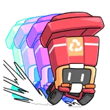 |
| 7 | 表情7 |  |  |  |
| 8 | 表情8 |  |  | 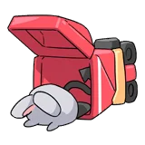 |
| 9 | 表情9 |  |  |  |
| 10 | 表情9 |  |  |  |

## 装扮

官方 wiki 未提供该角色的 /获取 页，头像、名片、卡牌、骰子清单暂缺。

## 人物传记

目击到它的人很少，基本相当于都市传说。

## 画廊其他素材

- 起始点：
- 像素头像：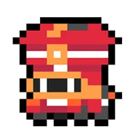
- Lv4羁绊等级奖励：
- Lv5羁绊等级奖励：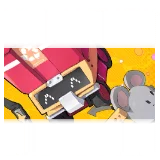
- 缔结契约名片奖励：
- 探天助手皮肤名片：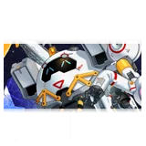
