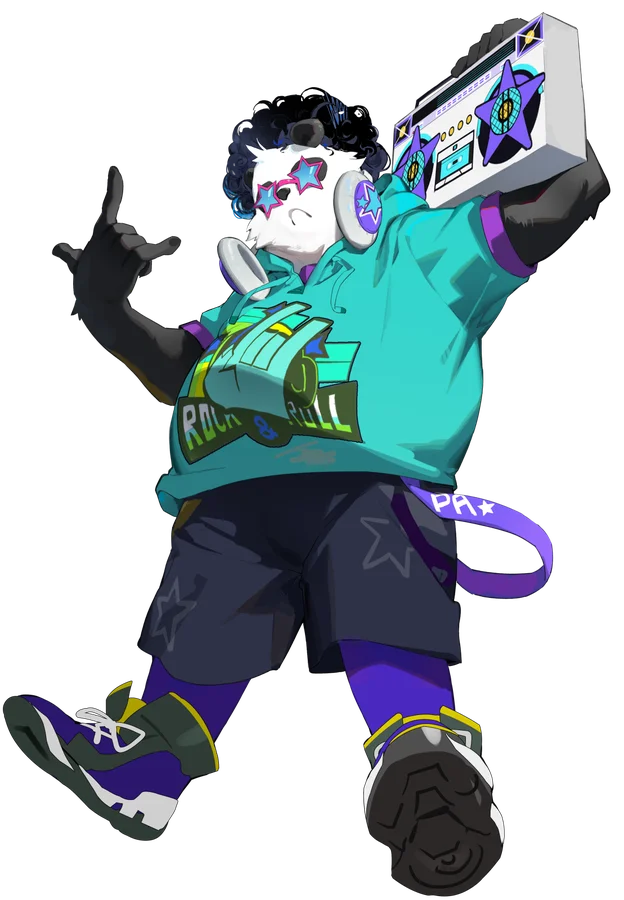
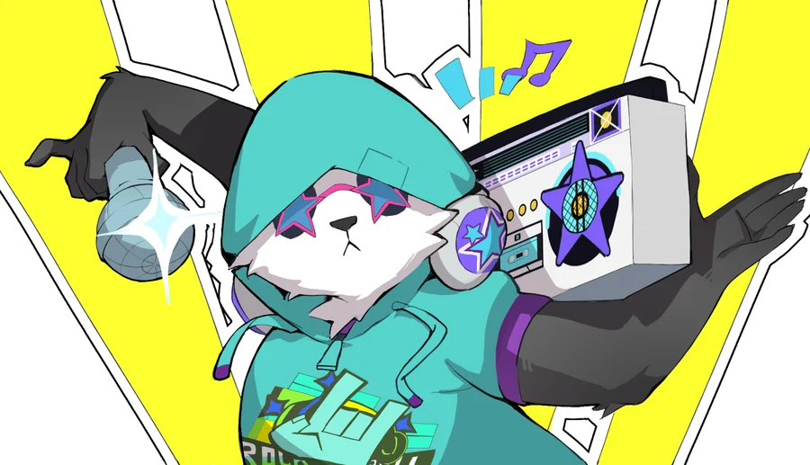
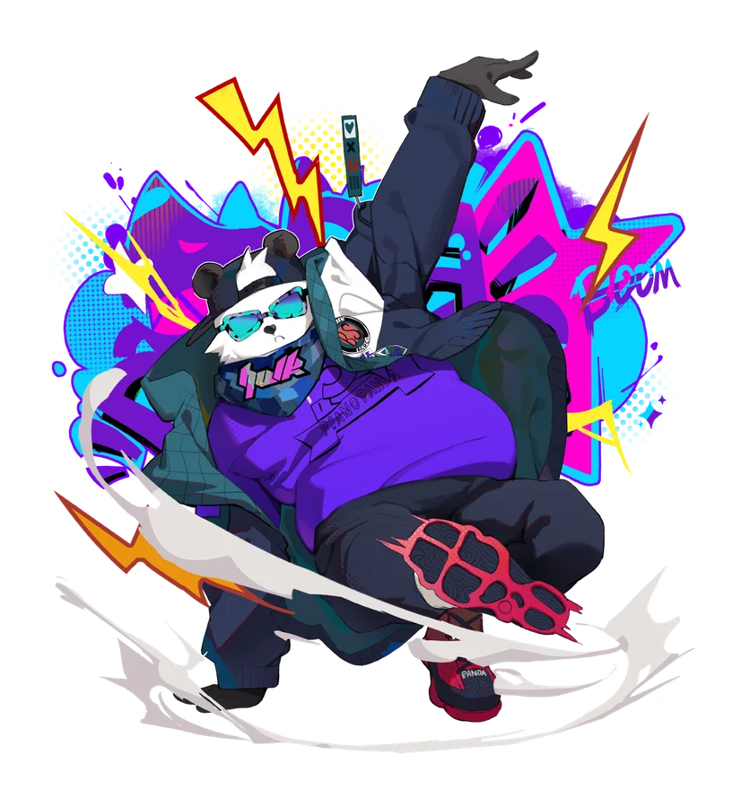
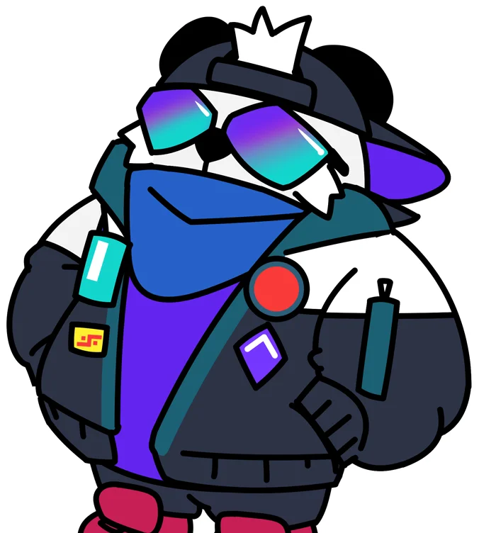

# 潘大猛（肉弹战车）
> 分类：角色 · 编号 110 · 时期 第一期 · 男
> 来源：https://wiki.biligame.com/starengine/%E6%BD%98%E5%A4%A7%E7%8C%9B

土生土长的联合城人。街舞、摇滚、二次元文化都是其最爱。平时会在街区做街舞表演和义工，偶尔也去枫的酒店打工，毕竟他的爱好都挺花钱的。

## 战斗数值

| 攻击 | 防御 | 生命 |
| --- | --- | --- |
| 1 | 0 | 14 |

## 技能

### 主动技能：搞事情（冷却 4）

获得自爆或以牙还牙中的随机1张。

**PVE**：获得巧克力蛋糕或汉堡中的随机1张。

### 被动技能：有好有坏

所有回血效果+2，但是受到伤害也会+1。

**PVE**：使用汉堡、巧克力蛋糕后，恢复5格内所有友方角色2点生命值。

**潜能激发**：吃下食物时获得1层反击，如果该食物为汉堡额外获得生命值上限+2。
使用主动技能时，嘲讽5格范围内的怪物1回合。
反击时，根据本次受到的伤害等量增加攻击力。

## 基础资料

- 姓名：潘大猛
- 英文名：Pandaman
- 日文名：パンダマン
- 从属组织：联合城,隆兴饭店
- 上线时间：202402291000
- 生日：10月1日
- 喜欢食物：绿叶蔬菜
- 初始骰子：磁带盒骰子
- 礼物：浴室鸭、小熊玩偶、小怪兽手办
- 徽章：山峦、月光

## PVE 特性

- 达到1星时防御力+1
- 达到2星时移动速度+1，生命值上限+1
- 达到3星时攻击力+1、防御力+1、移动速度+1

## 皮肤（共 2 套）

> 皮肤编号取自素材文件名；「默认」「羁绊皮肤」也是独立皮肤。

### 1. 默认（初始）

- 素材编号：110
- 立绘：
- Q版立绘：
- 头像：
- Q版头像：
- 半身像（星币<20）：
- 半身像（星币≥20）：

### 2. 羁绊皮肤（羁绊解锁）

- 素材编号：110_Max
- 立绘：
- Q版立绘：
- 头像：
- Q版头像：
- 半身像（星币<20）：
- 半身像（星币≥20）：

## 表情（共 9 个）

| # | 名称 | 品质 | 获取方式 | 图片 |
| --- | --- | --- | --- | --- |
| 1 | 表情1 |  |  |  |
| 2 | 表情2 |  |  |  |
| 3 | 表情3 |  |  |  |
| 4 | 表情4 |  |  |  |
| 5 | 表情5 |  |  |  |
| 6 | 表情6 |  |  |  |
| 7 | 表情7 |  |  |  |
| 8 | 表情8 |  |  |  |
| 9 | 表情9 |  |  |  |

## 装扮

官方 wiki 未提供该角色的 /获取 页，头像、名片、卡牌、骰子清单暂缺。

## 人物传记

你可以在周末下午去联合城凰区的三神广场看他的表演。

## 画廊其他素材

- 起始点：
- 像素头像：
- Lv4羁绊等级奖励：
- Lv5羁绊等级奖励：
- 缔结契约名片奖励：
