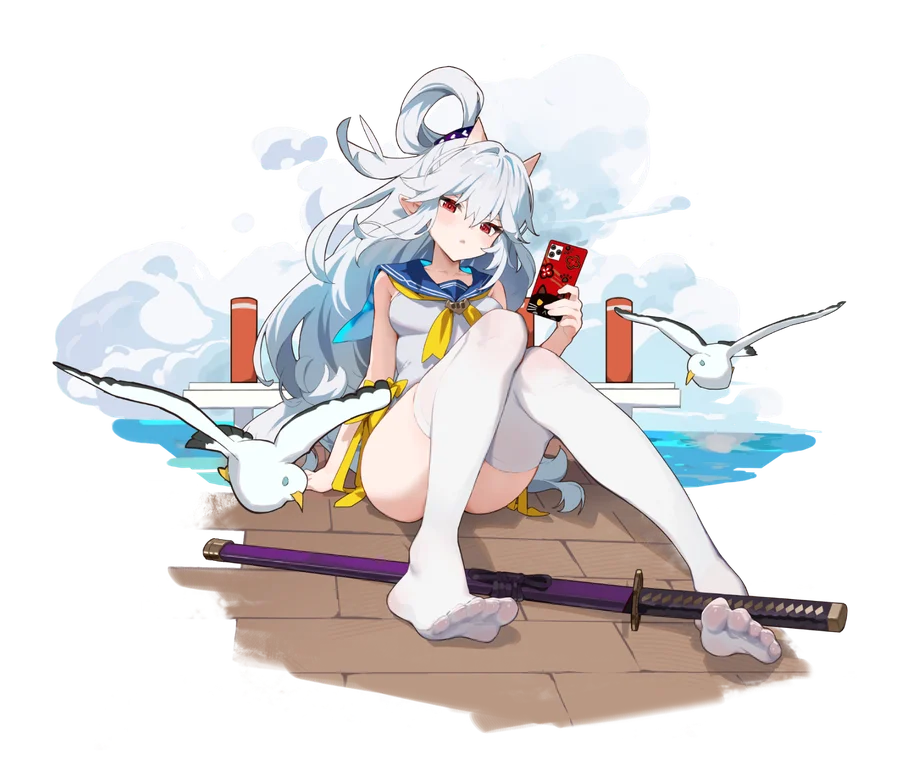
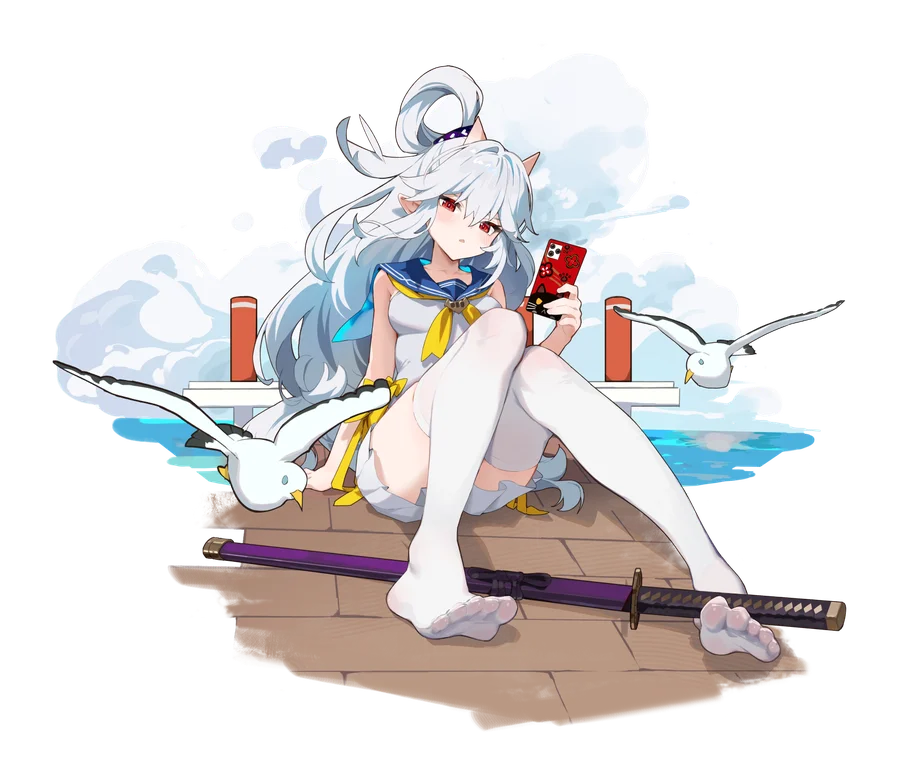
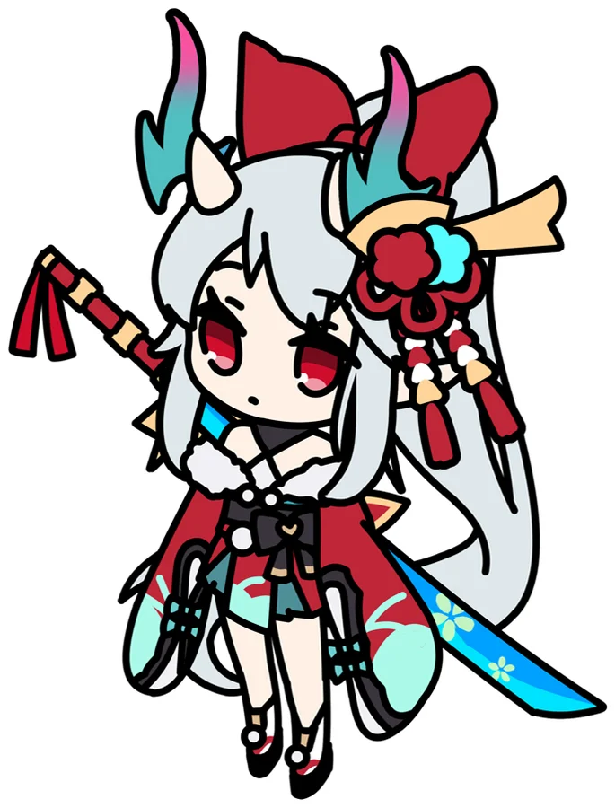
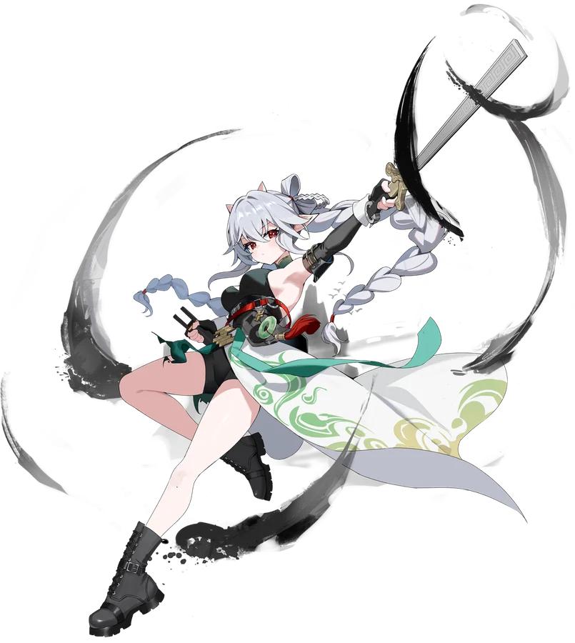

# 美咲（太刀使）
> 分类：角色 · 编号 115 · 时期 第二期 · 女
> 来源：https://wiki.biligame.com/starengine/%E7%BE%8E%E5%92%B2

三神教教主的护法。三神教是和星辉院齐名的又一宗教机构。它不光承担着福利院的工作，还有和本苍院一样的文献研究能力。美咲的龙崎家与天王寺家，米泽家同是三神教三大家族。

## 战斗数值

| 攻击 | 防御 | 生命 |
| --- | --- | --- |
| 0 | 2 | 9 |

## 技能

### 主动技能：樱花裂空斩（冷却 3）

指定4格内的一个敌方角色，造成2点伤害并获得1层剑气（每层使自身攻击力+1，满3层时攻击力额外）。

**PVE**：指定4格内的一个怪物，造成2点伤害并获得1层剑气（每层使自身攻击力+1，满3层时攻击力额外）。

### 被动技能：剑气

战斗时，如果自身攻击命中或闪避成功，获得1层剑气（每层使自身攻击力+1，满3层时攻击力额外），最多叠加3层。被击倒后，清除所有剑气（每层使自身攻击力+1，满3层时攻击力额外）层数。

**潜能激发**：主动技能射程增加至6，当剑气（每层使自身攻击力+1，满3层时攻击力额外）满3层时使用主动技能，将消耗2层剑气（每层使自身攻击力+1，满3层时攻击力额外）并获得1张名刀：嘎呜切。
美咲的名刀：嘎呜切费用降低1。

## 基础资料

- 姓名：龙崎美咲
- 英文名：Misaki
- 日文名：ミサキ
- 从属组织：三神教,龙崎家族
- 事件经历：天王落
- 上线时间：202406071600
- 生日：7月20日
- 喜欢食物：抹茶冰淇淋
- 初始骰子：封印箱骰子
- 礼物：浴室鸭、漂亮的洋装、陈年的红酒
- 徽章：川河、冰原

## PVE 特性

- 达到1星时攻击力+1
- 达到2星时攻击力+2
- 达到3星时攻击力+1、移动速度+2

## 皮肤（共 6 套）

> 皮肤编号取自素材文件名；「默认」「羁绊皮肤」也是独立皮肤。

### 1. 默认（初始）

- 素材编号：115
- 立绘：
- Q版立绘：
- 头像：
- Q版头像：
- 半身像（星币<20）：
- 半身像（星币≥20）：

### 2. 羁绊皮肤（羁绊解锁）

- 素材编号：115_Max
- 立绘：
- 立绘（和谐版）：
- Q版立绘：
- 头像：
- Q版头像：
- 半身像（星币<20）：
- 半身像（星币≥20）：

### 3. 战斗女仆（蓝品质）

- 素材编号：115_01
- 立绘：
- Q版立绘：
- 头像：
- Q版头像：
- 半身像（星币<20）：
- 半身像（星币≥20）：

**皮肤故事**：和姬梦枫不一样的是，美咲这身确实不是她自己想这么穿的。

原因想必也都知道了，就是三神教御主照的功劳。

雅央平时都不可能出现在神社里，而凛也依旧在上演“离家出走”的戏码。

这时候只有老实的美咲遭殃了，照只能逮着美咲当换装娃娃。

因为御主她真的很喜欢洋装啊。那没办法，作为侍卫的美咲也只能如此了。

唯一和姬梦枫一样的就是穿着这身还能完美的完成护卫任务，只能说不愧是美咲。

不过还是得说声谢谢御主大人。

### 4. 真龙御礼（彩品质）

- 素材编号：115_02
- 立绘：
- Q版立绘：
- 头像：
- Q版头像：
- 半身像（星币<20）：
- 半身像（星币≥20）：

**皮肤故事**：美咲这身装扮完全是照借助“龙王祭”向外界展示三神教实力表演。

在联合城有这么一个都市传说，相传有几件灾厄之物和几件祝福之物。

每个东西都以不同的形态沉睡在联合城或这个世界的某些地方。

他们都有着自己的代号和外形。

“真龙御礼”便是其中之一。

与其说三家是在侍奉三神教，不如说三神教在保护三家。

有传言“真龙御礼”是一把蓝色的刀，又有传言“真龙御礼”是一个饰品。

但是到底是什么？真假难辩。

不过当前，龙崎美咲她就是人们口中说的“真龙御礼”。

### 5. 魔女兵器（紫品质）

- 素材编号：115_03
- 立绘：
- Q版立绘：
- 头像：
- Q版头像：
- 半身像（星币<20）：
- 半身像（星币≥20）：

### 6. 墨韵圆舞（紫品质）

- 素材编号：115_04
- 立绘：
- Q版立绘：
- 头像：
- Q版头像：
- 半身像（星币<20）：
- 半身像（星币≥20）：

**皮肤故事**：对于龙崎美咲而言，尝试新事物、了解世界上不同的文化是她的一大乐趣。

此前她曾尝试包粽子。这种通过食物传递精神寄托，赞颂人和事的节日，使她很是开心。

而今天，她尝试的是以书法为核心的文房四宝。这种古老的技艺虽已鲜有人使用，却因修身养性的价值，成为许多年轻人追捧的对象。尽管入门门槛较高，但一旦掌握，成就感便会油然而生。

美咲学习书法或许略显笨拙，但若论舞刀弄剑，她定能得心应手。

在朋友的指导下，她将墨迹在纸笔间勾勒出的韵律感，自创了一套行云流水的“墨舞”：既有墨色跃然纸上的灵动，又带着刀剑挥舞的刚毅，仿佛她正以刀剑在巨大的白纸上挥洒创作，韵味十足。

果然，美咲是个天才呢。

## 表情（共 13 个）

| # | 名称 | 品质 | 获取方式 | 图片 |
| --- | --- | --- | --- | --- |
| 1 | 表情1 |  |  |  |
| 2 | 表情2 |  |  |  |
| 3 | 表情3 |  |  |  |
| 4 | 表情4 |  |  |  |
| 5 | 表情5 |  |  |  |
| 6 | 表情6 |  |  |  |
| 7 | 表情7 |  |  |  |
| 8 | 表情8 |  |  |  |
| 9 | 表情9 |  |  |  |
| 10 | 表情10 |  |  |  |
| 11 | 表情11 |  |  |  |
| 12 | 表情12 |  |  |  |
| 13 | 表情13 |  |  |  |

## 装扮

官方 wiki 未提供该角色的 /获取 页，头像、名片、卡牌、骰子清单暂缺。

## 人物传记

和雅央以及教主是青梅竹马，与青山小町是好友。一直在追查“天王落”事件的真相。

## 画廊其他素材

- 起始点：
- 像素头像：
- Lv4羁绊等级奖励：
- Lv5羁绊等级奖励：
- 缔结契约名片奖励：
- 战斗女仆皮肤名片：
- 真龙御礼皮肤名片：
- 魔女兵器皮肤名片：
- 墨韵圆舞皮肤名片：
