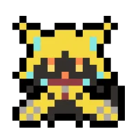
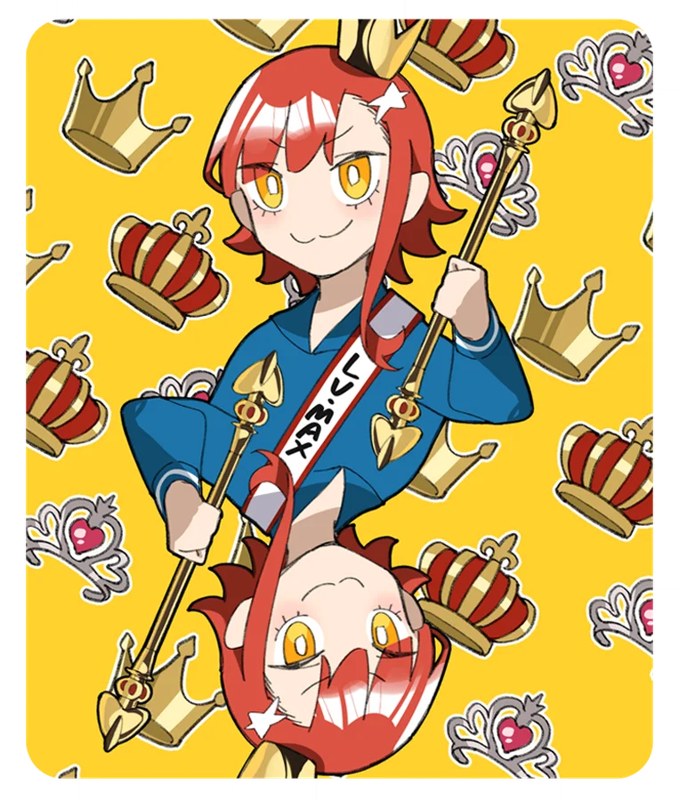
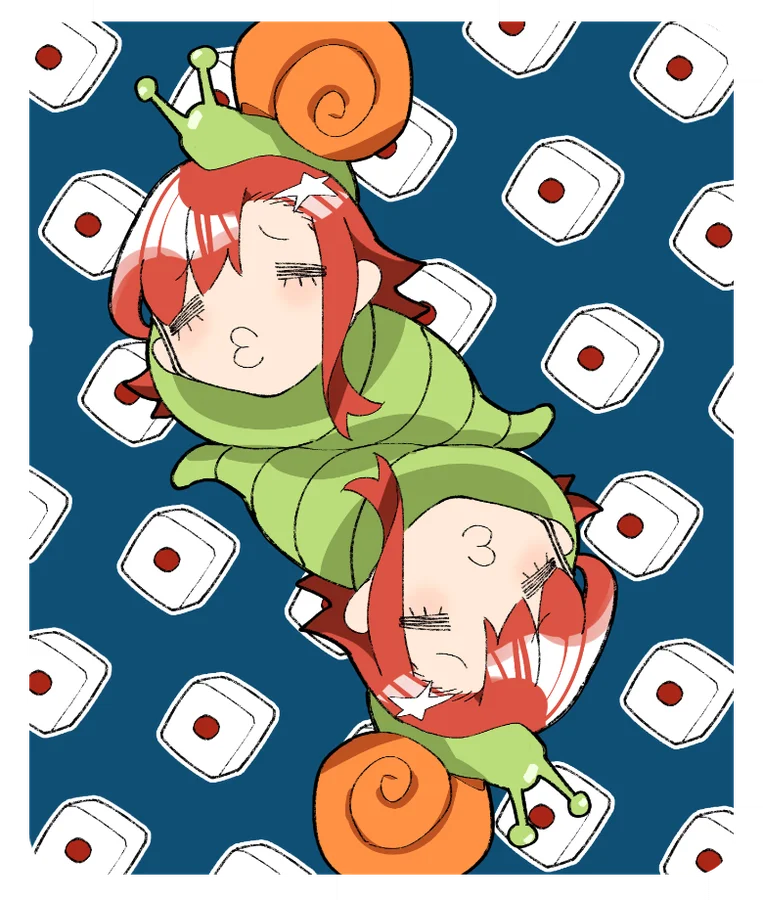
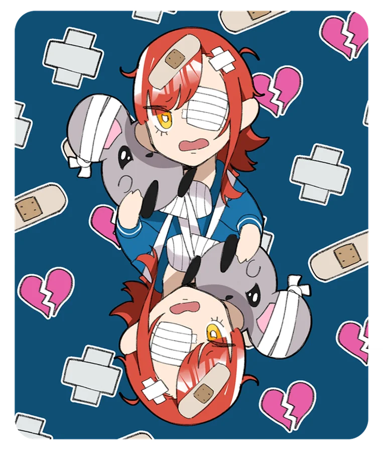
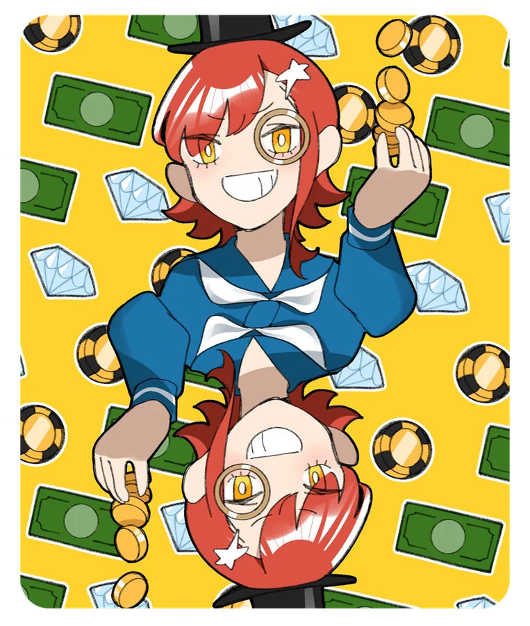
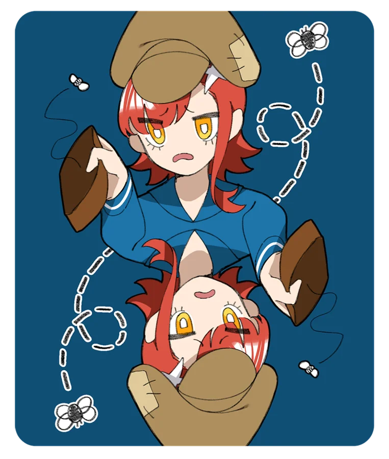
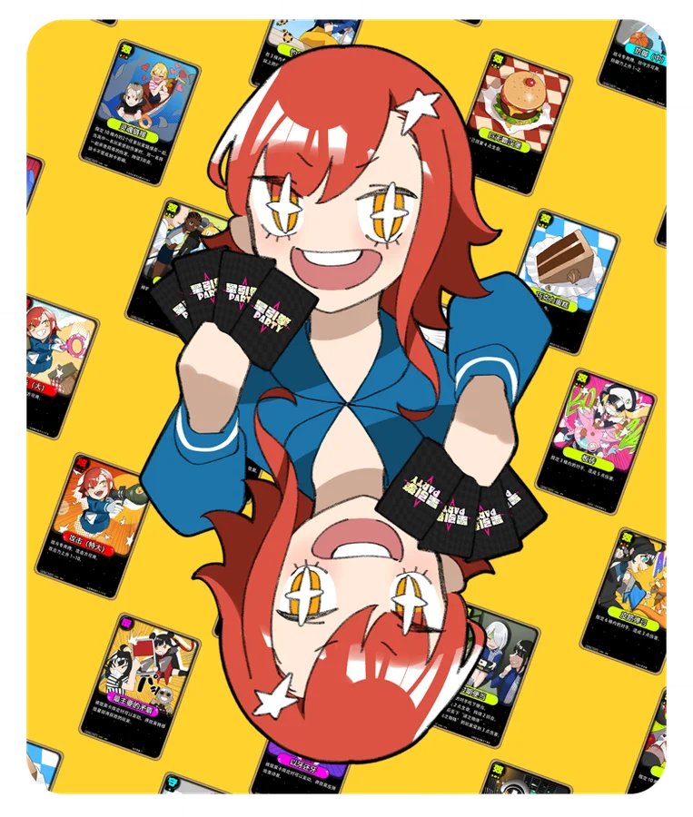
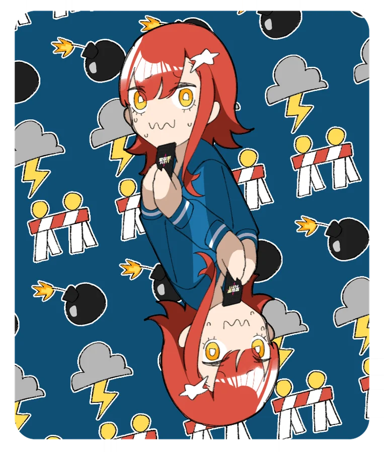

# 梦想号-上层甲板
> 分类：地图
> 来源：https://wiki.biligame.com/starengine/%E6%A2%A6%E6%83%B3%E5%8F%B7-%E4%B8%8A%E5%B1%82%E7%94%B2%E6%9D%BF

## 地图背景

为了拓展更多可游玩区域，梦想号对上层甲板进行了重新装修与整合，将其改造为一个大平层。原本位于中间的娱乐区和会议区部分功能也延伸至此。这种空间布局不仅可容纳更多活动，也为游客的自由流动提供了便利。

## 地图说明

梦想号-上层甲板 是限时玩法幸运星争夺战的专属地图，在活动幸运星争夺战（p6042.md）期间开放，该模式改变了原先标准对战模式的游戏规则，4名玩家将会被分为2个2人小队，最先收集齐足够幸运星的队伍将会获得胜利。
 
玩家所处的队伍可以通过以下方式获取幸运星：

- 角色在起始点处获得星星
- 角色完成奖励卡牌要求
- 其他队伍中的角色被击倒

关于角色，在该模式中需注意：

- 帕露南（p565.md）
  - 主动技能打开的是标准对战模式中的商店
- 恋（p578.md）
  - 主动技能仅能选择敌方角色为目标
- Z3000（p580.md）
  - 主动技能仅能选择敌方角色为目标
  - 【谜之物体】可以对任意停留在该地块处的角色造成伤害，这包括友方角色
- 潘大猛（p582.md）
  - 主动技能可以获取卡牌自爆（p1596.md），即便自爆（p1596.md）不在地图的牌库中。自爆（p1596.md）仅能对敌方角色造成伤害
- 墨影（p4677.md）
  - 【影子】仅能对停留在该地块处的敌方角色造成伤害
- 璐璐（p584.md）
  - 主动技能仅能选择敌方角色为目标
- 蓝海晴（p588.md）
  - 主动技能可以选择任意角色为目标，这包括友方角色
- 美咲（p590.md）
  - 主动技能仅能选择敌方角色为目标
- 阿尔（p854.md）
  - 主动技能仅能选择敌方角色为目标
- 星魅琉华（p638.md）
  - 主动技能不会对经过的友方角色造成伤害
- 南希露（p639.md）
  - 主动技能仅能选择敌方角色为目标
  - 3格内的其他角色可以触发南希露的被动技能，这包括友方角色
- 凛（p1232.md）
  - 活体书页（p3754.md）仅能对敌方角色造成伤害
- 梅加斯（p640.md）
  - 主动技能仅锁定敌方角色为目标
- 姬梦朝（p865.md）
  - 主动技能中【白泽赐福】仅能施加于自身
  - 符卡-福（p3755.md）仅可以选择友方角色为目标，不同于标准对战模式中仅可以对自身使用
- 照（p3530.md）
  - 主动技能可以选择地其他角色为目标，这包括队伍中另外一名角色
- 摩西（p4165.md）
  - 主动技能仅能选择敌方角色为目标
- 真梦梓（p4358.md）
  - 主动技能仅能选择敌方角色为目标
- 邦妮（p4676.md）
  - 主动技能仅能选择敌方角色为目标
- 玲玲（p5439.md）
  - 主动技能不会挟持友方角色
- 吉尔·斯汀雷（p3829.md）
  - 主动技能仅施加于自身
- 多萝西·海兹（p3818.md）
  - 被动技能可以夺取友方角色1星币

关于卡牌，在该模式中需注意：

- 卡牌激光（p1583.md）仅能选定敌方角色为目标，不能选择友方角色和怪物为目标
- 卡牌皮筋弹弓（p1599.md）仅能选定敌方角色为目标，不能选择友方角色和怪物为目标
- 卡牌板砖（p1600.md）仅能选定敌方角色为目标，不能选择友方角色和怪物为目标
- 卡牌抢夺（p1606.md）仅能选定敌方角色为目标，不能选择友方角色
- 卡牌加急加快（p1613.md）仅能选定友方角色为目标，不能选择敌方角色
- 卡牌奢华大餐（p1616.md）仅能选定友方角色为目标，不能选择敌方角色，效果仅对友方角色生效
- 卡牌自爆（p1596.md）仅能对敌方角色造成伤害
- 卡牌符卡-福（p3755.md）仅可以选择友方角色为目标
- 卡牌活体书页（p3754.md）仅能对敌方角色造成伤害
- 卡牌爆破专家（p1602.md）放置的陷阱可以对任意停留在该地块处的角色造成伤害，这包括友方角色
- 卡牌路障（p1597.md）仅能使经过的角色停止移动，不能使经过的怪物停止移动

其他在该模式中请注意：

- 获取星星所需的星币数固定为15/20/25，获取星星会消耗星币，这与合作挑战模式一致
- 角色打开的商店为标准对战模式的版本，不包含转账功能
- 全部角色共用游戏开始时刷新的4张奖励卡牌，每张奖励卡牌在对局中仅能完成一次
- 全部奖励卡牌的要求完成后不会刷新新的奖励卡牌

## 奖励卡牌

| 图像 | 名称 | 触发条件 | 奖励 |
| --- | --- | --- | --- |
|  | 权杖 | 角色获得3星 | 幸运星+3 你好强大[1] |
|  | 缓慢 | 骰出3次1 | 幸运星+1 移动速度+3 |
|  | 力量 | 累计造成30点伤害 | 幸运星+1 获得2张战斗卡牌 |
|  | 忍耐 | 被击倒2次 | 幸运星+1 防御力+3 |
|  | 财富 | 持有星币到达35 | 幸运星+1 生命值上限+2，立刻恢复满生命值 |
|  | 贫穷 | 第5轮开始时，持有星币数最低 | 幸运星+1 立刻获得10星币 |
|  | 智慧 | 累计获得12张卡牌 | 幸运星+1 出牌数+1 |
|  | 霉运 | 触发2次陷阱卡牌或天降横祸 | 幸运星+1 受到伤害-1，主动技能冷却缩减1 |

### 怪物属性

|  |  |
| --- | --- |
|  | 4

 1

 9 |

### 行动顺序

行动顺序 小偷 海盗鲨鱼

## 地图

地块统计
 
 
 
 
 
 A6=个人命运
A7=天降横财
A8=全员事件
A9=天降横祸

B2=卡牌奖励
B3=突击门
B4=天降横财
B5=恢复
B6=传送门
B9=疾行
B10=起始点4

C1=起始点1
C5=全员事件
C10=天降横财

D1=跳跃
D5=天降横祸
D10=跳跃

E1=商店
E5=天降横财
E6=疾行
E7=全员事件
E8=卡牌奖励
E9=天降横祸
E10=商店

F1=跳跃
F5=天降横祸
F10=跳跃

G1=起始点3
G5=全员事件
G10=天降横财

H2=卡牌奖励
H3=疾行
H4=天降横财
H5=恢复
H6=传送门
H9=突击门
H10=起始点2

I6=个人命运
I7=卡牌奖励
I8=全员事件
I9=天降横祸
 #fe1fee=E10->F10,H5->G5,B5->B6,E5->D5
#00f1f9=E10->D10,H5->H6,B5->C5,E5->F5
 起始点1=135
起始点2=270
起始点3=45
起始点4=270
 9
 10

- ↑ 这句“你好强大”只是字面意思:)
