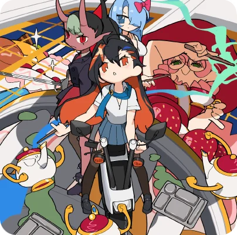
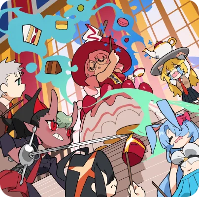
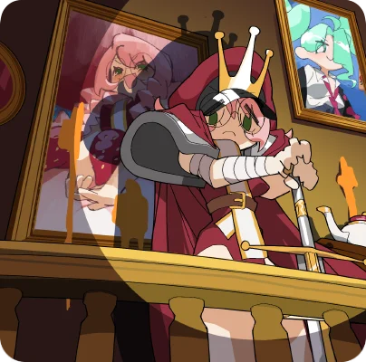
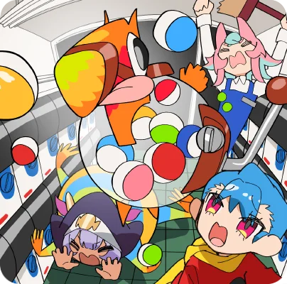
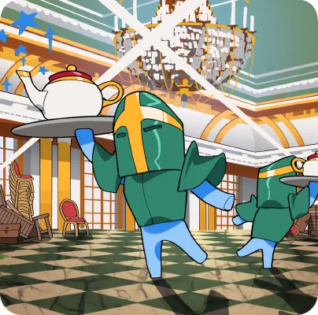
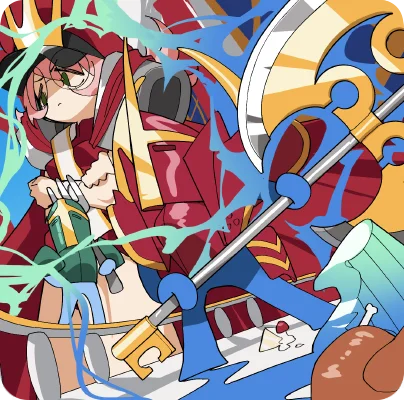
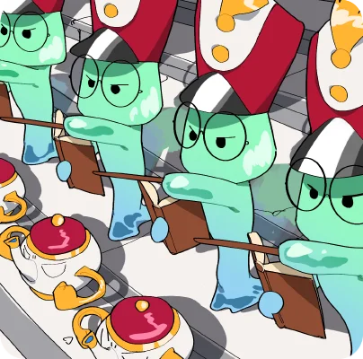
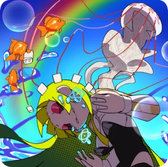
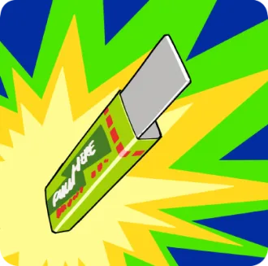
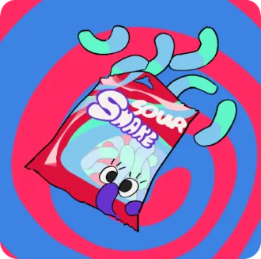

# 海选赛运动场
> 分类：地图
> 来源：https://wiki.biligame.com/starengine/%E6%B5%B7%E9%80%89%E8%B5%9B%E8%BF%90%E5%8A%A8%E5%9C%BA

## 地图背景

中城大学附属中学位于凰区，是一所隶属于中城大学的顶尖高校。与其他学校不同的是，这里是为了培养出更加精英化的学生而建造的学府。在寸土寸金的凰区，学校拥有一个大型操场实属奢侈。不过，最近中学的操场因部分设备老化，已开始进行翻新工作。

## 地图说明

海选赛运动场 是限时玩法人机大战运动会的专属地图，在活动智械狂潮（p6348.md）期间开放。
 
在海选赛运动场中，仅需3人即可开始游戏。 
运动会决赛拥有地图专属机制：心智。 
AI机器人们会不停的解析并剥夺角色的心智，请保持心智不被侵蚀，一旦被彻底解析完成，你将无法与机器人们正面抗衡。 
相较于魔法学院（p645.md），如果当前游戏中存在“院长的茶会”，那么代理院长（p3613.md）血量下调至99/110/130/130；如果当前游戏中存在“安全官突击”，那么学院安全官（p3614.md）血量下调至30/35/40/45，同时学院安全官（p3614.md）由首领调整为精英；如果当前游戏中存在“安全官检查”，那么学院安全官（p3614.md）血量下调至88/99/110/120。

## 地图事件

全难度（代理院长）
全难度（学院安全官）

| 图像 | 名称 | 描述 | 触发条件 | 备注 |
| --- | --- | --- | --- | --- |
|  | 学院戒严！ | 裁判艾米登场，刷新2个魔法茶壶，1个果冻战士 | 进度达到1 | 该地图事件触发后，会在地图坐标I9处刷新裁判艾米（p6130.md），在地图坐标A5、E2处刷新2个魔法茶壶（p3608.md），并在地图坐标A1处刷新1个果冻战士（p3612.md） |
|  | 原罪现身 | 代理院长登场，刷新1个果冻巫师 | 进度达到3 | 该地图事件触发后，会在地图坐标A2处刷新代理院长（p3613.md），并在地图坐标E5处刷新1个果冻巫师（p3610.md） |
|  | 安全官突击 | 学院安全官登场 | 进度达到5且当前游戏的畸变组件中存在“安全官突击” | 该地图事件触发后，会在地图坐标E8处刷新学院安全官（p3614.md） |
|  | 狂躁的皮纳塔 | 刷新2个糖果皮纳塔。所有怪物攻击力+1，防御力+1 | 进度达到6 | 该地图事件触发后，会在地图坐标B9、H1处刷新2个糖果皮纳塔（p4088.md） |
|  | 茶话会 | 刷新1个果冻护卫，1个果冻巫师 | 进度达到9 | 该地图事件触发后，会在地图坐标I5处刷新1个果冻护卫（p3611.md），并在地图坐标A5处刷新1个果冻巫师（p3610.md） |

| 图像 | 名称 | 描述 | 触发条件 | 备注 |
| --- | --- | --- | --- | --- |
|  | 严阵以待 | 裁判艾米登场，刷新2个果冻护卫，1个魔法茶壶 | 进度达到1 | 该地图事件触发后，会在地图坐标I9处刷新裁判艾米（p6130.md），在地图坐标A5、I5处刷新2个果冻护卫（p3611.md），并在地图坐标A2处刷新1个魔法茶壶（p3608.md） |
|  | 检举揭发 | 学院安全官登场，刷新1个果冻巫师 | 进度达到3 | 该地图事件触发后，会在地图坐标E8处刷新学院安全官（p3614.md），并在地图坐标E5处刷新1个果冻巫师（p3610.md） |
|  | 茶话会 | 刷新2个果冻护卫。所有怪物攻击力+1，防御力+1 | 进度达到6 | 该地图事件触发后，会在地图坐标C2、G8处刷新刷新2个果冻护卫（p3611.md） |
|  | 明胶追击 | 刷新1个果冻护卫，1个果冻巫师 | 进度达到9 | 该地图事件触发后，会在地图坐标A1处刷新1个果冻护卫（p3611.md），并在地图坐标F8处刷新1个果冻巫师（p3610.md） |

## 地图任务

代理院长
学院安全官

| 任务 | 奖励 |
| --- | --- |
| 击倒魔法茶壶 0\3 | 所有角色获得 强化筹码（p644.md）(60%/37%/3%) |
| 击倒果冻巫师 0\2 | 所有角色获得 强化筹码（p644.md）(40%/45%/15%) |
| 击倒果冻战士 0\1 | 所有角色获得 强化筹码（p644.md）(40%/45%/15%) |
| 击倒裁判艾米 0\1 | 所有角色获得 强化筹码（p644.md）(40%/45%/15%) |

| 任务 | 奖励 |
| --- | --- |
| 击倒果冻护卫 0\1 | 所有角色获得 强化筹码（p644.md）(60%/37%/3%) |
| 击倒果冻巫师 0\2 | 所有角色获得 强化筹码（p644.md）(40%/45%/15%) |
| 击倒果冻护卫 0\3 | 所有角色获得 强化筹码（p644.md）(40%/45%/15%) |
| 击倒裁判艾米 0\1 | 所有角色获得 强化筹码（p644.md）(40%/45%/15%) |

### 怪物属性

|  |  |
| --- | --- |
|  | 2

 1

 99

 2

 1

 110

 3

 2

 120

 4

 2

 140 |
|  | 2

 2

 111

 3

 2

 130

 4

 2

 160

 4

 2

 200 |
|  | 2

 6

 35

 2

 6

 36

 3

 8

 38

 4

 10

 40 |
|  | 3

 4

 15

 3

 4

 16

 4

 4

 18

 4

 4

 20 |
|  | 2

 1

 15

 3

 1

 16

 3

 1

 17

 3

 1

 21 |
|  | 3

 1

 10

 3

 1

 11

 4

 1

 11

 4

 1

 12 |
|  | 4

 2

 7

 5

 2

 7

 6

 3

 7

 6

 3

 8 |
|  | 3

 0

 8

 4

 0

 9

 5

 0

 9

 5

 0

 10 |
|  | 0

 0

 4

 0

 0

 4 |
|  | 5

 1

 24

 5

 1

 27

 6

 1

 30

 6

 2

 33 |

### 行动顺序

行动顺序 小偷 果冻巫师 宝藏桶 代理院长 学院安全官 魔法茶壶 变异茶壶 糖果皮纳塔 果冻战士 果冻护卫 裁判艾米 召唤的魔法茶壶 召唤的变异茶壶

## 地图专属筹码

运动手环
攻击力+1，攻击时，如果防御方的移动速度受到影响，攻击力额外+4。 时间怀表
被击倒后的下一轮开始时，立即复活。该轮怪物行动时，全体怪物被时间静止。随后本筹码变为时间怀表(破碎)。

## 地图专有卡牌

  
 人机交融
人机交融 指定一个角色，使目标获得1层【心智】 自身本回合出牌数+1 

 是他干的
是他干的 选择一个友方角色，造成1点伤害并施加【问题学生】，随后自身获得3星币。回合结束时如果本卡在手牌中，则自身受到1点伤害 
  
 支援口香糖
支援口香糖 指定一个角色，恢复2点生命值，并移除【改造】 自身本回合出牌数+1 
  
 能量补充棒
能量补充棒 指定一名拥有【改造】的角色，攻击力+2，移动速度+2，持续2回合。随后对目标施加2层【改造】 
  
 大聪明软糖
大聪明软糖 指定一名角色获得3张卡牌，并移除【改造】

## 地图特殊效果/状态

 丨 心智 丨 用于抵抗智械怪物的能力，对特定单位造成额外伤害。  丨 指示 丨 场上其他角色每打出3张【是他干的】，雅央永久增加1点攻击力并召唤一个果冻护卫。  丨 【问题学生】 丨 正在被追击  丨 改造 丨 层数归零时，受到当前生命值的伤害。

## 畸变组件

海选赛运动场共有23种畸变组件。畸变组件的组件总数及组件总评分根据难度不同处在不同固定区间，如下表：

| 难度 | 组件总数 | 组件总评分 |
| --- | --- | --- |
| 普通  | 3、4 | +1 |
| 困难  | 3、4 | 0、+1 |
| 噩梦  | 3、4 | 0、+1 |
| 疯狂  | 4 | +1 |

在所有难度中，一定仅存在1个第一类畸变组件，最多仅存在1个第二类畸变组件。 
如果当前游戏的第一类畸变组件为“院长的茶会”，那么有概率将畸变组件“安全官突击”加入游戏： 
 安全官突击 -------
 地图事件加入：安全官突击 代理院长也会优先追击【问题学生】，但会在攻击后为【问题学生】恢复3点生命值 以上所有内容皆不计入裁判艾米（p6130.md）的被动技能“赛事主持”。事实上，由于裁判艾米（p6130.md）的被动技能“赛事主持”会从除第一类畸变组件外全部未加入当前游戏的畸变组件中任意选择1个加入游戏，导致实际游戏中畸变组件的组合往往与以上规定相悖。 
关于该地图的畸变组件如下：

#### 第一类畸变组件

 院长的茶会 -------
 首领固定为代理院长。魔法茶壶、变异茶壶被击倒后，随机变更击倒者的属性 轮次1结束时，所有角色额外选择1次筹码 
 安全官检查 -------
 首领固定为学院安全官。角色拥有【问题学生】时，移动速度+2 轮次1结束时，所有角色额外选择1次筹码

#### 第二类畸变组件

 裁判的关注1 -------
 裁判艾米获得主动技能【黄牌警告】：指定距离最远的一个角色判罚，使其下次移动速度-2。该技能冷却时间为3轮。 
 裁判的关注2 -------
 裁判艾米获得主动技能【红牌判罚】：随机指定一个角色判罚，将该角色2点攻击力或防御力转移给一个随机非首领怪物，该怪物被击倒后返还属性。该技能冷却时间为3轮。 、

#### 其他畸变组件

 能量紊乱 -------
 角色回合开始时，其战斗卡牌的费用随机变为0-4 
 狂风 -------
 角色与怪物的移动速度+2。如果角色或怪物移动的最终移动点数大于10，其主动技能冷却时间-1 
 暴雨 -------
 使用效果牌时，受到1点伤害，本回合攻击力+1 
 神秘宝藏 -------
 游戏开始时随机刷新1个宝藏桶，之后每隔5轮，随机刷新1个新的宝藏桶 宝藏桶每次最多受到1点伤害，击倒它的角色获得1个随机筹码 
 灵光一闪 -------
 获得卡牌时，33%复制该卡牌并加入手牌（每回合最多触发3次） 
 敏捷 -------
 角色闪避成功后，获得1层反击 
 过载模式 -------
 角色与怪物获得主动技能冷却缩减1，使用主动技能后本轮防御力-1 角色出牌数+1，一回合最多使用3张效果牌 
 打劫 -------
 游戏开始时，所有角色额外获得6星币，进度+1 筹码商店的价格不会上涨 
 雷云 -------
 地图随机2个区域出现雷云，角色在雷云中停留受到2点伤害，智械怪物在雷云中停留恢复3点生命值 
 晕船 -------
 如果角色移动的最终点数大于8，则回合结束时在所在的地块放置【谜之物体】 
 精准选择 -------
 轮次基础奖励卡牌，改为在四张中选一张 
 意外之财 -------
 转账时30%概率自身额外获得8星币 
 复制卡牌 -------
 一轮一次，手牌数小于4时，复制使用的第1张效果牌 一轮一次，手牌数大于5时，使用效果牌后，随机丢弃1张卡牌 
 套利 -------
 角色的回合结束后，获得自身星币10%的星币(向下取整) 
 接力棒 -------
 游戏开局时，第一行动顺位玩家获得【接力棒】（攻击力+2，防御力+2，移动速度+2） 轮次结束后，【接力棒】强制传递给下一顺位玩家 
 抢断 -------
 角色经过友方角色时，自身受到1点伤害 
 广域标记 -------
 所有单位登场后，获得3层标记 
 海盗王的号令 -------
 首领与精英怪物的攻击力+1、防御力+1 首领怪物使用主动技能后，恢复所有怪物3点生命值

## 地图

任务 击倒魔法茶壶0\2 所有角色获得 强化筹码*1 击倒果冻巫师0\2 所有角色获得 强化筹码*1 击倒果冻战士0\1 所有角色获得 强化筹码*1 击倒裁判艾米0\1 所有角色获得 强化筹码*1

学院戒严！
学院戒严！ 裁判艾米登场，刷新2个魔法茶壶，1个果冻战士 2

原罪现身
原罪现身 代理院长登场，刷新1个果冻巫师 45

狂躁的皮纳塔
狂躁的皮纳塔 刷新2个糖果皮纳塔。所有怪物攻击力+1，防御力+1 78

茶话会
茶话会 刷新1个果冻护卫，1个果冻巫师 10111213141516 任务 击倒果冻护卫0\1 所有角色获得 强化筹码*1 击倒果冻巫师0\2 所有角色获得 强化筹码*1 击倒果冻护卫0\3 所有角色获得 强化筹码*1 击倒裁判艾米0\1 所有角色获得 强化筹码*1

严阵以待
严阵以待 裁判艾米登场，刷新2个果冻护卫，1个魔法茶壶 2

检举揭发
检举揭发 学院安全官登场，刷新1个果冻巫师 45 茶话会
茶话会 刷新2个果冻护卫。所有怪物攻击力+1，防御力+1 78

明胶追击
明胶追击 刷新1个果冻护卫，1个果冻巫师 10111213141516 地块统计
 
 
 
 
 
 A1=保障点
A2=天降横祸
A3=怪物突击门
A4=全员事件
A5=商店
A6=恢复
A7=怪物突击门
A8=疾行
A9=起始点3

B1=卡牌奖励
B5=卡牌奖励
B9=全员事件

C2=疾行
C5=怪物
C8=怪物突击门

D2=怪物
D5=天降横财
D8=天降横财

E2=商店
E5=起始点1
E8=筹码商店

F2=天降横财
F5=卡牌奖励
F8=怪物

G2=怪物突击门
G5=怪物
G8=疾行

H1=全员事件
H5=天降横财
H9=卡牌奖励

I1=起始点2
I2=疾行
I3=怪物突击门
I4=恢复
I5=商店
I6=全员事件
I7=怪物突击门
I8=天降横祸
I9=保障点
 #fe1fee=A5->A6,I5->I4
#00f1f9=A5->A4,I5->I6
 起始点1=180
起始点2=180
起始点3=270
 9
 9
 A1=普通~疯狂:学院戒严！>1020, 普通~疯狂:明胶追击>1021
A5=普通~疯狂:学院戒严！>1023, 普通~疯狂:茶话会>1022, 普通~疯狂:严阵以待>1021
E2=普通~疯狂:学院戒严！>1023
I9=普通~疯狂:学院戒严！>1061, 普通~疯狂:严阵以待>1061

A2=普通~疯狂:原罪现身>1019, 普通~疯狂:严阵以待>1023
E5=普通~疯狂:原罪现身>1022, 普通~疯狂:检举揭发>1022
E8=普通~疯狂:检举揭发>1018

B9=普通~疯狂:狂躁的皮纳塔>1040
C2=普通~疯狂:茶话会>1021
G8=普通~疯狂:茶话会>1021
H1=普通~疯狂:狂躁的皮纳塔>1040

F8=普通~疯狂:明胶追击>1022
I5=普通~疯狂:茶话会>1021, 普通~疯狂:严阵以待>1021
