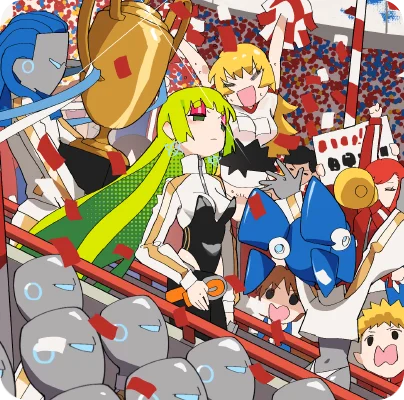
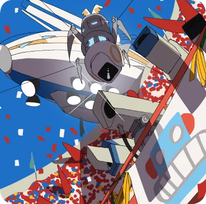
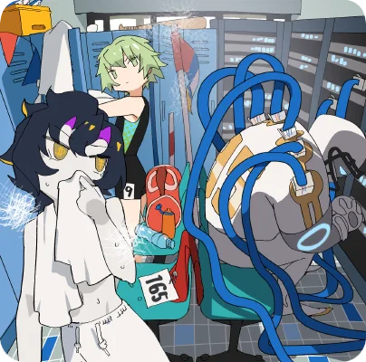
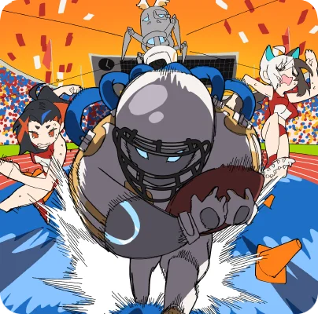
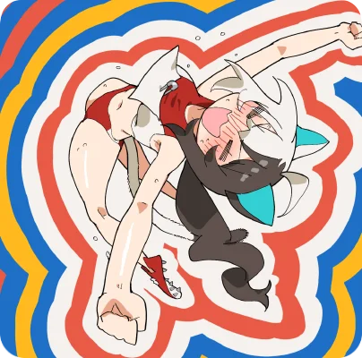
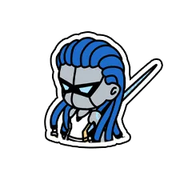
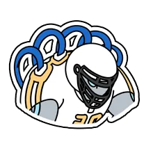
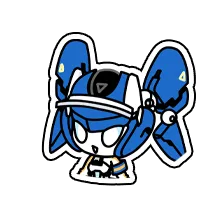
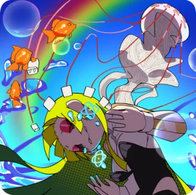
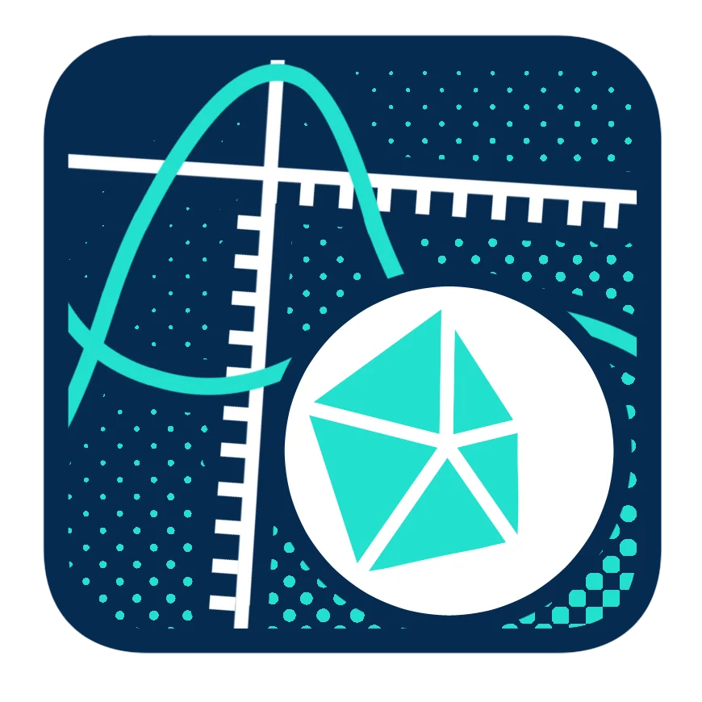

# 决赛大赛场
> 分类：地图
> 来源：https://wiki.biligame.com/starengine/%E5%86%B3%E8%B5%9B%E5%A4%A7%E8%B5%9B%E5%9C%BA

## 地图背景

明王山体育场位于临浜区，是联合城为数不多的大型综合体育中心。除水上运动外，所有田径项目均可在此举办；当没有体育赛事时，这里还可举办演唱会、大型非体育赛事等活动。这里几乎从未有过空闲的时候，热闹的氛围从建成之初就从未间断。

## 地图说明

决赛大赛场 是限时玩法人机大战运动会的专属地图，在活动智械狂潮（p6348.md）期间开放。
 
在决赛大赛场中，仅需3人即可开始游戏。 
运动会决赛拥有地图专属机制：心智。 
AI机器人们会不停的解析并剥夺角色的心智，请保持心智不被侵蚀，一旦被彻底解析完成，你将无法与机器人们正面抗衡。

## 地图事件

全难度

| 图像 | 名称 | 描述 | 触发条件 | 备注 |
| --- | --- | --- | --- | --- |
|  | 万众期待 | 科技巨头嘎呜登场，裁判艾米登场，刷新3个机械投手 | 进度达到1 | 该地图事件触发后，会在地图坐标A2、A9、H9处刷新3个机械投手（p6133.md），在地图坐标G9处刷新裁判艾米（p6130.md），并在地图坐标C1处刷新科技巨头嘎呜（p6067.md） |
|  | 幕间狂欢 | 刷新1个机械监控师 | 进度达到3 | 该地图事件触发后，会在地图坐标F2处刷新1个机械监控师（p6131.md） |
|  | 准备上场 | 刷新1个机械四分卫，1个机械监控师。所有怪物攻击力+1，防御力+1 | 进度达到6 | 该地图事件触发后，会在地图坐标C8处刷新1个机械四分卫（p6132.md），并在地图坐标H2处刷新1个机械监控师（p6131.md） |
|  | 绝对冲撞 | 刷新1个机械四分卫，2个机械监控师 | 进度达到10 | 该地图事件触发后，会在地图坐标F2处刷新1个机械四分卫（p6132.md），并在地图坐标C2、F7处刷新2个机械监控师（p6131.md） |
|  | 永不言弃 | 难以置信！居然没有倒下！ | 进度达到10且存在1名被击倒的角色恢复行动，有概率触发该地图事件[1] | 该地图事件触发后，会将地图BGM切换为“战(Another Mix)”，同时使恢复行动的角色获得99层【心智】，攻击力+9，防御力+9，移动速度+9，出牌数+9。 |

## 地图任务

| 任务 | 奖励 |
| --- | --- |
| 击倒机械投手 0\3 | 所有角色获得 强化筹码（p644.md）(60%/37%/3%) |
| 击倒机械监控师 0\2 | 所有角色获得 强化筹码（p644.md）(40%/45%/15%) |
| 击倒思维飞艇 0\2 | 所有角色获得 强化筹码（p644.md）(40%/45%/15%)，进度-1 |
| 击倒机械四分卫 0\2 | 所有角色获得 强化筹码（p644.md）(25%/50%/25%) |
| 击倒裁判艾米 0\1 | 所有角色获得 强化筹码（p644.md）(40%/45%/15%) |

### 怪物属性

|  |  |
| --- | --- |
|  | 4

 1

 11

 4

 1

 12 |
|  | 0

 0

 4

 0

 0

 4 |
|  | 5

 1

 24

 5

 1

 27

 6

 1

 30

 6

 2

 33 |
|  | 3

 0

 8

 4

 0

 9

 4

 1

 10

 4

 1

 11 |
|  | 5

 1

 18

 5

 1

 20

 5

 2

 22

 6

 2

 24 |
|  | 2

 2

 14

 3

 2

 16

 3

 3

 18

 4

 3

 20 |
|  | 3

 1

 128

 3

 1

 138

 4

 1

 148

 4

 1

 158 |
|  | 4

 2

 15

 4

 2

 17

 5

 2

 18

 5

 2

 20 |

### 行动顺序

行动顺序 小偷 科技巨头嘎呜 机械监控师 宝藏桶 机械投手 智械海盗鲨 机械四分卫 思维飞艇 裁判艾米 召唤的思维飞艇

## 地图专属筹码

电击枪
击倒精英单位后，获得1层【心智】。【心智】层数大于等于3时，攻击力+2，防御力+2。 自适应核心
心智小于等于3时，受到伤害-1。 
心智大于等于3时，攻击力+2。 娱乐终端
攻击力+4，防御力+4。 
回合结束时，心智层数-1。 原初意识
心智增加时，生命值上限永久+1。 
心智减少时，攻击力永久+1。 运动手环
攻击力+1，攻击时，如果防御方的移动速度受到影响，攻击力额外+4。 时间怀表
被击倒后的下一轮开始时，立即复活。该轮怪物行动时，全体怪物被时间静止。随后本筹码变为时间怀表(破碎)。

## 地图专有卡牌

  
 人机交融
人机交融 指定一个角色，使目标获得1层【心智】 自身本回合出牌数+1

## 地图特殊效果/状态

 丨 心智 丨 用于抵抗智械怪物的能力，对特定单位造成额外伤害。  丨 超量解析 丨 3层时，自身和思维飞艇获得攻击力+1，防御力+1。思维飞艇主动技能可在伤害后降低目标1层【心智】 
           6层时，自身和思维飞艇获得攻击力+1，防御力+1。思维飞艇的主动技能基础伤害+2。 
           9层时，自身和思维飞艇获得攻击力+2，防御力+2，移动速度+2。  丨 硅基进化 丨 强化次数  丨 裁判补正 丨 攻击力（防御力）-2，击杀获得属性的怪物后移除  丨 裁判补正 丨 攻击力（防御力）+2，被击杀后恢复受罚角色属性  丨 接力棒 丨 攻击力+2，防御力+2，移动速度+2。轮次结束时，传递给下一行动顺位的玩家。

## 畸变组件

决赛大赛场共有22种畸变组件。畸变组件的组件总数及组件总评分根据难度不同处在不同固定区间，如下表：

| 难度 | 组件总数 | 组件总评分 |
| --- | --- | --- |
| 普通  | 3、4 | +1、+2 |
| 困难  | 4 | +1、+2 |
| 噩梦  | 4、5 | -1、0 |
| 疯狂  | 5 | -2、-1、0 |

在所有难度中，一定仅存在1个第一类畸变组件。当难度为疯狂时，一定仅存在1个第二类畸变组件，但这不意味着其他难度不会向游戏内增加第二类畸变组件，事实上，在游戏难度为普通/困难/噩梦时仍有可能会初始给出1个第二类畸变组件。 
以上所有内容皆不计入裁判艾米（p6130.md）的被动技能“赛事主持”。事实上，由于裁判艾米（p6130.md）的被动技能“赛事主持”会从全部未加入当前游戏的畸变组件中任意选择1个加入游戏，导致实际游戏中畸变组件的组合往往与以上规定相悖。 
关于该地图的畸变组件如下：

#### 第一类畸变组件

 人机对决 -------
 所有角色进入游戏时获得1层【心智】 所有角色获得筹码【电击枪】 
 亲切裁判 -------
 所有角色进入游戏时获得2层【心智】 裁判艾米进入游戏时即加入战斗，属性获得额外强化，且可享受外置主脑强化效果。裁判艾米使用主动技能时，可额外减少目标1层心智。 击倒裁判艾米后，所有角色获得1张人机交融，该轮结束时额外选择1次筹码 
 全力全开 -------
 所有角色进入游戏时获得3层【心智】 首领获得受到伤害永久-2。首领使用主动技能后，额外获得1层【超量解析】。【超量解析】达到12层时，首领额外获得极为强大的增益 所有玩家获得筹码【原初意识】

#### 第二类畸变组件

 裁判的关注1 -------
 裁判艾米获得主动技能【黄牌警告】：指定距离最远的一个角色判罚，使其下次移动速度-2。该技能冷却时间为3轮。 
 裁判的关注2 -------
 裁判艾米获得主动技能【红牌判罚】：随机指定一个角色判罚，将该角色2点攻击力或防御力转移给一个随机非首领怪物，该怪物被击倒后返还属性。该技能冷却时间为3轮。

#### 其他畸变组件

 能量紊乱 -------
 角色回合开始时，其战斗卡牌的费用随机变为0-4 
 狂风 -------
 角色与怪物的移动速度+2。如果角色或怪物移动的最终移动点数大于10，其主动技能冷却时间-1 
 暴雨 -------
 使用效果牌时，受到1点伤害，本回合攻击力+1 
 神秘宝藏 -------
 游戏开始时随机刷新1个宝藏桶，之后每隔5轮，随机刷新1个新的宝藏桶 宝藏桶每次最多受到1点伤害，击倒它的角色获得1个随机筹码 
 灵光一闪 -------
 获得卡牌时，33%复制该卡牌并加入手牌（每回合最多触发3次） 
 敏捷 -------
 角色闪避成功后，获得1层反击 
 打劫 -------
 游戏开始时，所有角色额外获得6星币，进度+1 筹码商店的价格不会上涨 
 雷云 -------
 地图随机2个区域出现雷云，角色在雷云中停留受到2点伤害，智械怪物在雷云中停留恢复3点生命值 
 晕船 -------
 如果角色移动的最终点数大于8，则回合结束时在所在的地块放置【谜之物体】 
 海盗王的号令 -------
 首领与精英怪物的攻击力+1、防御力+1 首领怪物使用主动技能后，恢复所有怪物3点生命值 
 精准选择 -------
 轮次基础奖励卡牌，改为在四张中选一张 
 意外之财 -------
 转账时30%概率自身额外获得8星币 
 复制卡牌 -------
 一轮一次，手牌数小于4时，复制使用的第1张效果牌 一轮一次，手牌数大于5时，使用效果牌后，随机丢弃1张卡牌 
 套利 -------
 角色的回合结束后，获得自身星币10%的星币(向下取整) 
 接力棒 -------
 游戏开局时，第一行动顺位玩家获得【接力棒】（攻击力+2，防御力+2，移动速度+2） 轮次结束后，【接力棒】强制传递给下一顺位玩家 
 抢断 -------
 角色经过友方角色时，自身受到1点伤害 
 广域标记 -------
 所有单位登场后，获得3层标记

## 地图

任务 击倒机械投手0\3 所有角色获得 强化筹码*1 击倒机械监控师0\2 所有角色获得 强化筹码*1 击倒机械四分卫0\2 所有角色获得 强化筹码*1 击倒思维飞艇0\2 所有角色获得 强化筹码*1, 进度-1 击倒裁判艾米0\1 所有角色获得 强化筹码*1

万众期待
万众期待 科技巨头嘎呜登场，裁判艾米登场，刷新3个机械投手 2

幕间狂欢
幕间狂欢 刷新1个机械监控师 45

准备上场
准备上场 刷新1个机械四分卫，1个机械监控师。所有怪物攻击力+1，防御力+1 789

绝对冲撞
绝对冲撞 刷新1个机械四分卫，2个机械监控师 111213141516 地块统计
 
 
 
 
 
 A2=保障点
A3=怪物突击门
A4=筹码商店
A5=卡牌奖励
A6=疾行
A7=天降横祸
A8=全员事件
A9=天降横财

B2=天降横财
B9=怪物

C1=怪物
C2=卡牌奖励
C3=起始点1
C4=全员事件
C5=恢复
C6=怪物突击门
C7=起始点2
C8=商店

D1=疾行
D8=思维强化

E1=恢复
E8=疾行

F1=思维强化
F2=商店
F3=怪物突击门
F4=天降横祸
F5=起始点3
F6=全员事件
F7=卡牌奖励
F8=怪物

G2=怪物
G9=天降横财

H2=天降横财
H3=全员事件
H4=疾行
H5=天降横祸
H6=商店
H7=怪物突击门
H8=卡牌奖励
H9=保障点
 #fe1fee=C2->B2,C8->D8,F2->F1,F8->G9
#00f1f9=C2->C1,C8->B9,F2->G2,F8->E8
 起始点1=270
起始点2=90
起始点3=270
 8
 9
 A2=普通~疯狂:万众期待>1062
A9=普通~疯狂:万众期待>1062
H2=普通~疯狂:万众期待>1062, 普通~疯狂:准备上场>1064
G9=普通~疯狂:万众期待>1061
C1=普通~疯狂:万众期待>1065

F2=普通~疯狂:幕间狂欢>1064, 普通~疯狂:绝对冲撞>1063

C8=普通~疯狂:准备上场>1063

C2=普通~疯狂:绝对冲撞>1064
F7=普通~疯狂:绝对冲撞>1064

- ↑ 这可能不准确。
