# 淘汰赛运动场
> 分类：地图
> 来源：https://wiki.biligame.com/starengine/%E6%B7%98%E6%B1%B0%E8%B5%9B%E8%BF%90%E5%8A%A8%E5%9C%BA

## 地图背景

中城大学附属中学位于凰区，是一所隶属于中城大学的顶尖高校。与其他学校不同的是，这里是为了培养出更加精英化的学生而建造的学府。在寸土寸金的凰区，学校拥有一个大型操场实属奢侈。不过，最近中学的操场因部分设备老化，已开始进行翻新工作。

## 地图说明

淘汰赛运动场 是限时玩法人机大战运动会的专属地图，在活动智械狂潮（p6230.md）期间开放。
 
在淘汰赛运动场中，仅需3人即可开始游戏。 
运动会决赛拥有地图专属机制：心智。 
AI机器人们会不停的解析并剥夺角色的心智，请保持心智不被侵蚀，一旦被彻底解析完成，你将无法与机器人们正面抗衡。 
相较于龙宫游乐园（p3537.md），该地图中的天川真梦梓（p3623.md）血量下调至88/99/111/126，天川苍鲤（p3652.md）血量下调至80/90/100/111。

## 地图事件

全难度（天川真梦梓）
全难度（天川苍鲤）

| 图像 | 名称 | 描述 | 触发条件 | 备注 |
| --- | --- | --- | --- | --- |
| 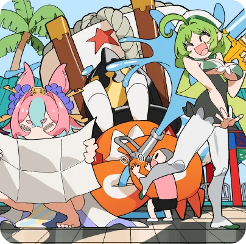 | 水上乐园 | 裁判艾米登场，刷新1个大嗓门，1个练家子 | 进度达到1 | 该地图事件触发后，会在地图坐标E5处刷新裁判艾米（p6130.md），在地图坐标C8处刷新大嗓门（p3651.md），并在地图坐标G8处刷新练家子（p3650.md） |
| 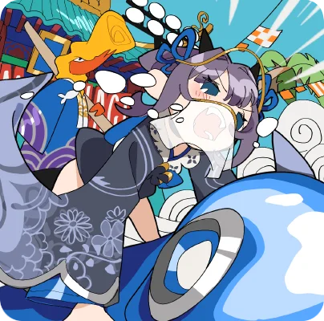 | 真梦梓出击！ | 天川真梦梓登场，刷新2个蟹布罗 | 进度达到3 | 该地图事件触发后，会在地图坐标E1处刷新天川真梦梓（p3623.md），并在地图坐标C5、G5处刷新2个蟹布罗（p3647.md） |
|  | 家有锦鲤 | 天川苍鲤登场 | 进度达到5且当前游戏的畸变组件中存在“家有锦鲤” | 该地图事件触发后，会在地图坐标E10处刷新天川苍鲤（p3652.md） |
| 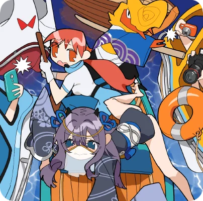 | 独木难支 | 刷新1个虾布罗，2个海盗鲨鱼。所有怪物攻击力+1，防御力+1 | 进度达到6 | 该地图事件触发后，会在地图坐标E4处刷新1个虾布罗（p3648.md），并在地图坐标A5、I5处刷新2个海盗鲨鱼（p3533.md） |
| 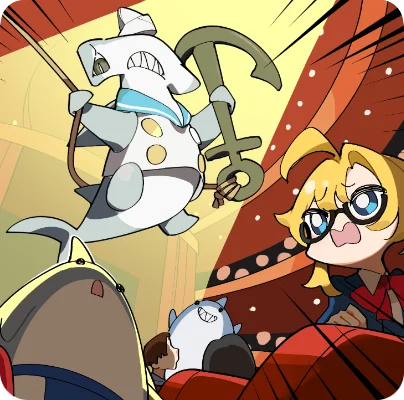 | 鲨手降临 | 刷新1个海王鲨，1个虾布罗 | 进度达到9 | 该地图事件触发后，会在地图坐标G1处刷新1个海王鲨（p3535.md），并在地图坐标C10处刷新1个虾布罗（p3648.md） |

| 图像 | 名称 | 描述 | 触发条件 | 备注 |
| --- | --- | --- | --- | --- |
|  | 水上乐园 | 裁判艾米登场，刷新1个大嗓门，1个练家子 | 进度达到1 | 该地图事件触发后，会在地图坐标E5处刷新裁判艾米（p6130.md），在地图坐标C8处刷新大嗓门（p3651.md），并在地图坐标G8处刷新练家子（p3650.md） |
|  | 苍鲤登场！ | 天川苍鲤登场，刷新2个海盗鲨鱼 | 进度达到3 | 该地图事件触发后，会在地图坐标E10处刷新天川苍鲤（p3652.md），并在地图坐标C8、G8处刷新2个海盗鲨鱼（p3533.md） |
| 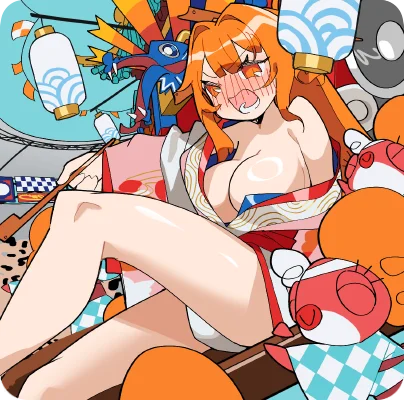 | 酪酊丑态 | 刷新1个金小鱼，1个海盗鲨鱼。所有怪物攻击力+1，防御力+1 | 进度达到6 | 该地图事件触发后，会在地图坐标A7处刷新1个金小鱼（p3649.md），并在地图坐标I7处刷新1个海盗鲨鱼（p3533.md） |
|  | 大逃鲨 | 刷新1个海盗鲨鱼，1个海王鲨，1个金小鱼 | 进度达到9 | 该地图事件触发后，会在地图坐标A3处刷新1个海盗鲨鱼（p3533.md），在地图坐标E5处刷新1个海王鲨（p3535.md），并在地图坐标I3处刷新1个金小鱼（p3649.md） |

### 怪物属性

|  |  |
| --- | --- |
|  | 4

 1

 9

 4

 1

 10

 4

 1

 10

 4

 1

 10

 4

 1

 11 |
|  | 3

 0

 18

 4

 0

 18

 4

 1

 20

 5

 2

 22

 6

 2

 44 |
|  | 4

 1

 99

 4

 1

 111

 5

 2

 120

 6

 2

 150 |
|  | 1

 1

 88

 2

 2

 100

 3

 3

 110

 4

 4

 135 |
| 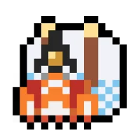 | 2

 1

 7

 3

 1

 8

 3

 2

 8

 4

 2

 9 |
|  | 3

 1

 20

 3

 2

 22

 4

 2

 24

 4

 2

 26 |
|  | 2

 0

 6

 3

 0

 7

 5

 0

 8

 6

 0

 11 |
|  | 3

 0

 18

 3

 0

 20

 4

 1

 20

 4

 1

 24 |
|  | 3

 3

 13

 4

 4

 14

 5

 4

 15

 5

 5

 16 |
|  | 0

 0

 4

 0

 0

 4 |
|  | 5

 1

 24

 5

 1

 27

 6

 1

 30

 6

 2

 33 |

### 行动顺序

行动顺序 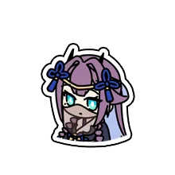天川真梦梓 小偷 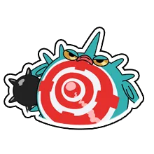练家子 天川苍鲤 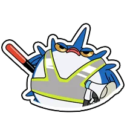大嗓门 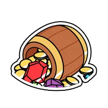宝藏桶 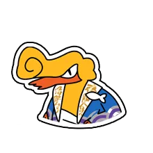虾布罗 海王鲨 蟹布罗 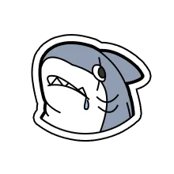海盗鲨鱼 金小鱼 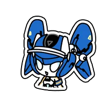裁判艾米 召唤的金小鱼

## 地图专属筹码

运动手环
攻击力+1，攻击时，如果防御方的移动速度受到影响，攻击力额外+4。 时间怀表
被击倒后的下一轮开始时，立即复活。该轮怪物行动时，全体怪物被时间静止。随后本筹码变为时间怀表(破碎)。

## 地图专有卡牌

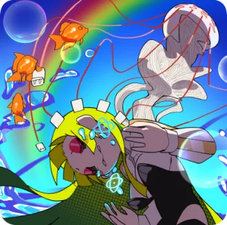  
 人机交融
人机交融 指定一个角色，使目标获得1层【心智】 自身本回合出牌数+1 
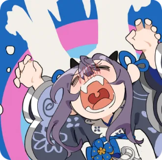   
 毒牙
毒牙 移除目标2层【金鳞】，本次攻击无法被反击

## 地图特殊效果/状态

 丨 心智 丨 用于抵抗智械怪物的能力，对特定单位造成额外伤害。  丨 逆鳞 丨 每层增加2点攻击并减少2点受到伤害，回合结束时清除。  丨 金鳞 丨 每层增加1点攻击与防御。 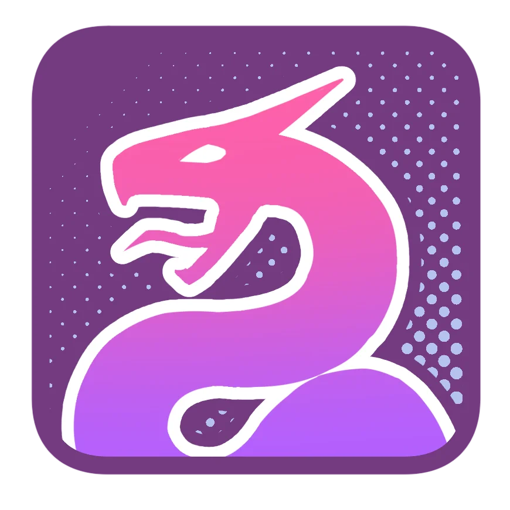 丨 化龙 丨 到达5层时，转变为【真龙形态】 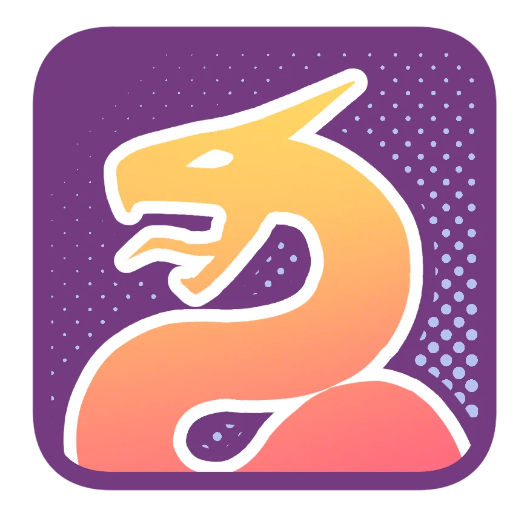 丨 真龙形态 丨 攻击力+4，主动技能不再拥有范围限制

## 畸变组件

淘汰赛运动场共有23种畸变组件。畸变组件的组件总数及组件总评分根据难度不同处在不同固定区间，如下表：

| 难度 | 组件总数 | 组件总评分 |
| --- | --- | --- |
| 普通  | 3、4 | +1 |
| 困难  | 3、4 | 0、+1 |
| 噩梦  | 3、4 | 0、+1 |
| 疯狂  | 4 | +1 |

在所有难度中，一定仅存在1个第一类畸变组件，最多仅存在1个第二类畸变组件。 
如果当前游戏的第一类畸变组件为“化龙”，那么有概率将畸变组件“家有锦鲤”加入游戏： 
 家有锦鲤 -------
 地图事件加入：家有锦鲤 天川真梦梓使用主动技能时，若天川苍鲤在技能范围内，额外获得1层【化龙】 天川苍鲤被击败时，清空天川真梦梓的【化龙】 以上所有内容皆不计入裁判艾米（p6130.md）的被动技能“赛事主持”。事实上，由于裁判艾米（p6130.md）的被动技能“赛事主持”会从除第一类畸变组件外全部未加入当前游戏的畸变组件中任意选择1个加入游戏，导致实际游戏中畸变组件的组合往往与以上规定相悖。 
关于该地图的畸变组件如下：

#### 第一类畸变组件

 化龙 -------
 首领固定为天川真梦梓。当首领使角色失去达到5张牌，获得【真龙形态】，攻击力永久+4，主动技能不再拥有范围限制 
轮次1结束时，所有角色额外选择1次筹码 
 不醉不归 -------
 首领固定为天川苍鲤。天川苍鲤使用主动技能后，在随机地块放置3个葫芦，拾取葫芦可获得1张【毒牙】和1张随机卡牌 
轮次1结束时，所有角色额外选择1次筹码

#### 第二类畸变组件

 裁判的关注1 -------
 裁判艾米获得主动技能【黄牌警告】：指定距离最远的一个角色判罚，使其下次移动速度-2。该技能冷却时间为3轮。 
 裁判的关注2 -------
 裁判艾米获得主动技能【红牌判罚】：随机指定一个角色判罚，将该角色2点攻击力或防御力转移给一个随机非首领怪物，该怪物被击倒后返还属性。该技能冷却时间为3轮。 、

#### 其他畸变组件

 能量紊乱 -------
 角色回合开始时，其战斗卡牌的费用随机变为0-4 
 狂风 -------
 角色与怪物的移动速度+2。如果角色或怪物移动的最终移动点数大于10，其主动技能冷却时间-1 
 暴雨 -------
 使用效果牌时，受到1点伤害，本回合攻击力+1 
 神秘宝藏 -------
 游戏开始时随机刷新1个宝藏桶，之后每隔5轮，随机刷新1个新的宝藏桶 宝藏桶每次最多受到1点伤害，击倒它的角色获得1个随机筹码 
 灵光一闪 -------
 获得卡牌时，33%复制该卡牌并加入手牌（每回合最多触发3次） 
 敏捷 -------
 角色闪避成功后，获得1层反击 
 过载模式 -------
 角色与怪物获得主动技能冷却缩减1，使用主动技能后本轮防御力-1 角色出牌数+1，一回合最多使用3张效果牌 
 打劫 -------
 游戏开始时，所有角色额外获得6星币，进度+1 筹码商店的价格不会上涨 
 雷云 -------
 地图随机2个区域出现雷云，角色在雷云中停留受到2点伤害，智械怪物在雷云中停留恢复3点生命值 
 晕船 -------
 如果角色移动的最终点数大于8，则回合结束时在所在的地块放置【谜之物体】 
 精准选择 -------
 轮次基础奖励卡牌，改为在四张中选一张 
 意外之财 -------
 转账时30%概率自身额外获得8星币 
 复制卡牌 -------
 一轮一次，手牌数小于4时，复制使用的第1张效果牌 一轮一次，手牌数大于5时，使用效果牌后，随机丢弃1张卡牌 
 套利 -------
 角色的回合结束后，获得自身星币10%的星币(向下取整) 
 接力棒 -------
 游戏开局时，第一行动顺位玩家获得【接力棒】（攻击力+2，防御力+2，移动速度+2） 轮次结束后，【接力棒】强制传递给下一顺位玩家 
 抢断 -------
 角色经过友方角色时，自身受到1点伤害 
 广域标记 -------
 所有单位登场后，获得3层标记 
 海盗王的号令 -------
 首领与精英怪物的攻击力+1、防御力+1 首领怪物使用主动技能后，恢复所有怪物3点生命值

## 地图

任务 击倒大嗓门或练家子0\2 所有角色获得 强化筹码*1 击倒蟹布罗0\2 所有角色获得 强化筹码*1 击倒虾布罗0\2 所有角色获得 强化筹码*1 击倒裁判艾米0\1 所有角色获得 强化筹码*1

水上乐园
水上乐园 裁判艾米登场，刷新1个大嗓门，1个练家子 2

真梦梓出击！
真梦梓出击！ 天川真梦梓登场，刷新2个蟹布罗 45

独木难支
独木难支 刷新1个虾布罗，2个海盗鲨鱼。所有怪物攻击力+1，防御力+1 78

鲨手降临
鲨手降临 刷新1个海王鲨，1个虾布罗 10111213141516 任务 击倒大嗓门或练家子0\2 所有角色获得 强化筹码*1 击倒海盗鲨鱼0\2 所有角色获得 强化筹码*1 击倒金小鱼0\4 所有角色获得 强化筹码*1 击倒裁判艾米0\1 所有角色获得 强化筹码*1 水上乐园
水上乐园 裁判艾米登场，刷新1个大嗓门，1个练家子 2

苍鲤登场！
苍鲤登场！ 天川苍鲤登场，刷新2个海盗鲨鱼 45

酪酊丑态
酪酊丑态 刷新1个金小鱼，1个海盗鲨鱼。所有怪物攻击力+1，防御力+1 78

大逃鲨
大逃鲨 刷新1个海盗鲨鱼，1个海王鲨，1个金小鱼 10111213141516 地块统计
 
 
 
 
 
 A3=怪物
A4=天降横财
A5=起始点3
A6=卡牌奖励
A7=疾行

B2=怪物突击门
B8=恢复

C1=天降横祸
C5=疾行
C6=天降横财
C7=全员事件
C8=商店
C9=卡牌奖励
C10=怪物

D1=全员事件
D5=天降横祸
D10=怪物突击门

E1=商店
E2=卡牌奖励
E3=起始点1
E4=天降横财
E5=筹码商店
E10=保障点

F1=天降横财
F5=怪物突击门
F10=天降横祸

G1=恢复
G5=怪物
G6=恢复
G7=卡牌奖励
G8=商店
G9=天降横财
G10=疾行

H2=疾行
H8=全员事件

I3=全员事件
I4=天降横祸
I5=起始点2
I6=怪物
I7=怪物突击门
 #fe1fee=C8->C9,E5->E4,G8->H8
#00f1f9=C8->B8,E5->F5,G8->G9
 起始点1=90
起始点2=90
起始点3=90
 9
 10
 A3=普通~疯狂:大逃鲨>1002
A5=普通~疯狂:独木难支>1002
A7=普通~疯狂:酪酊丑态>1030
C5=普通~疯狂:真梦梓出击！>1028
C8=普通~疯狂:水上乐园>1031, 普通~疯狂:苍鲤登场！>1002
C10=普通~疯狂:鲨手降临>1029
E1=普通~疯狂:真梦梓出击！>1026
E4=普通~疯狂:独木难支>1029
E5=普通~疯狂:水上乐园>1061, 普通~疯狂:大逃鲨>1025
E10=普通~疯狂:苍鲤登场！>1027
G1=普通~疯狂:鲨手降临>1025
G5=普通~疯狂:真梦梓出击！>1028
G8=普通~疯狂:水上乐园>1032, 普通~疯狂:苍鲤登场！>1002
I3=普通~疯狂:大逃鲨>1030
I5=普通~疯狂:独木难支>1002
I7=普通~疯狂:酪酊丑态>1002
