# 娜蒂斯（绿洲女王）
> 分类：角色 · 编号 116 · 时期 第二期 · 女
> 来源：https://wiki.biligame.com/starengine/%E5%A8%9C%E8%92%82%E6%96%AF

绿洲市的权贵,也是联合城领导者家族之一。作为联合城的工业命脉，绿洲市的能源产业对于联合城至关重要。恩菲尔德家族不但是绿洲市实质的掌权者，还是联合城掌权议会中的一员，家族的产业遍布整个绿洲市。

## 战斗数值

| 攻击 | 防御 | 生命 |
| --- | --- | --- |
| 1 | 1 | 9 |

## 技能

### 主动技能：女王特权（冷却 3）

获得3张临时卡牌。临时卡牌会在回合结束时自动丢弃。

### 被动技能：威压

攻击时，每比敌方多一张手牌，攻击力+1，最多+3。

## 基础资料

- 姓名：娜蒂斯·恩菲尔德
- 英文名：Nardis
- 日文名：ナーディス
- 从属组织：联合城,恩菲尔德家族
- 上线时间：202407121600
- 生日：9月19日
- 喜欢食物：碳烤鹰嘴豆
- 初始骰子：多面体骰子
- 礼物：居家服、精酿的啤酒、小怪兽手办
- 徽章：月光、熔岩

## PVE 特性

- 达到1星时攻击力+1
- 初始星币+6
- 达到3星时攻击力+1、防御力+1、移动速度+1

## 皮肤（共 4 套）

> 皮肤编号取自素材文件名；「默认」「羁绊皮肤」也是独立皮肤。

### 1. 默认（初始）

- 素材编号：116
- 立绘：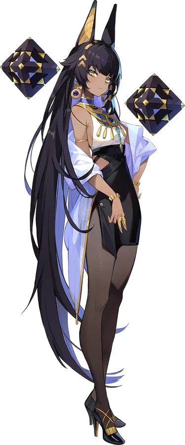
- Q版立绘：
- 头像：
- Q版头像：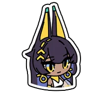
- 半身像（星币<20）：
- 半身像（星币≥20）：

### 2. 羁绊皮肤（羁绊解锁）

- 素材编号：116_Max
- 立绘：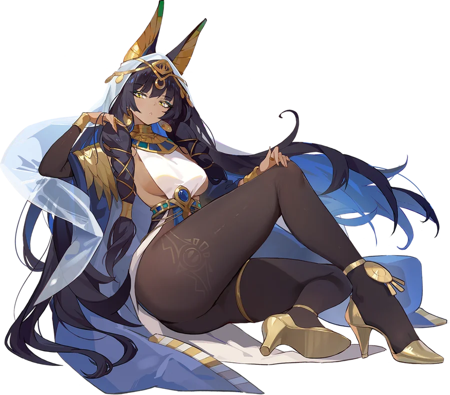
- 立绘（和谐版）：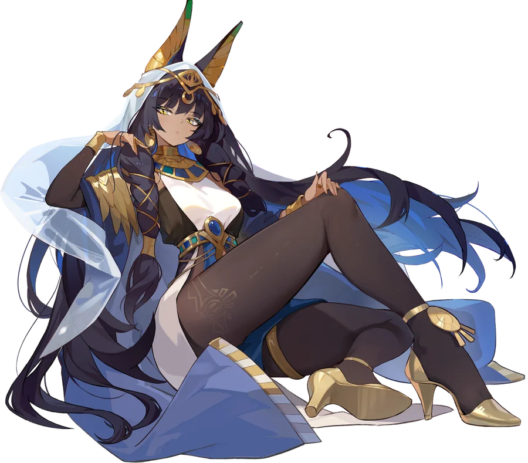
- Q版立绘：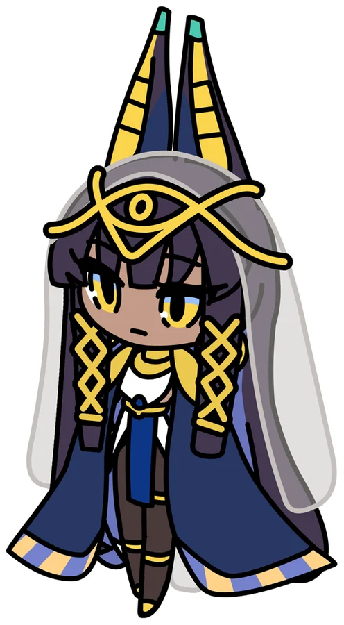
- 头像：
- Q版头像：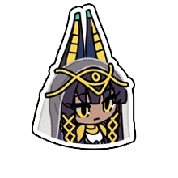
- 半身像（星币<20）：
- 半身像（星币≥20）：

### 3. 祭典礼服（紫品质）

- 素材编号：116_01
- 立绘：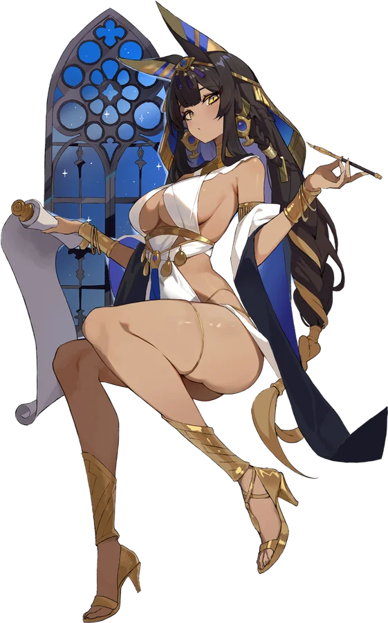
- 立绘（和谐版）：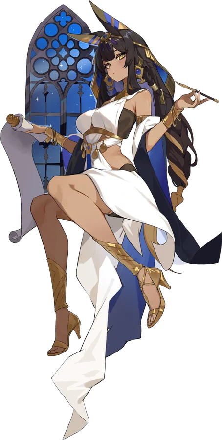
- Q版立绘：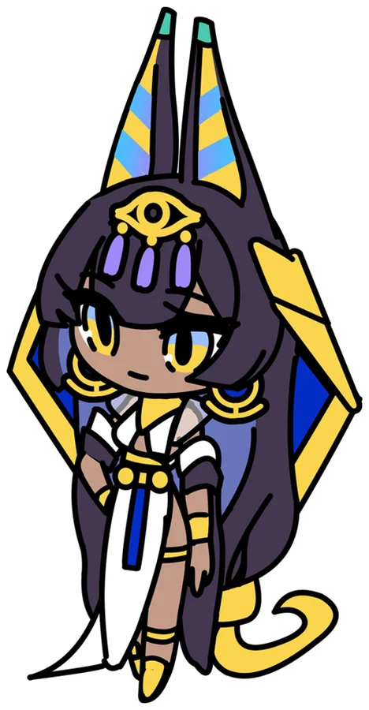
- 头像：
- Q版头像：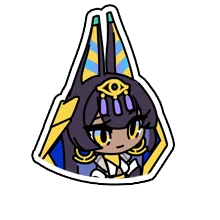
- 半身像（星币<20）：
- 半身像（星币≥20）：

**皮肤故事**：每年的收获节，娜蒂斯都是最忙的一个人。

她不但要主持整个收获节的工作，还要在节日开场的时候提出祝词，给每年的收获节打下一个好的开场。

娜蒂斯依稀记得，她很小的时候这些事情都由母亲去完成，自己只是那个站在旁边看着母亲的懵懂小孩。

她只是觉得母亲那时候穿着得很好看，白色的裙摆加上华丽的头饰，身上那些金色的装饰品在那时的她看来显得格外耀眼。

现在，当对着镜子中的自己时，她不由自主地看到了儿时母亲的身影。当然，娜蒂斯此时比母亲更加耀眼，更加华丽，更加威严。

代表着整个绿洲城，代表着几百年恩菲尔德家族的荣耀，娜蒂斯在收获节的庆典上不能有丁点闪失。

这就是新时代“绿洲女王”的荣光时刻。恩菲尔德家族的荣光时刻。

### 4. 暮色魔女（蓝品质）

- 素材编号：116_02
- 立绘：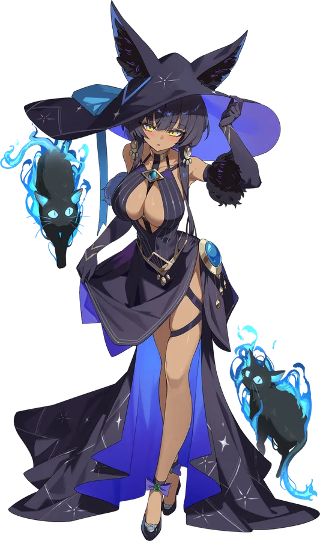
- 立绘（和谐版）：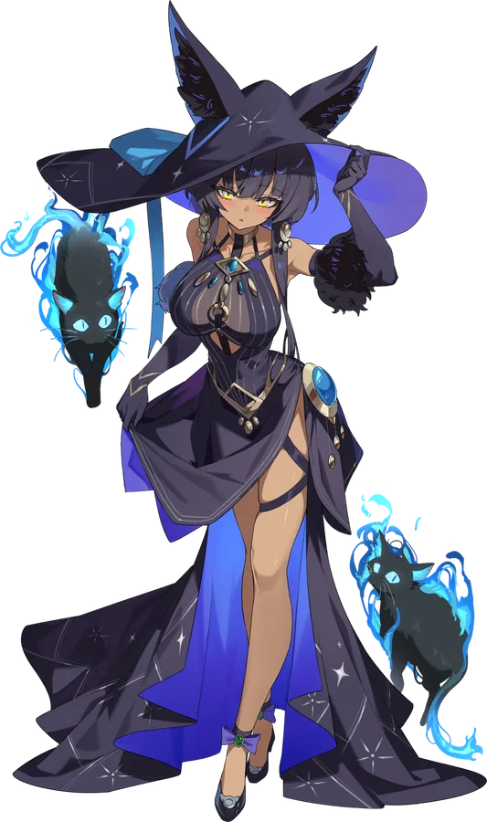
- Q版立绘：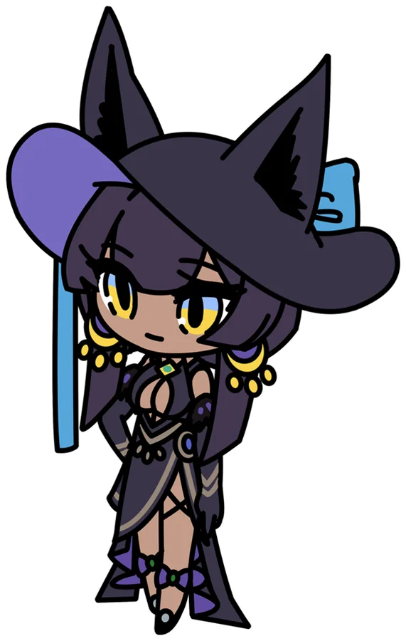
- 头像：
- Q版头像：
- 半身像（星币<20）：
- 半身像（星币≥20）：

**皮肤故事**：恩菲尔德家族的祖先世代都是强大的“魔法使”。

然而，他们家族的魔法与其他魔法使不同，主要用于隐藏某些事物的轨迹与行踪。

黑猫是恩菲尔德家族的“媒介灵宠”在家族中享有崇高地位。在许多场合，他们都将黑猫微记作为装饰品，以彰显其重要性。

“暮色”是专为增强恩菲尔德家族魔力而打造的魔导具它是一枚魔力强大的宝石，仅对家族成员有效，普通人则毫无用处。娜蒂斯所穿的礼服正是以“暮色”为装饰制成的。

当娜蒂斯佩戴“暮色”时，她的能力会增强数倍，法力凝结的结晶形态甚至可以具现化。强大的魔力能凝聚出“黑猫灵宠”，环绕在她身边。

作为神器“冥王”的守护者，这样的实力是必不可少的。

## 表情（共 16 个）

| # | 名称 | 品质 | 获取方式 | 图片 |
| --- | --- | --- | --- | --- |
| 1 | 表情1 |  |  |  |
| 2 | 表情2 |  |  |  |
| 3 | 表情3 |  |  |  |
| 4 | 表情4 |  |  |  |
| 5 | 表情5 |  |  |  |
| 6 | 表情6 |  |  |  |
| 7 | 表情7 |  |  |  |
| 8 | 表情8 |  |  |  |
| 9 | 表情9 |  |  |  |
| 10 | 表情10 |  |  |  |
| 11 | 表情10 |  |  |  |
| 12 | 表情11 |  |  |  |
| 13 | 表情12 |  |  |  |
| 14 | 表情12 |  |  |  |
| 15 | 表情13 |  |  |  |
| 16 | 表情13 |  |  |  |

## 装扮

官方 wiki 未提供该角色的 /获取 页，头像、名片、卡牌、骰子清单暂缺。

## 人物传记

娜蒂斯长期居住在联合城，偶尔被家族叫回绿洲市。

## 画廊其他素材

- 起始点：
- 像素头像：
- Lv4羁绊等级奖励：
- 头像鼠：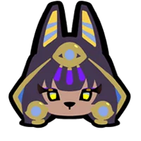
- Lv5羁绊等级奖励：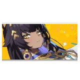
- 缔结契约名片奖励：
- 祭典礼服皮肤名片：
- 暮色魔女皮肤名片：
