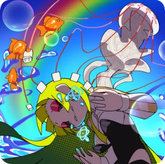

# 人机交融
> 分类：卡牌/手牌
> 编号：21024
> 类型：Effect
> 来源：https://wiki.biligame.com/starengine/%E4%BA%BA%E6%9C%BA%E4%BA%A4%E8%9E%8D

## 卡牌效果

合作挑战（PVE）：指定一个角色，使目标获得1层【心智】

自身本回合出牌数+1

## 资料

- **编号**：21024
- **类型**：Effect
- **对象**：Entity
- **来源**：地图卡牌:决赛大赛场

## 详解

注意：人机交融仅在合作挑战模式的地图海选赛运动场、淘汰赛运动场与决赛大赛场中作为专属卡牌出现。

卡牌中的【心智】效果是一个施加给角色的效果，其效果为：

用于抵抗智械怪物的能力，对特定单位造成额外伤害。

在海选赛运动场与淘汰赛运动场中，虽然击倒裁判艾米会获得该卡牌，但地图中没有可以触发【心智】效果的怪物或筹码，这使得该卡牌的实际作用仅有“自身本回合出牌数+1”。

## 花絮

*人机交融卡面中心的角色具体如下：
**智械中枢(上)
**天王寺雅央(下)。

## 历史

*2025年6月25日
**引入游戏。

## 图片

