# 赛克斯（魔渊幼体）
> 分类：角色 · 编号 129 · 女
> 来源：https://wiki.biligame.com/starengine/%E8%B5%9B%E5%85%8B%E6%96%AF

拉姆齐生物科技技术顾问，与璐璐一样，她也是拉姆齐生物科技的产物，代号“魔渊”。与璐璐不同的是，她本体为人造人，但意识在“退魔之夜”当晚觉醒，并与其他超自然生物有着千丝万缕的联系。本体拥有超强的再生能力和魔力亲和力。性格看似温顺，实则老谋深算，像一位深藏不露的老奶奶。她几乎没有攻击性，但并不代表她不会主动攻击。

## 战斗数值

| 攻击 | 防御 | 生命 |
| --- | --- | --- |
| 0 | 2 | 9 |

## 技能

### 主动技能：魔域转化（冷却 3）

选定4格内的一个地块，生成1个魔渊触须，并将该地块1格内的所有地块临时转化为魔渊区域。随后，激活魔渊区域内的所有魔渊触须。

魔渊区域：对以任何形式进入魔渊区域的敌方单位施加下次移动速度-2；此外，一轮一次，使移动进入魔渊区域的敌方角色停止移动。魔渊区域在赛克斯回合开始时消失。

**PVE**：选定4格内的一个地块，生成1个魔渊触须，并将该地块2格内的所有地块临时转化为魔渊区域。随后，激活魔渊区域内的所有魔渊触须。

魔渊区域：对以任何形式进入魔渊区域的怪物施加下次移动速度-2。魔渊区域在赛克斯回合开始时消失。

### 被动技能：触须深渊

游戏开始时，随机在地图上生成5个魔渊触须。回合结束时，赛克斯激活2格内所有的魔渊触须。

激活魔渊触须：魔渊触须对1格内的所有敌方单位造成1点伤害。

魔渊触须永久存在，一个地块最多存在一个魔渊触须。

**PVE**：自身造成伤害时，对目标施加1层渊蚀印记（每层使自身受到来自魔渊触须和赛克斯的伤害），持续1轮。

回合结束时，在自身所在的地块生成1个魔渊触须。随后，激活3格内所有的魔渊触须。

激活魔渊触须：魔渊触须对2格内的所有怪物造成1点伤害，随后对其中受减速效果影响的怪物施加1层渊蚀印记（每层使自身受到来自魔渊触须和赛克斯的伤害），持续1轮。

魔渊触须永久存在，一个地块最多存在一个魔渊触须。

## 基础资料

- 姓名：赛克斯（NO.06）
- 英文名：Sykes
- 日文名：サイクス
- 从属组织：拉姆齐生物科技
- 上线时间：202607301000
- 生日：6月6日
- 喜欢食物：魔力晶核
- 初始骰子：章鱼丸骰子
- 礼物：居家服、精酿的啤酒、手作巧克力
- 徽章：熔岩、月光

## PVE 特性

- 达到1星时防御力+1
- 初始星币+6
- 达到3星时攻击力+1、防御力+1、移动速度+1

## 皮肤（共 2 套）

> 皮肤编号取自素材文件名；「默认」「羁绊皮肤」也是独立皮肤。

### 1. 默认（初始）

- 素材编号：129
- 立绘：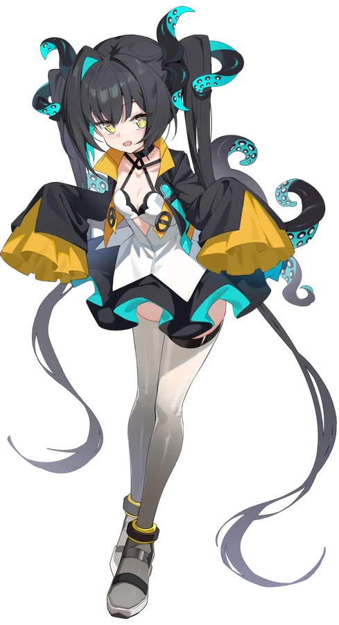
- 立绘（和谐版）：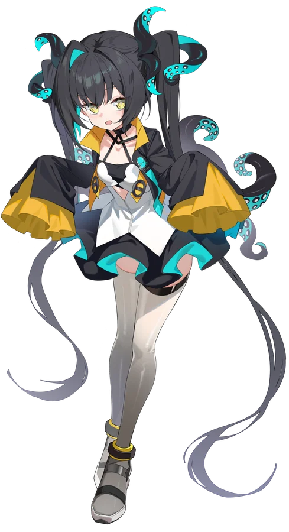
- Q版立绘：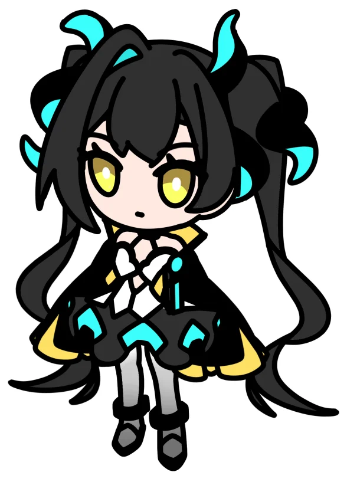
- 头像：
- Q版头像：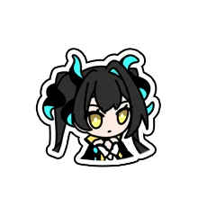
- 半身像（星币<20）：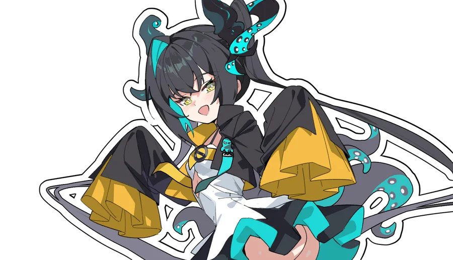
- 半身像（星币≥20）：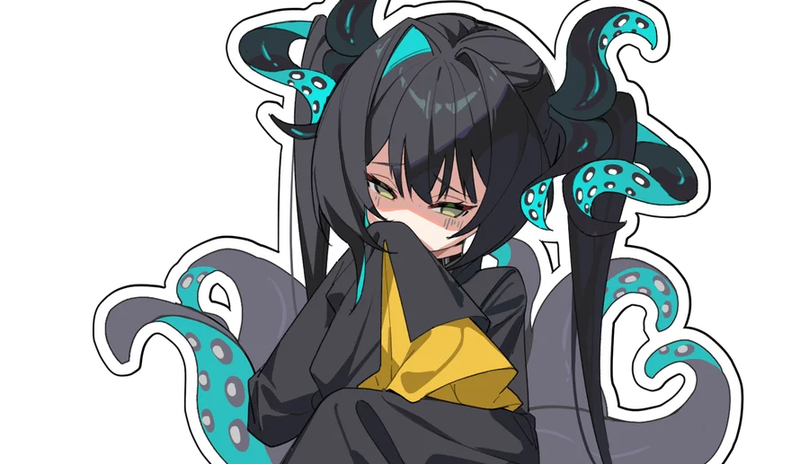

### 2. 羁绊皮肤（羁绊解锁）

- 素材编号：129_Max
- 立绘：
- 立绘（和谐版）：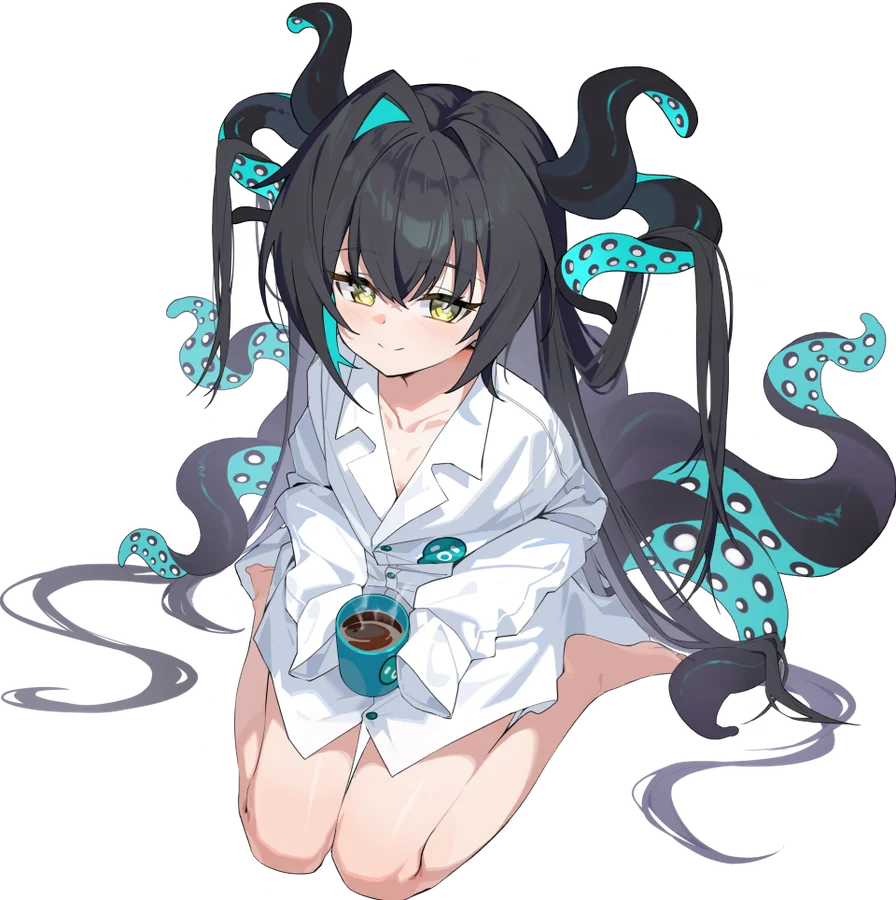
- Q版立绘：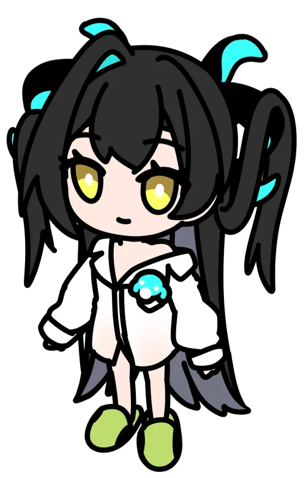
- 头像：
- Q版头像：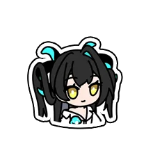
- 半身像（星币<20）：
- 半身像（星币≥20）：

## 表情（共 8 个）

| # | 名称 | 品质 | 获取方式 | 图片 |
| --- | --- | --- | --- | --- |
| 1 | 表情1 |  |  |  |
| 2 | 表情2 |  |  |  |
| 3 | 表情3 |  |  |  |
| 4 | 表情4 |  |  |  |
| 5 | 表情5 |  |  |  |
| 6 | 表情6 |  |  |  |
| 7 | 表情7 |  |  |  |
| 8 | 表情8 |  |  | 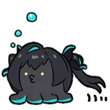 |

## 装扮

官方 wiki 未提供该角色的 /获取 页，头像、名片、卡牌、骰子清单暂缺。

## 人物传记

现任拉姆齐生物科技的技术顾问，其超强的再生能力也使其成为研究材料之一。

## 画廊其他素材

- 起始点：
- 像素头像：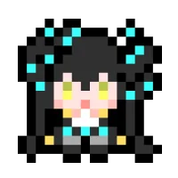
- Lv4羁绊等级奖励：
- Lv5羁绊等级奖励：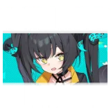
- 缔结契约名片奖励：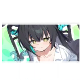
