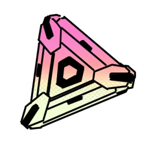

# 自适应核心
> 分类：筹码
> 编号：50075
> 品质：蓝
> 类别：地图筹码:决赛大赛场
> 来源：https://wiki.biligame.com/starengine/%E8%87%AA%E9%80%82%E5%BA%94%E6%A0%B8%E5%BF%83

## 效果

心智小于等于3时，受到伤害-1。

心智大于等于3时，攻击力+2。

## 资料

- **品质**：蓝
- **编号**：50075
- **类别**：地图筹码:决赛大赛场

## 详解

该筹码属于地图筹码,为地图决赛大赛场专属，详细机制请参考游戏内说明。

## 历史

*2026年7月30日
**引入游戏。

## 图片

