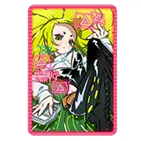
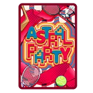

# 智械狂潮（下半期）
> 分类：活动
> 来源：https://wiki.biligame.com/starengine/%E6%99%BA%E6%A2%B0%E7%8B%82%E6%BD%AE%EF%BC%88%E4%B8%8B%E5%8D%8A%E6%9C%9F%EF%BC%89

## 活动任务

活动任务活动任务06.25~07.30 
×1 完成1场合作挑战模式（每日刷新） 1/1   
×1 累计参与PVE天数≥1天 1/1   
×1 累计参与PVE天数≥3天 3/3   
×2 累计参与PVE天数≥7天 7/7   
×2 累计参与PVE天数≥10天 10/10   
×1 累计参与【运动会合作挑战】任意地图≥1次 1/1   
×3 累计参与【运动会合作挑战】任意地图≥5次 5/5   
×3 累计参与【运动会合作挑战】任意地图≥10次 10/10   
×1 累计参与【运动会合作挑战】中击败裁判艾米≥1次 1/1   
×2 累计参与【运动会合作挑战】中击败裁判艾米≥3次 3/3   
×3 累计参与【运动会合作挑战】中击败裁判艾米≥5次 5/5   
×1 累计参与【运动会合作挑战】中击败裁判艾米≥10次 10/10   
×3 至少使用4名角色在【海选赛】、【淘汰赛】和【决赛】中取得胜利 1/1   
×2 完成游戏后为其他玩家点赞≥5次 5/5   
×4 完成游戏后为其他玩家点赞≥15次 15/15   
×6 完成游戏后为其他玩家点赞≥30次 30/30  

## 活动商店

奖杯雪花球 ×10 限购3248 奖杯雪花球 ×1 28 抽奖券 ×1 限购2020 拉拉队员-璐璐 ×1 限购1666 名片-拉拉队员（动态） ×1 限购1500 名片-拉拉队员 ×1 限购160 史莱姆表情14（动态） ×1 限购1100 史莱姆表情15（动态） ×1 限购1100 头像-拉拉队员鼠鼠 ×1 限购1120 头像-人工智能鼠鼠 ×1 限购130 卡牌-智械主宰 ×1 限购1120 卡牌-运动至上 ×1 限购130 星币 ×10 3 时装券 ×1 限购1025

## 活动手册

1、运动会活动期间，在海选赛运动场/淘汰赛运动场/决赛大赛场中获得胜利时，胜利的角色会获得对应的星星奖章。累计解锁一定数量的星星奖章，可以获得对应的奖励。 
2、角色通关并胜利海选赛运动场，才可以拿到淘汰赛运动场的资格。通关并胜利淘汰赛运动场，才可以拿到决赛大赛场的资格。 
3、累计获得3颗星星奖章，可以解锁淘汰赛运动场的全角色资格；累计获得6颗，可以解锁决赛大赛场的全角色资格。全角色资格需要手动领取3星/6星奖励后生效。

| 条件 | 奖励 |
| --- | --- |
| 达到3星 | ×60 |
| 达到6星 | ×60 |
| 达到9星 | ×1 |
| 达到12星 | ×120 |
| 达到15星 | ×120 |
