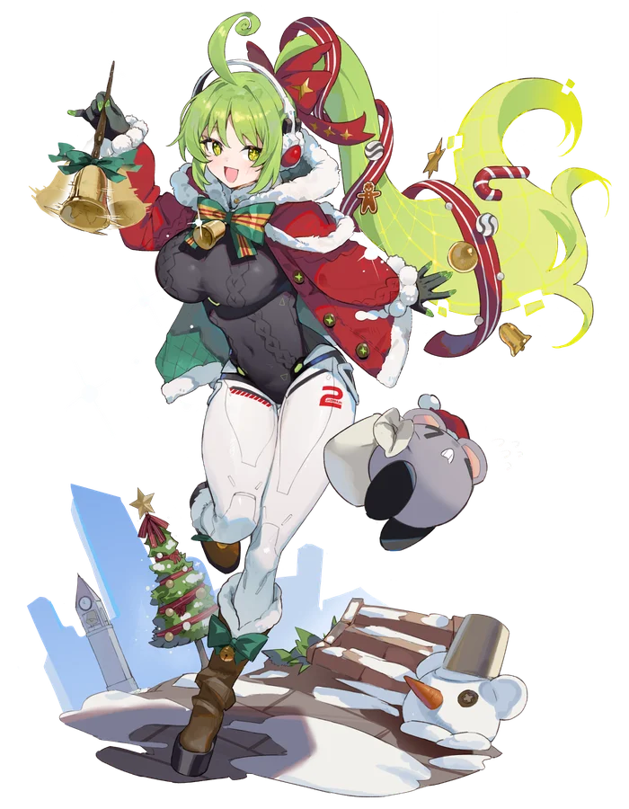
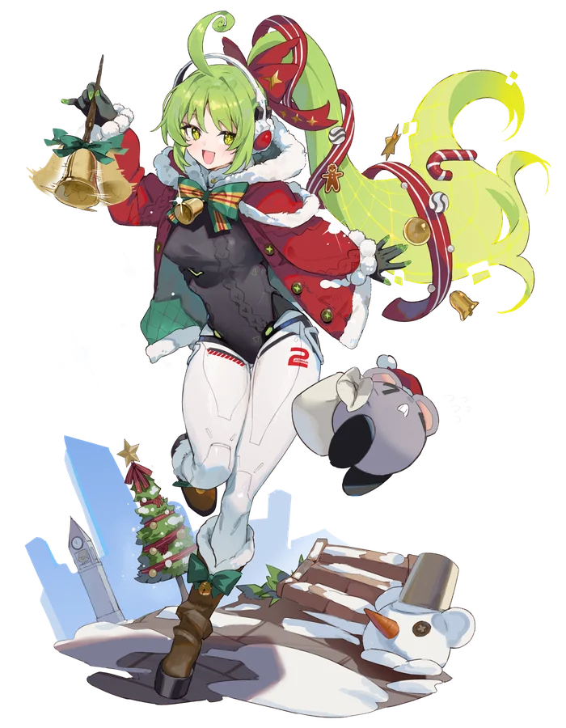
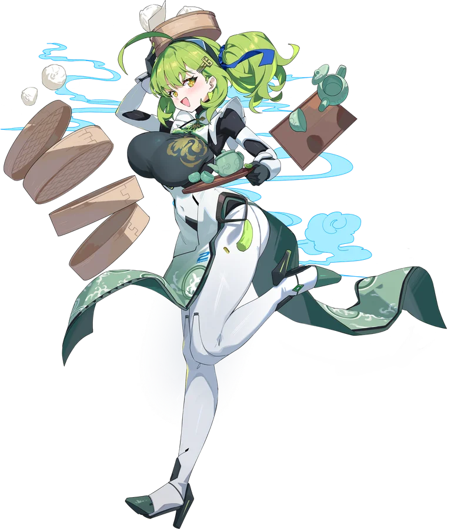
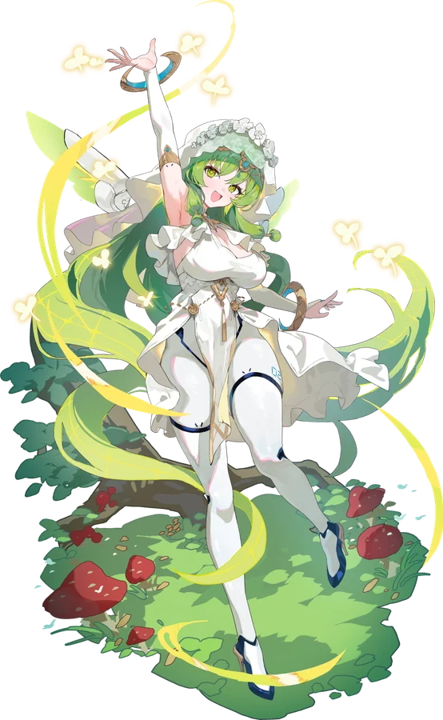
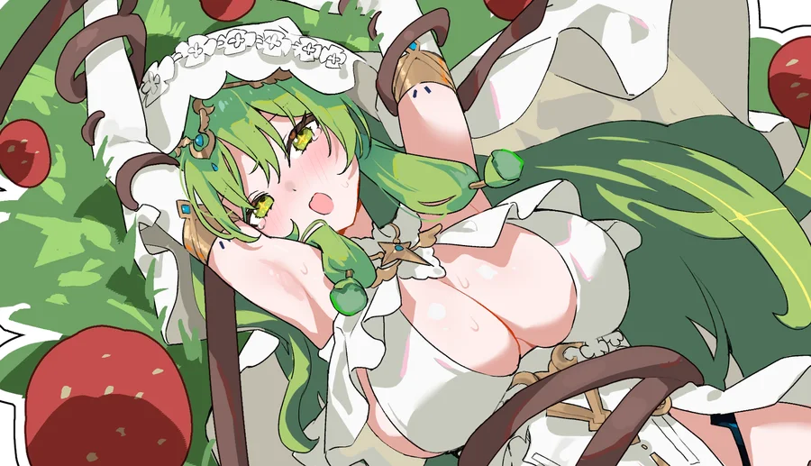

# 茉莉（家政机器人）
> 分类：角色 · 编号 117 · 时期 第二期 · 女
> 来源：https://wiki.biligame.com/starengine/%E8%8C%89%E8%8E%89

蓝海晴在大学时期同好会一同制作的机器人，内部的系统是一个在“暗网”搞到的据说非常高质量的AI。茉莉在她们毕业后被同好会的另一个成员露佳·皮克西带去了拉姆齐生物科技的技术部门，在那里她变成了一个得力的助手。

## 战斗数值

| 攻击 | 防御 | 生命 |
| --- | --- | --- |
| 1 | 0 | 9 |

## 技能

### 主动技能：能量过载（冷却 4）

使用主动技能后，防御力-3，移动速度+3，持续1轮。

### 被动技能：移动充能

每累计13点移动点数，交替使自身攻击力永久+1、防御力永久+1。

**潜能激发**：使用主动技能后，若下次移动的点数大于等于10，本回合攻击力+2，反之防御力+2。

停留在疾行地块后，主动技能冷却时间-2。

## 基础资料

- 姓名：茉莉
- 英文名：Jasmine
- 日文名：ジャスミン
- 从属组织：拉姆齐生物科技
- 上线时间：202408021600
- 生日：8月12日
- 喜欢食物：无
- 初始骰子：3D打印机骰子
- 礼物：普通的饮料、小熊玩偶、水手服
- 徽章：阳炎、冰原

## PVE 特性

- 达到1星时攻击力+1、移动速度+1
- 达到2星时攻击力+2
- 达到3星时攻击力+1、移动速度+2

## 皮肤（共 6 套）

> 皮肤编号取自素材文件名；「默认」「羁绊皮肤」也是独立皮肤。

### 1. 默认（初始）

- 素材编号：117
- 立绘：
- 立绘（和谐版）：
- Q版立绘：
- 头像：
- Q版头像：
- 半身像（星币<20）：
- 半身像（星币≥20）：

### 2. 羁绊皮肤（羁绊解锁）

- 素材编号：117_Max
- 立绘：
- 立绘（和谐版）：
- Q版立绘：
- 头像：
- Q版头像：
- 半身像（星币<20）：
- 半身像（星币≥20）：

### 3. 节日盛装（紫品质）

- 素材编号：117_01
- 立绘：
- 立绘（和谐版）：
- Q版立绘：
- 头像：
- Q版头像：
- 半身像（星币<20）：
- 半身像（星币≥20）：

**皮肤故事**：“呃，还有几分钟就过节了，但完全没有实感啊。”露佳伸了个懒腰。

“不过还要加班就很真实。”露佳下意识的吐槽道。

“马上就结束了。海晴他们说是半小时前就到我家了。”

想到这里露佳已经迫不及待想回家了。

“茉莉跑哪里去了？”露佳把杯子放下，准备用通信装置定位一下茉莉的位置。

就在此时，突然办公室的灯全部熄灭，露佳陷入了一片黑暗中。

“唉？停电？不对啊？这楼从来没停过电啊？”露佳在黑暗中拿起通信器准备紧急呼叫茉莉。

“啪嗒！”不远的地方传来了一声诡异的响声。

“什..什么东西！”只见一道绿光缓缓靠近露佳。

“咚咚！哒哒哒！！！”突然一张大脸凑到了露佳的脸上。

“啊啊啊啊啊啊啊啊！！！”露佳吓得坐在了地上。

此时灯光又亮了起来，茉莉正穿着穿着充满节日气氛的服装站在露佳的脸前。

“啊啊~露佳露佳~茉莉好看吗？”茉莉瞪着大眼睛看着坐在地上的露佳，她眼里满是想要被表扬的渴望。

“噗..哈哈哈哈哈，真是的…”露佳看见打扮成这样的茉莉突然笑出了声。

“好看，很有节日气氛。”露佳说道。

“嘿嘿，专门为你准备的。”茉莉高兴地使劲晃动手里的铃铛，并且用脸颊蹭着露佳的额头。

“嗯，谢谢。节日快乐。”露佳摸着茉莉的头说道。

### 4. 冲浪海岸（蓝品质）

- 素材编号：117_02
- 立绘：
- 立绘（和谐版）：
- Q版立绘：
- 头像：
- Q版头像：
- 半身像（星币<20）：
- 半身像（星币≥20）：

**皮肤故事**：“防晒霜、防水袋、毛毯……”

露佳检查着去海边的装备，旁边的茉莉则在帮她整理物品。

“呃，这不是玲玲的冲浪板么，怎么还在这里？”露佳看到仓库里的冲浪板发出了疑问。

“冲浪板？”茉莉突然来了兴趣，眼睛亮了起来。

“就是用这个板子，可以在海上利用海浪漂浮滑行。”

“我要玩！我要玩！”茉莉吵闹起来。

“你都没学过基本的知识，万一掉海里了我可救不起来你。”露佳否定了茉莉的想法，继续收拾东西。

“好了！学会了！”茉莉开启了网络下载模式，用了不到10秒的时间搜索完了网上所有的冲浪课程。

“呃，你这临时下载下来的有什么用啊。算了，反正明天玲玲也要去，让她教教你好了。就算你掉海里，那怪力女也能把你捞起来。”

“好耶！玲玲教我！我一定会很快学会的！”

茉莉像只快乐的小狗一样开心地手舞足蹈。

### 5. 后厨能手（紫品质）

- 素材编号：117_03
- 立绘：
- 立绘（和谐版）：
- Q版立绘：
- 头像：
- Q版头像：
- 半身像（星币<20）：
- 半身像（星币≥20）：

**皮肤故事**：每隔几个月，凰区的社区活动会有几天是美食一条街。

各种各样的传统小吃在这几天里集中出现在大街小巷，为本就热闹的街区带来更多的人气。

茉莉作为住在附近社区的一员，当然也会作为志愿者加入到这个由社区共同举办的活动中。

不过，因为茉莉毛手毛脚熊孩子的属性深得人心，大家只能让她做一些招揽顾客的工作。

除非真的忙不过来，才会被允许让茉莉去后厨帮忙。

每当这个时候，你就会看见一个身手敏捷的绿油油的家伙在人群中来回穿梭，帮厨房忙前忙后。

充满元气的她总能快速地把厨师需要的东西和客人的点餐送达。

至于中途掉落的某些材料和餐食呢？你既然已经让茉莉帮忙了，还介意这些琐碎的事情吗？

### 6. 钢羽森姬（彩品质）

- 素材编号：117_04
- 立绘：
- 立绘（和谐版）：
- Q版立绘：
- 头像：
- 半身像（星币<20）：
- 半身像（星币≥20）：

**皮肤故事**：“茉莉，你听懂了吗？”蓝海晴叮嘱道。

 茉莉正仔细打量着自己的穿着，“嗯？这是什么形态？”

 “海晴海晴！我怎么会有翅膀啊？！”茉莉好奇地扭头看着自己的小翅膀，还能自己控制着扑棱一下。

 蓝海晴皱了皱眉头，她感觉茉莉是没听懂自己刚才的话，不过也无所谓了，毕竟茉莉就是这样的孩子。

 “你在这个故事里扮演的是大妖精——一种古代遗留下来的超级科技。”蓝海晴又细心解释了一遍。

 “懂了懂了！我就要在故事里扮演这个妖精，用伪装救出那个孩子对吧？对了对了，还要尽可能协助酒吧的姐姐！”茉莉叽里咕噜地突然说了一堆。

 蓝海晴笑了笑，这不是记得挺好的吗？

## 表情（共 17 个）

| # | 名称 | 品质 | 获取方式 | 图片 |
| --- | --- | --- | --- | --- |
| 1 | 表情1 |  |  |  |
| 2 | 表情2 |  |  |  |
| 3 | 表情3 |  |  |  |
| 4 | 表情4 |  |  |  |
| 5 | 表情5 |  |  |  |
| 6 | 表情6 |  |  |  |
| 7 | 表情7 |  |  |  |
| 8 | 表情8 |  |  |  |
| 9 | 表情9 |  |  |  |
| 10 | 表情10 |  |  |  |
| 11 | 表情11 |  |  |  |
| 12 | 表情12 |  |  |  |
| 13 | 表情13 |  |  |  |
| 14 | 表情14 |  |  |  |
| 15 | 表情15 |  |  |  |
| 16 | 表情16 |  |  |  |
| 17 | 表情17 |  |  |  |

## 装扮

官方 wiki 未提供该角色的 /获取 页，头像、名片、卡牌、骰子清单暂缺。

## 人物传记

茉莉会经常把璐璐当做有害垃圾清理，虽然遭到了璐璐多次抗议，但还是乐此不疲。

## 画廊其他素材

- 起始点：
- 像素头像：
- Lv4羁绊等级奖励：
- 头像鼠：
- Lv5羁绊等级奖励：
- 缔结契约名片奖励：
- 节日盛装皮肤名片：
- 冲浪海岸皮肤名片：
- 后厨能手皮肤名片：
