# 梅加斯（机械超人）
> 分类：角色 · 编号 122 · 时期 第三期 · 女
> 来源：https://wiki.biligame.com/starengine/%E6%A2%85%E5%8A%A0%E6%96%AF

库拉拉的好友兼搭档，“虹之镜”酒吧的服务生。“退魔之夜”和“天王落”事件的亲历者。格斗游戏大师，因其精湛的操作和机械方面的造诣游戏界称号“机械师”。恋小时候就认识梅加斯，算是恋的对手和老师。“天王落”事件引发了公司之间的激烈战斗，梅加斯也在事件中遭受了重大的精神挫折，与星魅琉华一样淡出了人们的视野。

## 战斗数值

| 攻击 | 防御 | 生命 |
| --- | --- | --- |
| 0 | 2 | 9 |

## 技能

### 主动技能：轨道轰炸（冷却 3）

丢弃所有手牌，每丢弃2张，对随机敌方角色造成1次2点伤害。

**PVE**：丢弃所有卡牌，每丢弃2张，对6格内的随机怪物造成1次3点伤害的【轨道轰炸】。丢弃的卡牌中每有3点费用，【轨道轰炸】便会增加1点伤害。

### 被动技能：物资补充

回合结束时，如果自身手牌少于6张，获得1张卡牌。

**潜能激发**：主动技能可选择传送到3格范围内的地块并释放。使用主动技能后，获得1张随机卡牌，如果主动技能丢弃的卡牌不少于6张，则改为获得1张轨道炮。使用轨道炮后，获得1张战斗卡牌，对目标及附近2格内的怪物造成该战斗卡牌费用的伤害并施加精准打击（受到【轨道轰炸】伤害+1）。

**技能细节**：【轨道轰炸】的次数满足：<math>次数=\left\lfloor\frac{手牌数}{2}\right\rfloor</math>；单次【轨道轰炸】的伤害满足：<math>单次伤害=\left\lceil3+\frac{手牌总费用}{3}\right\rceil</math>。
若全部击中在同一怪物上，那么总伤害满足：<math>总伤害=\left\lfloor\frac{手牌数}{2}\right\rfloor \times \left\lceil3+\frac{手牌总费用}{3}\right\rceil</math>

## 基础资料

- 姓名：梅加斯·威廉姆斯
- 英文名：Megas
- 日文名：メガス
- 从属组织：虹之镜酒吧
- 事件经历：退魔之夜,天王落
- 上线时间：202412201730
- 生日：1月23日
- 喜欢食物：菲力牛排
- 初始骰子：蓄电池骰子
- 礼物：智能手机、小熊玩偶、水手服
- 徽章：月光、熔岩

## PVE 特性

- 达到1星时防御力+1
- 初始星币+6
- 达到3星时攻击力+1、防御力+1、移动速度+1

## 皮肤（共 4 套）

> 皮肤编号取自素材文件名；「默认」「羁绊皮肤」也是独立皮肤。

### 1. 默认（初始）

- 素材编号：122
- 立绘：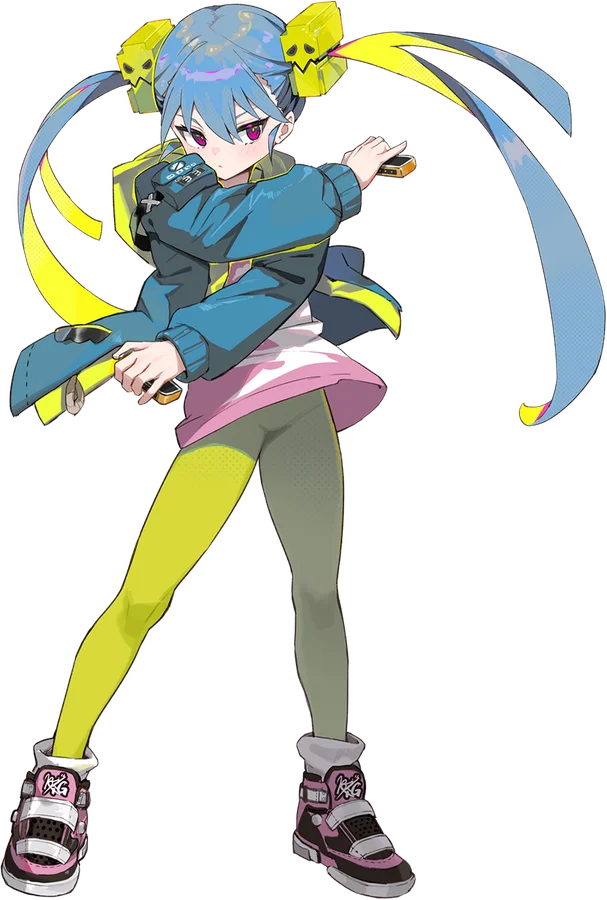
- Q版立绘：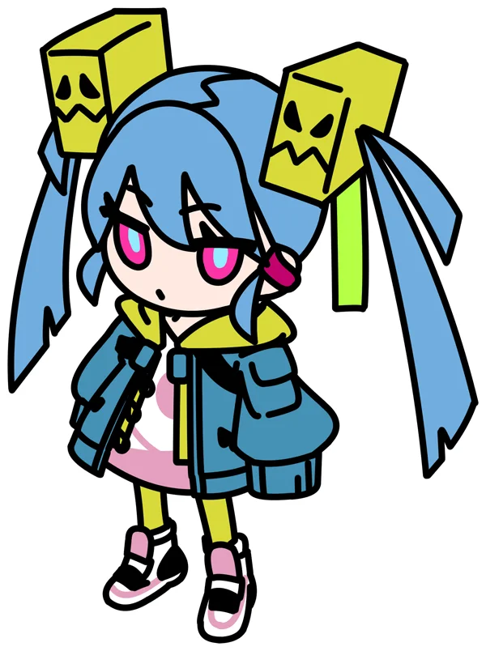
- 头像：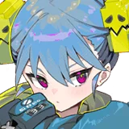
- Q版头像：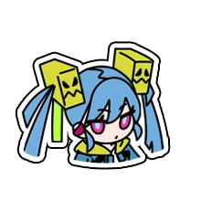
- 半身像（星币<20）：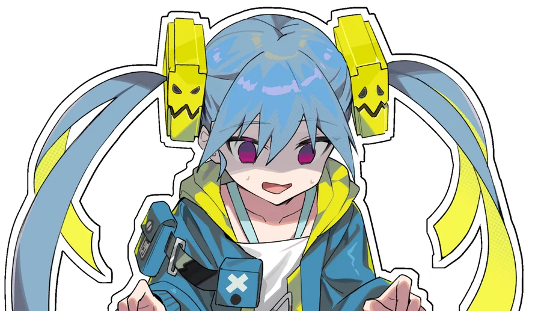
- 半身像（星币≥20）：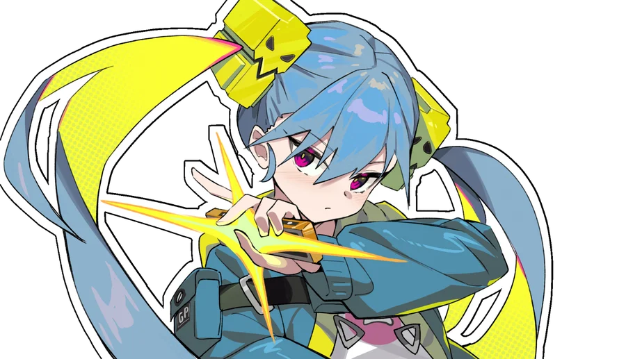

### 2. 羁绊皮肤（羁绊解锁）

- 素材编号：122_Max
- 立绘：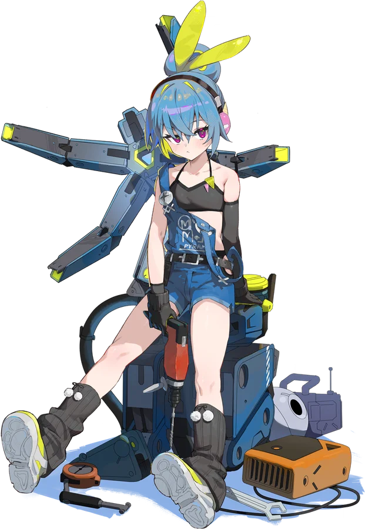
- Q版立绘：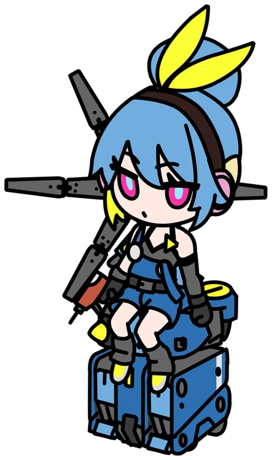
- 头像：
- Q版头像：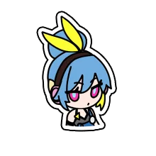
- 半身像（星币<20）：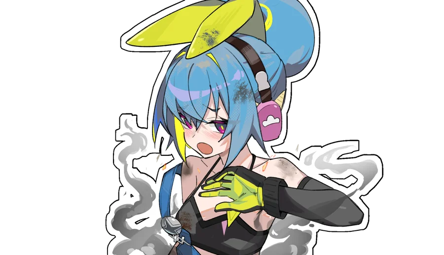
- 半身像（星币≥20）：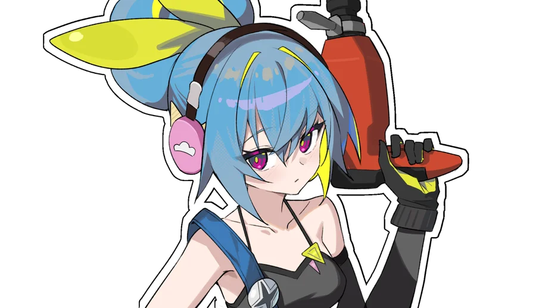

### 3. 海滨救援（蓝品质）

- 素材编号：122_01
- 立绘：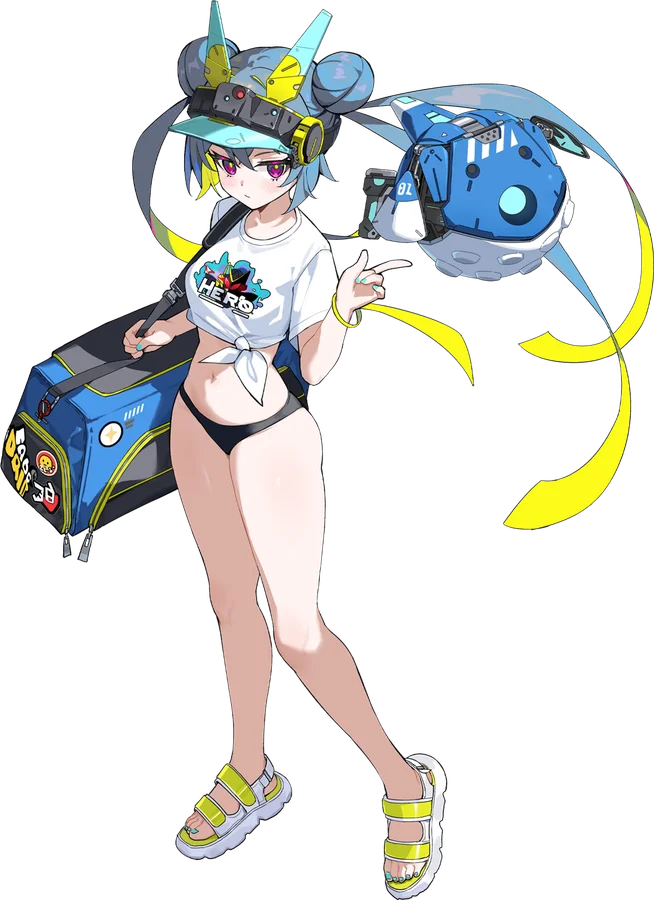
- 立绘（和谐版）：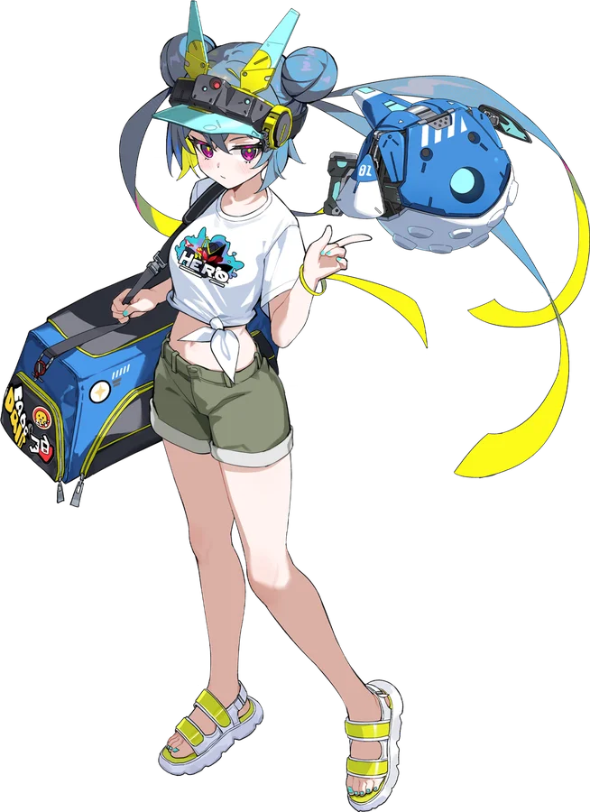
- Q版立绘：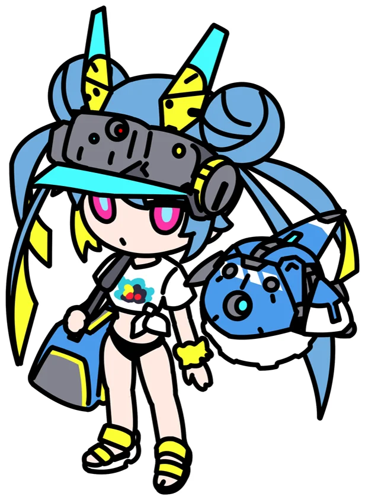
- 头像：
- Q版头像：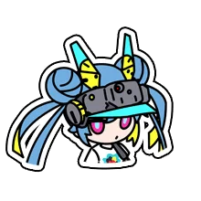
- 半身像（星币<20）：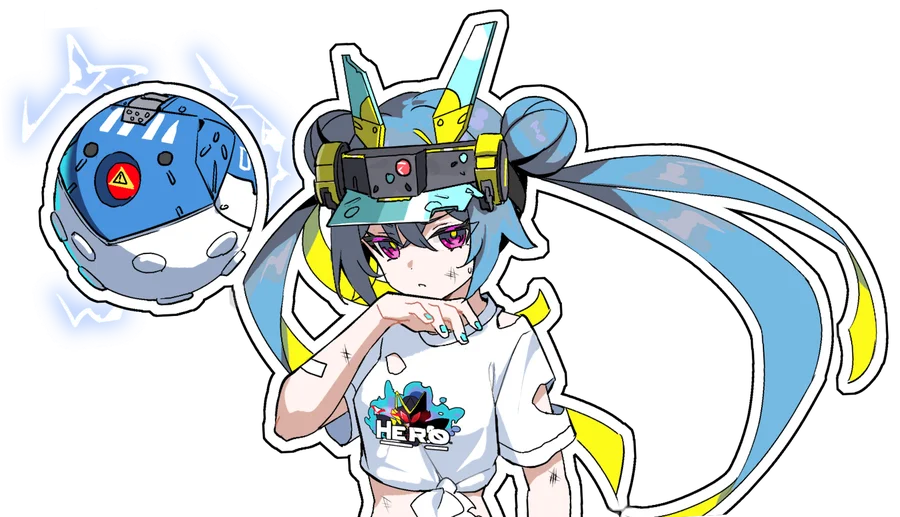
- 半身像（星币≥20）：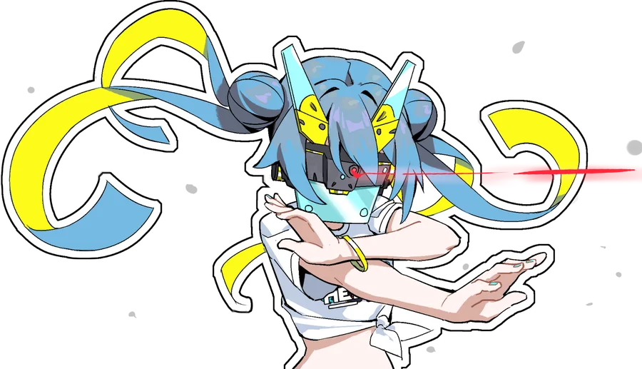

**皮肤故事**：每到这个季节，梅加斯的兼职就多到难以置信。

毕竟手艺又好又快又可靠的机械修理师在这方圆几十里地都没几个人。

更何况这个时候的海边游艇啊，机械动力帆船啊，摩托艇什么的使用量巨大，当然出毛病的概率也大大增加。

梅加斯极其喜欢捣鼓这些，且她修理只收取最低的费用，甚至有一些棘手的她都没遇到过的毛病，修好都是不需要收取报酬的，毕竟对于她而言这都是宝贵的经验。

往往这个时候，你来到海岸，大概率可以看到一个带着小帮手机器人，背着一个大背包的娇小身影，往返在各个帆船、快艇出租屋之间。

梅加斯很喜欢这种又能在海边欣赏风景，又能帮助到她人的感觉。

谁叫她是“机械师”呢。

### 4. 魔枪表演（橙品质）

- 素材编号：122_02
- 立绘：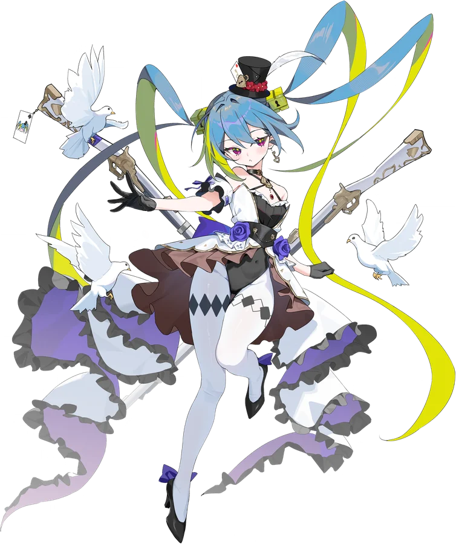
- Q版立绘：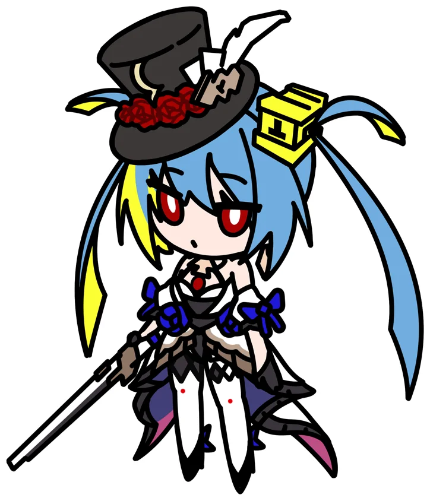
- 头像：
- Q版头像：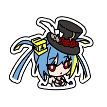
- 半身像（星币<20）：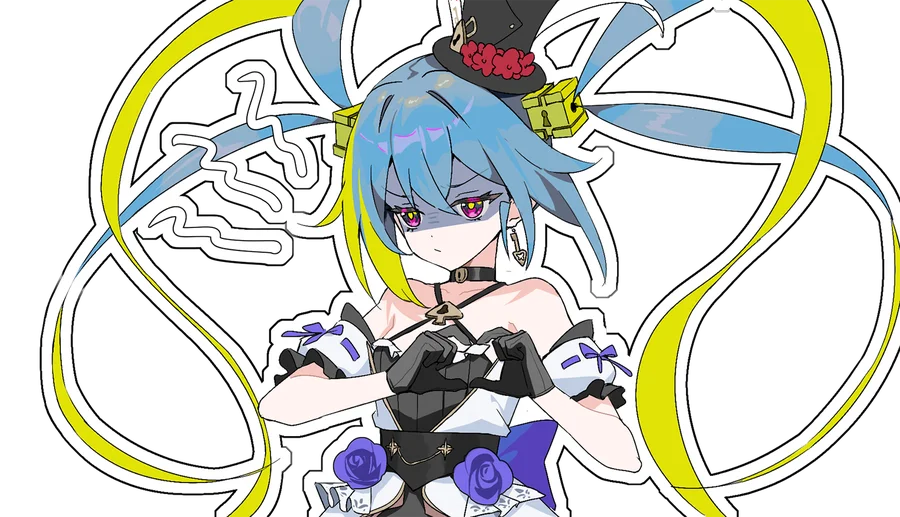
- 半身像（星币≥20）：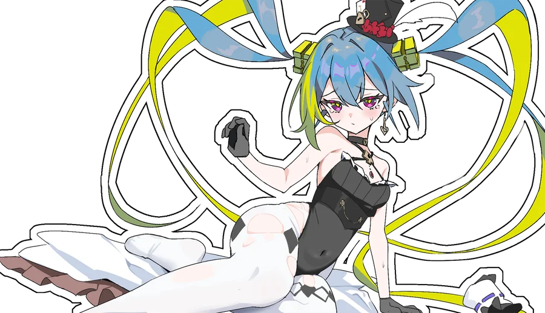

**皮肤故事**：“所以你最近在车库噼里啪啦地在干嘛？”摩西喝着库拉拉刚实验新饮料留下的残渣，看着穿着华丽礼服的梅加斯问道。

“徒弟搞了个什么小魔术剧团，我也有个表演，所以在抓紧练习。”梅加斯若无其事地摘下手套，坐在吧台上。

库拉拉递过来一杯果汁，缓缓抬头道：“你注意点，那玩意要是摔坏了可有人心疼了。”

“放心好了，我不会上来就用那么贵重的东西练习。我之前拆了两根重量差不多、被南希露用坏的拖把杆。”梅加斯朝摩西看了一眼，妩媚地笑了笑。

“什么玩意？什么魔术剧团？啥拖把？”摩西只觉得奇怪，皱着眉头听他们说话，一脸迷惑。

梅加斯两口把杯子里的果汁喝干，转身又准备去车库。

摩西更摸不着头脑了，但他隐约觉得有什么不好的事要发生。

“哦对了，梅加斯让我转告你，你那两把宝贝被她借走了。她说这是你平时老调侃她的代价，不过她说用完会还你。”

“宝贝？啥……啊啊啊啊啊啊啊啊！！！！她她她！！”

摩西此时已经明白是怎么回事了。唉，真惨。

## 表情（共 8 个）

| # | 名称 | 品质 | 获取方式 | 图片 |
| --- | --- | --- | --- | --- |
| 1 | 表情1 |  |  |  |
| 2 | 表情2 |  |  |  |
| 3 | 表情3 |  |  |  |
| 4 | 表情4 |  |  |  |
| 5 | 表情5 |  |  |  |
| 6 | 表情6 |  |  | 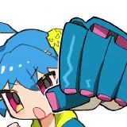 |
| 7 | 表情7 |  |  |  |
| 8 | 表情8 |  |  |  |

## 装扮

官方 wiki 未提供该角色的 /获取 页，头像、名片、卡牌、骰子清单暂缺。

## 人物传记

和琉华住在一起，偶尔会出现在酒吧。

## 画廊其他素材

- 起始点：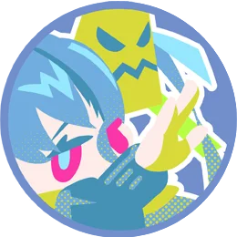
- 像素头像：
- Lv4羁绊等级奖励：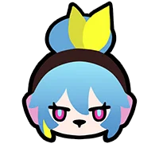
- 头像鼠：
- Lv5羁绊等级奖励：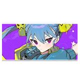
- 缔结契约名片奖励：
- 海滨救援皮肤名片：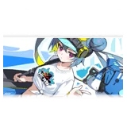
- 魔枪表演皮肤名片：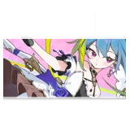
