# 超绝最可爱天使酱（超天酱）
> 分类：角色 · 编号 301 · 时期 联动 · 女
> 来源：https://wiki.biligame.com/starengine/%E8%B6%85%E7%BB%9D%E6%9C%80%E5%8F%AF%E7%88%B1%E5%A4%A9%E4%BD%BF%E9%85%B1

网络天使，糖糖开直播时的变装。装作性格乖巧的样子，动不动就会做出讨好阿宅们的行为。

## 战斗数值

| 攻击 | 防御 | 生命 |
| --- | --- | --- |
| 0 | 1 | 9 |

## 技能

### 主动技能：网络天使（冷却 3）

获得2星币，每使得一个角色或怪物成为【粉丝】，额外获得1星币，一次技能最多获得7星币。如果【粉丝】数量大于等于3个，则额外回复3点生命值。

**PVE**：获得1星币，每使得一个怪物成为【粉丝】，额外获得1星币，一次技能最多获得7星币。如果【粉丝】数量大于等于3个，则额外回复获得3点生命值。

### 被动技能：小天使请安

攻击超天酱和被超天酱战斗攻击的角色和怪物会被施加【粉丝】状态。当角色拥有【粉丝】且攻击超天酱时，攻击力-1。超天酱被击倒时，移除场上所有【粉丝】状态。

**PVE**：攻击超天酱和被超天酱攻击的怪物会被施加【粉丝】状态。当怪物拥有【粉丝】且攻击超天酱时，攻击力-1。

### 被动技能：一心同体

与糖糖组队的时候，会有神奇的事情发生。

**潜能激发**：使用主动技能最多获得的星币增加至10。

使用主动技能时，如果粉丝数量大于等于9个，则使场上所有粉丝攻击力永久-1(无法叠加)，并使其他友方角色获得3星币。

**技能细节**：超天酱使用主动技能时，会将游戏背景音乐切换为《[https://www.bilibili.com/video/BV1gU4y187xA INTERNET OVERDOSE]》，持续1轮。

“会有神奇的事情发生”指的是超天酱和糖糖会共享部分被动技能效果。具体内容包括：攻击糖糖和被糖糖攻击的怪物也会被施加【粉丝】状态。当怪物拥有【粉丝】且攻击糖糖时，攻击力-1。超天酱受到伤害时，糖糖获得1层【爱】。

## 基础资料

- 姓名：超绝最可爱天使酱
- 英文名：OMGKawaiiAngel
- 日文名：超絶最かわてんしちゃん
- 从属组织：主播女孩重度依赖
- 上线时间：202411291730
- 生日：7月7日
- 喜欢食物：未知
- 初始骰子：/
- 礼物：/、/、/
- 徽章：阳炎、/

## PVE 特性

- 达到1星时立刻获得10星币
- 初始星币+6
- 达到3星时攻击力+1、防御力+1、移动速度+1

## 皮肤（共 2 套）

> 皮肤编号取自素材文件名；「默认」「羁绊皮肤」也是独立皮肤。

### 1. 默认（初始）

- 素材编号：301
- 立绘：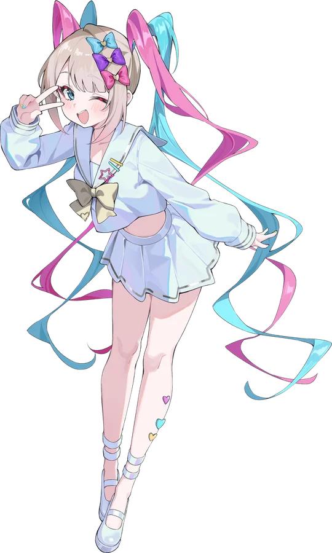
- Q版立绘：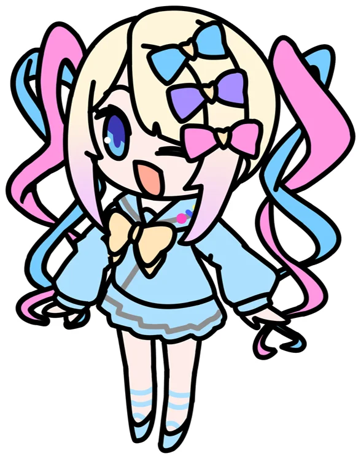
- 头像：
- Q版头像：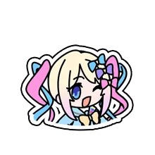
- 半身像（星币<20）：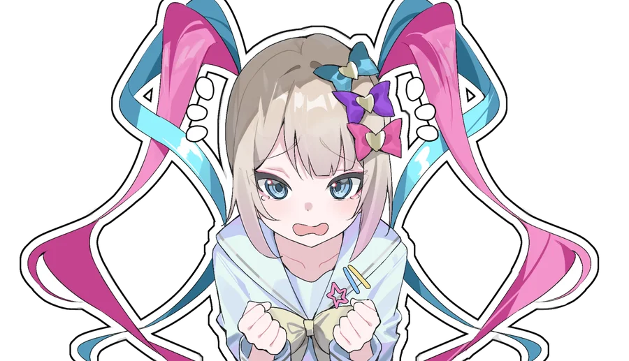
- 半身像（星币≥20）：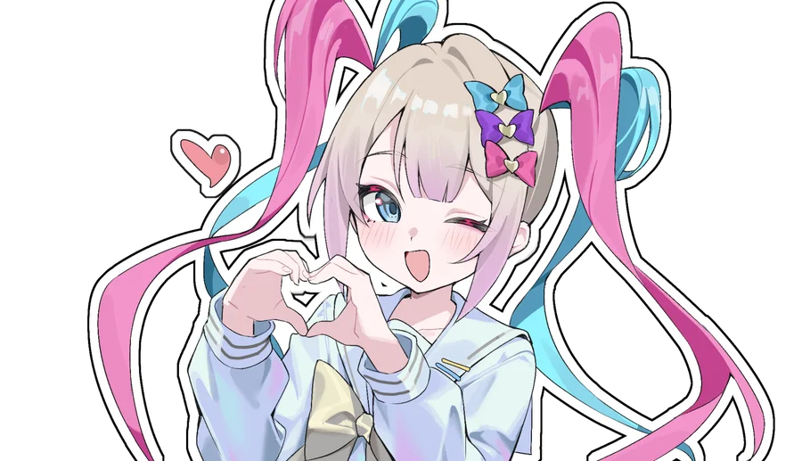

### 2. 网络主播（橙品质）

- 素材编号：301_01
- 立绘：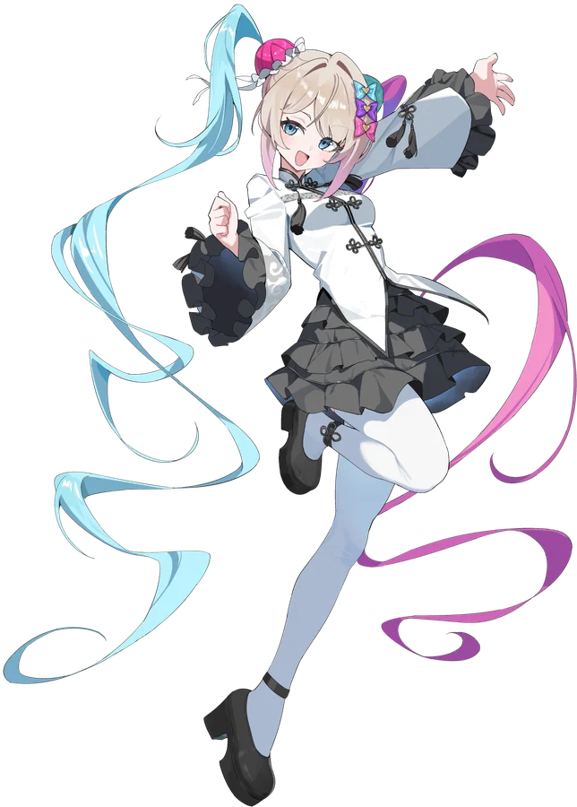
- Q版立绘：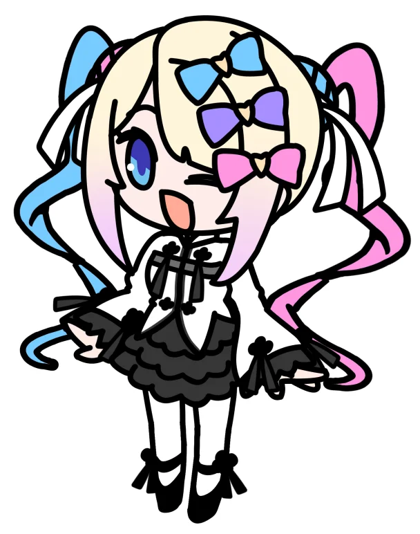
- 头像：
- Q版头像：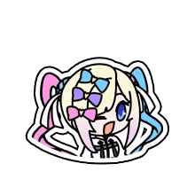
- 半身像（星币<20）：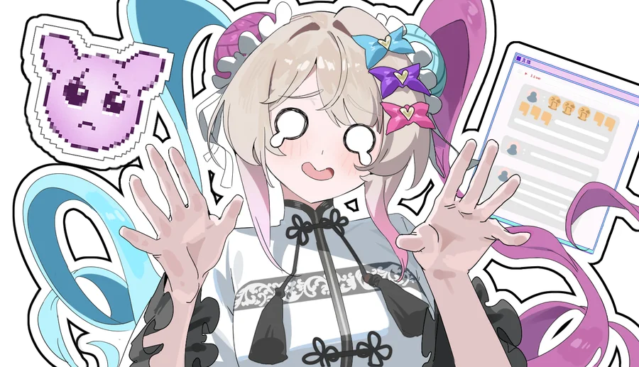
- 半身像（星币≥20）：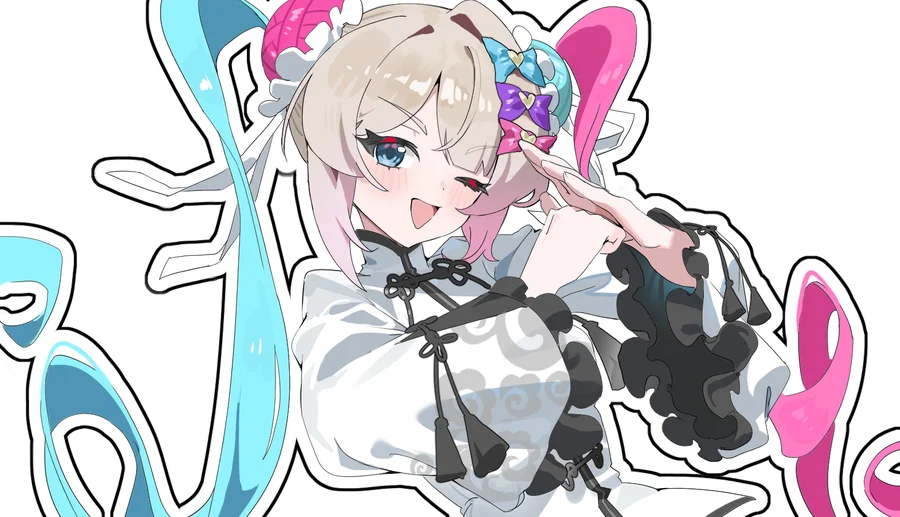

## 表情（共 8 个）

| # | 名称 | 品质 | 获取方式 | 图片 |
| --- | --- | --- | --- | --- |
| 1 | 表情1 |  |  |  |
| 2 | 表情2 |  |  |  |
| 3 | 表情3 |  |  | 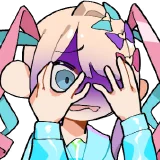 |
| 4 | 表情4 |  |  | 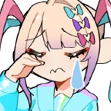 |
| 5 | 表情5 |  |  | 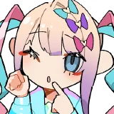 |
| 6 | 表情6 |  |  | 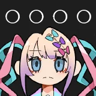 |
| 7 | 表情7 |  |  |  |
| 8 | 表情8 |  |  | 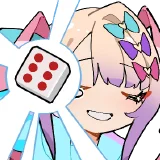 |

## 装扮

官方 wiki 未提供该角色的 /获取 页，头像、名片、卡牌、骰子清单暂缺。

## 画廊其他素材

- 起始点：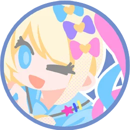
- 像素头像：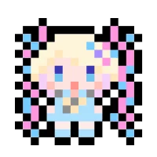
- 网络主播皮肤名片：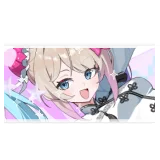
