# 主播女孩（糖糖）
> 分类：角色 · 编号 302 · 时期 联动 · 女
> 来源：https://wiki.biligame.com/starengine/%E4%B8%BB%E6%92%AD%E5%A5%B3%E5%AD%A9

看上去老实文静，实际性格任性，容易得意忘形，迫切的想要得到他人的认可，性格恶劣。

## 战斗数值

| 攻击 | 防御 | 生命 |
| --- | --- | --- |
| 1 | 4 | 9 |

## 技能

### 主动技能：感情过量摄入（冷却 3）

回复当前爱（每层使自身攻击力+1、防御力-1）层数的生命值，获得爱（每层使自身攻击力+1、防御力-1）层数的移动速度，持续1回合。回合结束时扣除4层爱（每层使自身攻击力+1、防御力-1）。

### 被动技能：无法承受的爱

受到伤害时，获得1层爱（每层使自身攻击力+1、防御力-1），最多叠加4层。游戏开始时，爱（每层使自身攻击力+1、防御力-1）为2层。

### 被动技能：一心同体

与超天酱组队的时候，会有神奇的事情发生。

**潜能激发**：使用主动技能时，如果有4层及以上的爱（每层使自身攻击力+1、防御力-1），使自身最大生命值永久+1、爱（每层使自身攻击力+1、防御力-1）的层数上限+1。

**技能细节**：“会有神奇的事情发生”指的是超天酱和糖糖会共享部分被动技能效果。具体内容包括：
1、攻击糖糖和被糖糖攻击的怪物也会被施加【粉丝】状态。
2、当怪物拥有【粉丝】且攻击糖糖时，攻击力-1。
3、超天酱受到伤害时，糖糖获得1层爱（每层使自身攻击力+1、防御力-1）。

## 基础资料

- 姓名：糖糖
- 英文名：Needy Girl
- 日文名：ニーディーガール
- 从属组织：主播女孩重度依赖
- 上线时间：202411291730
- 生日：5月5日
- 喜欢食物：未知
- 初始骰子：/
- 礼物：/、/、/
- 徽章：月光、/

## PVE 特性

- 达到1星时攻击力+1
- 达到2星时攻击力+2
- 达到3星时攻击力+1、移动速度+2

## 皮肤（共 2 套）

> 皮肤编号取自素材文件名；「默认」「羁绊皮肤」也是独立皮肤。

### 1. 默认（初始）

- 素材编号：302
- 立绘：
- Q版立绘：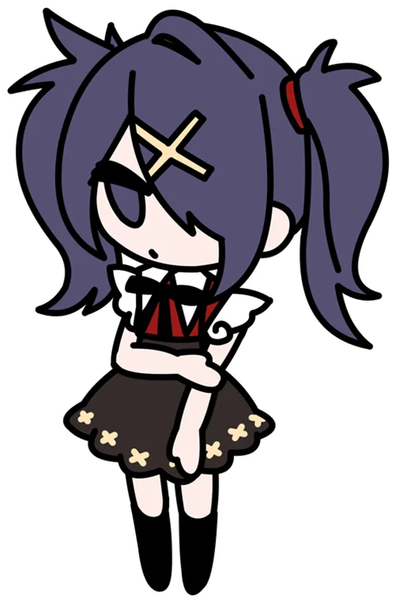
- 头像：
- Q版头像：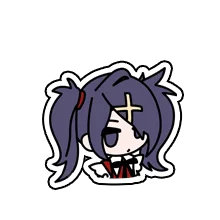
- 半身像（星币<20）：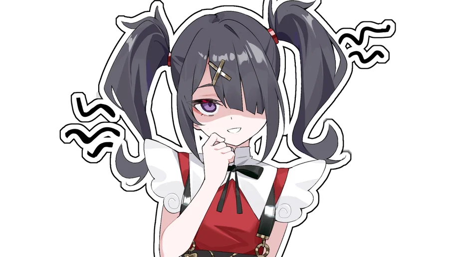
- 半身像（星币≥20）：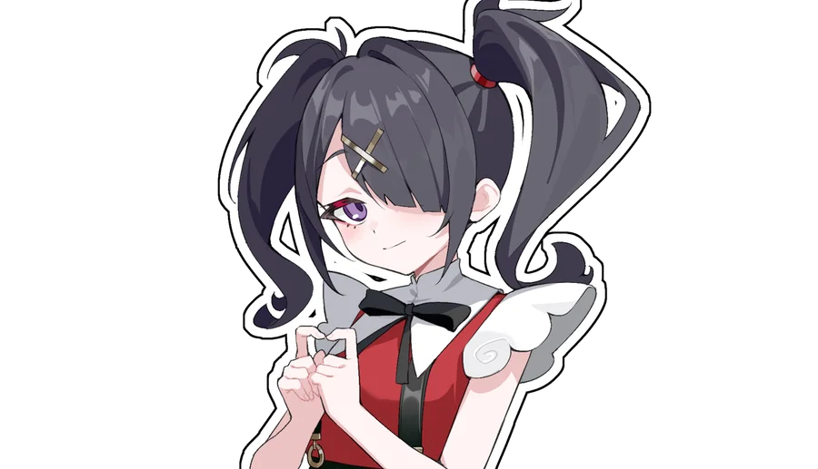

### 2. 休闲日常（橙品质）

- 素材编号：302_01
- 立绘：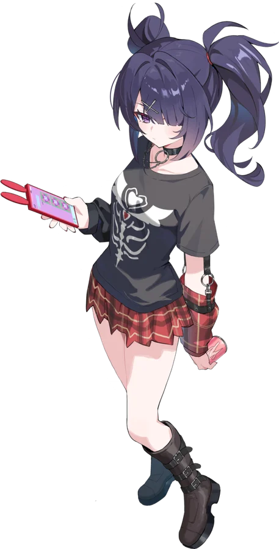
- Q版立绘：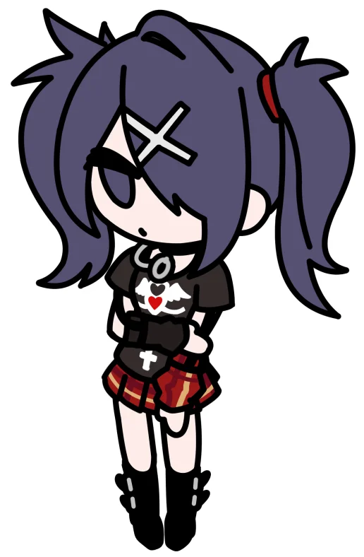
- 头像：
- Q版头像：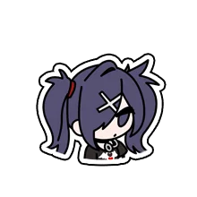
- 半身像（星币<20）：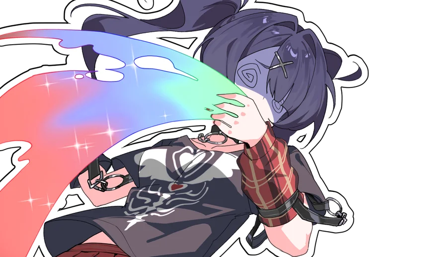
- 半身像（星币≥20）：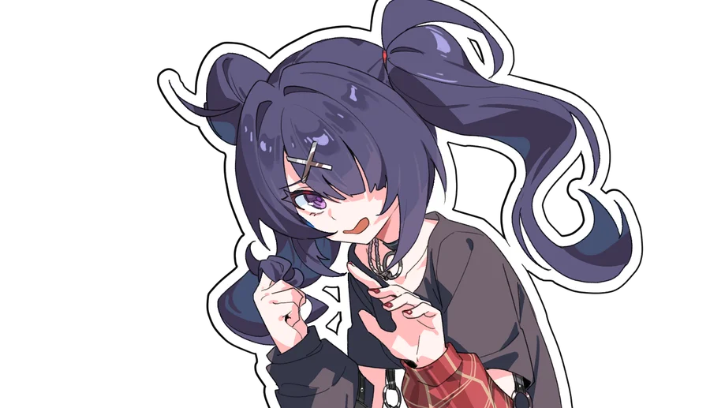

## 表情（共 8 个）

| # | 名称 | 品质 | 获取方式 | 图片 |
| --- | --- | --- | --- | --- |
| 1 | 表情1 |  |  | 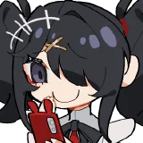 |
| 2 | 表情2 |  |  |  |
| 3 | 表情3 |  |  |  |
| 4 | 表情4 |  |  | 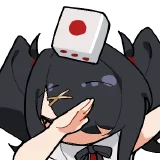 |
| 5 | 表情5 |  |  |  |
| 6 | 表情6 |  |  |  |
| 7 | 表情7 |  |  |  |
| 8 | 表情8 |  |  | 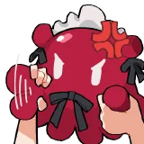 |

## 装扮

官方 wiki 未提供该角色的 /获取 页，头像、名片、卡牌、骰子清单暂缺。

## 画廊其他素材

- 起始点：
- 像素头像：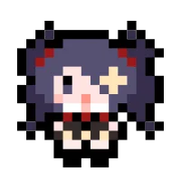
- 休闲日常皮肤名片：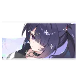
