# 筹码
> 分类：图鉴
> 来源：https://wiki.biligame.com/starengine/%E7%AD%B9%E7%A0%81

## 筹码机制

在合作挑战模式中，玩家可以通过获得星星、从筹码商店中购买、完成地图任务来获得筹码。特别的，已经潜能激发的米米（p215.md）每累计获得25张卡牌，获得1个筹码。 
玩家每次通过获得星星或在筹码商店中购买筹码，都将会从随机刷新的3个不同的筹码中进行选择。其中，第一个筹码的稀有度将固定根据玩家当前的星星数生成， 
其余筹码则按照对应的刷新概率随机生成，如下表：

| 星星数 | 蓝 | 紫 | 金 | 固定稀有度 | 概率分类 |
| --- | --- | --- | --- | --- | --- |
| 0-1星 | 60% | 37% | 3% | 蓝 | 1级概率 |
| 2星 | 40% | 45% | 15% | 紫 | 2级概率 |
| 3星 | 25% | 50% | 25% | 金 | 3级概率 |

完成地图任务获得筹码时，第一个格子没有固定稀有度。有三种稀有度筹码任务，分别对应上表的1级概率、2级概率、3级概率（可以鼠标悬浮来确认具体概率），如下表：

| 地图 | 任务 | 概率 | 任务 | 概率 | 任务 | 概率 | 任务 | 概率 |
| --- | --- | --- | --- | --- | --- | --- | --- | --- |
| 星趴·梦想号（p1217.md） | 击倒海盗鲨鱼4/4 | 1级概率 | 击倒海盗精锐2/2 | 2级概率 | 击倒海盗鲨鱼9/9 | 3级概率 |  |  |
| 御魂庆典（p1216.md） | 击倒冰冷蓝灵4/4 | 1级概率 | 击倒长戟灵体或刀剑灵体2/2 | 2级概率 | 击倒长戟灵体或刀剑灵体5/5 | 3级概率 |  |  |
| 水乡古镇（p646.md） | 击倒爆竹呱呱4/4 | 1级概率 | 击倒爆竹呱呱9/9 | 2级概率 | 击倒氛围机器人或机械蛇龙4/4 | 3级概率 |  |  |
| 魔法学院（p645.md）(代理院长) | 击倒魔法茶壶3/3 | 1级概率 | 击倒果冻护卫2/2 | 2级概率 | 击倒魔法茶壶8/8 | 3级概率 |  |  |
| 魔法学院（p645.md）(学院安全官) | 击倒果冻护卫2/2 | 2级概率 | 击倒果冻护卫4/4 | 2级概率 | 击倒果冻巫师3/3 | 3级概率 |  |  |
| 龙宫游乐园（p3537.md）(天川苍鲤) | 击倒蟹布罗6/6 | 2级概率 | 击倒大噪门和练家子 | 2级概率 | 击倒金小鱼3/3 | 2级概率 | 击倒金小鱼6/6 | 3级概率 |
| 龙宫游乐园（p3537.md）(天川真梦梓) | 击倒虾布罗2/2 | 2级概率 | 击倒虾布罗4/4 | 3级概率 |  |  |  |  |
| 幽魂暗巷（p3821.md） | 击倒科学怪猿3/3 | 2级概率 | 击倒人工生命体-天崩 | 2级概率 | 击倒人工生命体-噩梦 | 2级概率 | 击倒圆锯猴助手3/3 | 3级概率 |
| 园林中庭（p4817.md）(鸳鸯意识) | 击倒迎宾燕3/3 | 1级概率 | 击倒铜盞仙鹤2/2 | 2级概率 | 击倒铜盞鸳鸯2/2 | 2级概率 | 击败铜盞鸳鸯4/4 | 3级概率 |
| 园林中庭（p4817.md）(孔雀意识) | 击倒铜盞孔雀1/1 | 2级概率 | 击败铜盞孔雀2/2 | 3级概率 |  |  |  |  |
| 园林中庭（p4817.md）(失控凤凰) | 击倒铜盞孔雀1/1 | 3级概率 | 击倒铜盞鸳鸯2/2 | 3级概率 |  |  |  |  |
| 异变图书馆（p7133.md） | 击倒魔法茶壶3/3 | 1级概率 | 击倒罪恶茶壶2/2 | 2级概率 | 击倒大盗2/2 | 2级概率 | 击倒看守3/3 | 3级概率 |
| 森秋幻境（p9505.md） | 击倒闹钟猫头鹰3/3 | 1级概率 | 击倒采集小熊3/3 | 2级概率 | 击倒玩具恐龙2/2 | 2级概率 | 建造8个建筑 | 3级概率 |

在普通难度下，升星，商店和任务的筹码刷新概率将额外受到难度修正影响，如下表：

| 星星数 | 蓝 | 紫 | 金 | 固定稀有度 |
| --- | --- | --- | --- | --- |
| 0-1星 | 60% | 30% | 10% | 蓝 |
| 2星 | 40% | 40% | 20% | 紫 |
| 3星 | 20% | 50% | 30% | 金 |

筹码刷新机制：合作挑战模式中手动刷新筹码时，优先刷出上次未出现的筹码。 
手动刷新机制中设有非连续重复规则：同一筹码不会在相邻两次刷新中出现，但不限制隔次出现。 
筹码分为通用系筹码、星光系筹码、治愈系筹码、标记系筹码、充能系筹码与地图专属筹码。 
其中，各流派的效果如下表：

| 流派 | 效果 |
| --- | --- |
| 星光 | 可以使玩家等量增加轮次奖励时获得的星币数 |
| 治愈 | 回合开始时恢复治愈层数的生命值，回合结束时层数减半 |
| 标记 | 被标记目标受到伤害+1，回合结束时层数-1 |
| 充能 | 涌动的能量，最多拥有15层 |

每名玩家在同一局游戏中只能选取四种流派中的两种，当玩家现有的筹码中已存在两种流派，则剩余流派的筹码将不会出现在接下来的筹码选择中。通用筹码与地图专属筹码的出现概率不会受到四种流派筹码影响。 
各地图的地图专属筹码请见下表，或可以跳转至有地图专属筹码的地图界面查看。

## 选择筹码推荐

选择筹码推荐是星引擎party（p580.md）于2025年11月21日加入的系统，其会根据玩家当前的分值与筹码自身的属性动态计算筹码商店内出现的筹码的推荐分，并通过特定方式表示对玩家的推荐程度。玩家可以在设置中决定是否开启选择筹码推荐功能。 
筹码最终的推荐分由五个值共同决定，分别为基础分(Base)、成长分(Growth)、角色分(Role)、标签分(Tag)与关键词分(Keyword)，计算公式如下： 基础分(Base)：筹码的基础分值，通常情况由筹码品质决定，部分筹码的基础分值存在特殊值，不遵循品质对应分值的原则，统一请见下表； 
成长分(Growth)：筹码在特定轮次前为玩家带来迅速成长能力的分值，统一为+50。当该筹码出现时的轮次小于等于成长分限制轮次时则加入公式运算； 
角色分(Role)：筹码适配于特定角色的分值，分为两档。当该筹码出现时，当前角色处于适配角色列表中则加入+100，处于普通适配角色列表中则加入+50； 
标签分(Tag)：筹码适配于角色职业的分值，统一为+40。当该筹码出现时当前角色为对应职业则加入公式运算，关于角色职业如何划定，将在后文介绍； 
关键词分(Keyword)：筹码筹码流派的分值，统一为+30。当该筹码出现时当前角色持有该流派筹码则加入公式运算。 
当筹码的推荐分大于等于50时，则筹码的左上方会弹出表示推荐，当筹码的推荐分大于等于100时，则筹码的左上方会弹出表示强烈推荐。 [math]\displaystyle{ RecScore = Base + Growth + Role + Tag + Keyword }[/math]

| 筹码 | 基础分 | 成长分轮次限制 | 适配角色 | 普通适配角色 | 筹码标签 | 关键词条 | 攻击分值 | 卡牌分值 | 辅助分值 | 生存分值 |
| --- | --- | --- | --- | --- | --- | --- | --- | --- | --- | --- |
|  | 10 | 0 |  |  | 攻击 |  | 15 | 0 | 0 | 0 |
|  | 20 | 0 |  |  | 攻击 |  | 20 | 0 | 0 | 0 |
|  | 60 | 0 |  |  | 攻击 |  | 30 | 0 | 0 | 0 |
|  | 10 | 0 |  |  | 通用 |  | 0 | 0 | 0 | 0 |
|  | 50 | 0 |  |  | 通用 |  | 0 | 0 | 0 | 0 |
|  | 70 | 0 |  |  | 通用 |  | 0 | 0 | 0 | 0 |
|  | 10 | 0 |  |  | 生存 |  | 0 | 0 | 0 | 0 |
|  | 20 | 0 |  |  | 生存 |  | 0 | 0 | 0 | 0 |
|  | 30 | 0 |  |  | 攻击, 生存 |  | 10 | 0 | 0 | 0 |
|  | 20 | 0 |  |  | 攻击, 生存 |  | 30 | 0 | 0 | 10 |
|  | 30 | 0 |  |  | 攻击, 生存 |  | 30 | 0 | 0 | 10 |
|  | 20 | 0 |  |  | 攻击 |  | 30 | 0 | 0 | 0 |
|  | 10 | 0 |  |  | 辅助 |  | 0 | 0 | 0 | 0 |
|  | 50 | 2 |  |  | 辅助 |  | 0 | 0 | 0 | 0 |
|  | 70 | 5 |  |  | 辅助 |  | 0 | 0 | 0 | 0 |
|  | 10 | 0 |  |  | 生存 |  | 0 | 0 | 0 | 0 |
|  | 20 | 0 |  |  | 生存 |  | 0 | 0 | 0 | 0 |
|  | 30 | 0 |  |  | 生存 |  | 0 | 0 | 0 | 0 |
|  | 10 | 0 |  |  | 生存 |  | 0 | 0 | 0 | 20 |
|  | 30 | 0 |  |  | 生存 |  | 0 | 0 | 0 | 30 |
| 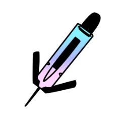 | 20 | 0 |  |  | 攻击 |  | 40 | 0 | 0 | 0 |
|  | 60 | 0 |  |  | 通用 |  | 0 | 0 | 0 | 0 |
|  | -10 | 0 |  |  | 卡牌 |  | 0 | 30 | 0 | 0 |
|  | 1 | 0 |  |  | 卡牌, 生存 |  | 0 | 30 | 0 | 0 |
|  | 20 | 0 |  |  | 卡牌, 辅助 |  | 0 | 30 | 0 | 0 |
| 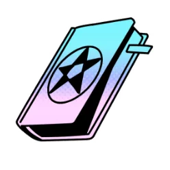 | 20 | 0 |  |  | 卡牌 |  | 0 | 30 | 0 | 0 |
|  | 1 | 0 |  |  | 通用 |  | 0 | 0 | 0 | 0 |
| 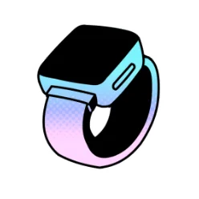 | 20 | 0 |  |  | 卡牌 |  | 0 | 30 | 0 | 0 |
|  | 10 | 0 |  |  | 卡牌 |  | 0 | 50 | 0 | 0 |
|  | 1 | 0 |  |  | 卡牌, 生存 |  | 0 | 20 | 0 | 0 |
|  | 30 | 0 |  |  | 生存, 辅助 |  | 0 | 0 | 0 | 50 |
|  | 20 | 0 |  |  | 卡牌, 辅助 |  | 0 | 10 | 10 | 0 |
| 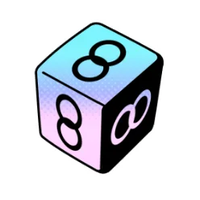 | 10 | 4 |  |  | 辅助 |  | 0 | 0 | 0 | 0 |
|  | 20 | 0 |  |  | 攻击 |  | 50 | 0 | 0 | 0 |
|  | 20 | 0 |  |  | 通用 |  | 0 | 0 | 0 | 0 |
|  | 60 | 0 |  |  | 卡牌 |  | 0 | 50 | 0 | 0 |
|  | 10 | 3 |  |  | 生存, 辅助 |  | 0 | 0 | 0 | 20 |
| 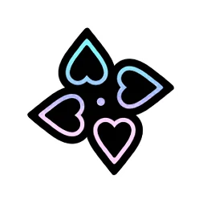 | 20 | 0 |  |  | 生存, 辅助 |  | 0 | 0 | 0 | 50 |
| 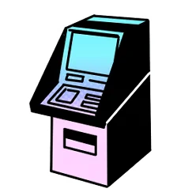 | 10 | 0 |  |  | 辅助 |  | 0 | 0 | 50 | 0 |
|  | 30 | 0 |  |  | 攻击, 辅助 |  | 30 | 0 | 20 | 0 |
|  | 30 | 0 |  |  | 攻击 |  | 30 | 0 | 0 | 0 |
|  | 30 | 0 |  |  | 卡牌 |  | 0 | 50 | 0 | 0 |
|  | 10 | 0 |  |  | 攻击 |  | 20 | 0 | 0 | 0 |
|  | 20 | 0 |  |  | 卡牌 |  | 0 | 50 | 0 | 0 |
|  | 20 | 0 |  |  | 卡牌 |  | 0 | 0 | 0 | 0 |
|  | 10 | 0 |  |  | 攻击 |  | 20 | 0 | 0 | 0 |
|  | 20 | 0 |  |  | 卡牌 |  | 0 | 20 | 0 | 0 |
|  | 60 | 0 |  |  | 攻击 |  | 0 | 0 | 0 | 0 |
|  | 20 | 0 |  |  | 攻击 |  | 20 | 0 | 0 | 0 |
|  | 10 | 0 |  |  | 攻击 |  | 20 | 0 | 0 | 0 |
|  | 70 | 0 |  |  | 通用 |  | 0 | 0 | 0 | 0 |
| 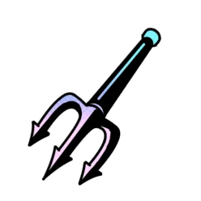 | 20 | 0 |  |  | 通用 |  | 0 | 0 | 0 | 0 |
|  | 10 | 0 |  |  | 通用 |  | 0 | 0 | 0 | 0 |
|  | 10 | 0 |  |  | 通用 |  | 0 | 0 | 0 | 0 |
|  | 100 | 0 |  |  | 通用 |  | 0 | 0 | 0 | 0 |
|  | 100 | 0 |  |  | 通用 |  | 0 | 0 | 0 | 0 |
|  | 20 | 0 |  |  | 通用 |  | 0 | 0 | 0 | 0 |
|  | 20 | 0 |  |  | 攻击 |  | 30 | 0 | 0 | 0 |
|  | 30 | 0 |  |  | 攻击 |  | 20 | 0 | 0 | 0 |
|  | 20 | 0 |  |  | 通用 |  | 0 | 0 | 0 | 0 |
|  | 30 | 0 |  |  | 通用 |  | 0 | 0 | 0 | 0 |
|  | 1 | 0 |  |  | 攻击 |  | 20 | 0 | 0 | 0 |
|  | 60 | 0 |  |  | 卡牌 |  | 0 | 50 | 0 | 0 |
|  | 50 | 0 |  |  | 通用 |  | 0 | 0 | 0 | 0 |
|  | 20 | 0 |  |  | 通用 |  | 0 | 0 | 0 | 0 |
|  | 30 | 0 |  |  | 攻击 |  | 30 | 0 | 0 | 0 |
|  | 20 | 0 |  |  | 通用 |  | 0 | 0 | 0 | 0 |
|  | 1 | 0 |  |  | 辅助 |  | 0 | 30 | 0 | 0 |
|  | 20 | 0 |  |  | 通用 |  | 0 | 0 | 0 | 0 |
|  | 20 | 0 |  |  | 攻击 |  | 20 | 0 | 0 | 0 |
|  | 30 | 0 |  |  | 通用 |  | 0 | 0 | 0 | 0 |
| 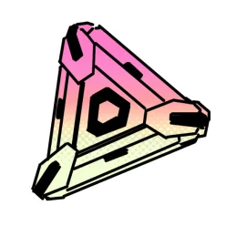 | 10 | 0 |  |  | 通用 |  | 0 | 0 | 0 | 0 |
|  | 20 | 0 |  |  | 攻击 |  | 30 | 0 | 0 | 0 |
|  | 30 | 0 |  |  | 通用 |  | 0 | 0 | 0 | 0 |
|  | 20 | 0 |  |  | 辅助 |  | 0 | 0 | 50 | 0 |
|  | 30 | 5 |  |  | 辅助 |  | 0 | 0 | 30 | 0 |
|  | 30 | 0 |  |  | 通用 |  | 0 | 0 | 0 | 0 |
|  | 10 | 0 |  |  | 卡牌 |  | 0 | 30 | 0 | 0 |
|  | 20 | 0 |  |  | 攻击 |  | 20 | 0 | 0 | 0 |
|  | 10 | 0 |  |  | 通用 |  | 0 | 0 | 0 | 0 |
| 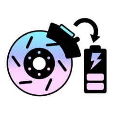 | 10 | 0 |  |  | 通用 |  | 0 | 0 | 0 | 0 |
| 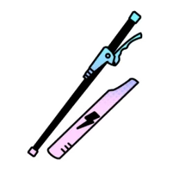 | 10 | 0 |  |  | 攻击 |  | 30 | 0 | 0 | 0 |
|  | 20 | 0 |  |  | 生存 |  | 0 | 0 | 0 | 0 |
|  | 20 | 0 |  |  | 卡牌 |  | 0 | 50 | 0 | 0 |
| 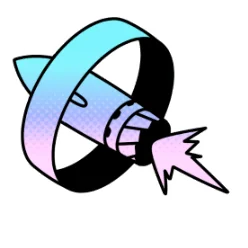 | 10 | 0 |  |  | 通用 |  | 0 | 0 | 0 | 0 |
|  | 20 | 0 |  |  | 通用 |  | 0 | 0 | 0 | 0 |
|  | 30 | 0 |  |  | 通用 |  | 0 | 0 | 0 | 0 |
|  | 30 | 0 |  |  | 攻击 |  | 50 | 0 | 0 | 0 |
|  | 20 | 0 |  |  | 攻击 |  | 30 | 0 | 0 | 0 |
|  | 30 | 0 |  |  | 辅助 |  | 0 | 0 | 20 | 0 |

角色职业是由角色目前所带的职业分值所决定的，目前的职业分值共存在四种：攻击分值(attackPt)、卡牌分值(cardPt)、辅助分值(SupportPt)与生存分值(tankPt)。角色自身带有一定数量的职业分值（如下表），在游戏过程中，角色获得筹码后，如若筹码带有职业分值，则将其累加在角色的职业分值上。角色某一职业分值越高，则其职业更倾向于该职业。

| 角色 | 攻击分值 | 卡牌分值 | 辅助分值 | 生存分值 |
| --- | --- | --- | --- | --- |
|  | 15 | 60 | 60 | 15 |
|  | 15 | 15 | 100 | 15 |
|  | 100 | 15 | 15 | 15 |
|  | 15 | 100 | 15 | 15 |
|  | 100 | 15 | 15 | 15 |
|  | 100 | 15 | 15 | 15 |
|  | 15 | 60 | 60 | 15 |
|  | 15 | 30 | 80 | 15 |
|  | 100 | 30 | 15 | 15 |
|  | 15 | 15 | 60 | 60 |
|  | 100 | 15 | 15 | 15 |
|  | 15 | 15 | 15 | 100 |
|  | 100 | 15 | 15 | 15 |
|  | 15 | 15 | 100 | 15 |
|  | 100 | 15 | 15 | 15 |
|  | 60 | 60 | 15 | 15 |
|  | 100 | 15 | 15 | 15 |
|  | 15 | 30 | 80 | 15 |
|  | 100 | 15 | 15 | 15 |
|  | 100 | 15 | 15 | 15 |
|  | 15 | 80 | 30 | 15 |
|  | 15 | 60 | 60 | 15 |
|  | 15 | 15 | 15 | 100 |
|  | 80 | 15 | 30 | 15 |
|  | 100 | 15 | 15 | 15 |
|  | 100 | 15 | 15 | 15 |
|  | 100 | 15 | 15 | 15 |
|  | 100 | 15 | 15 | 15 |
|  | 15 | 80 | 30 | 15 |
|  | 15 | 15 | 100 | 15 |
|  | 100 | 15 | 15 | 15 |
|  | 15 | 15 | 80 | 30 |
|  | 60 | 15 | 15 | 60 |
|  | 15 | 60 | 60 | 15 |
|  | 100 | 15 | 15 | 15 |

## 筹码一览

| 通用系 |
| --- | --- | --- |
| 拳击手套-初级 
攻击力 +1。  | 拳击手套-中级 
攻击力 +2。 | 拳击手套-高级 
攻击力 +5。 |
| 摩托头盔-一般 
防御力 +1。  | 摩托头盔-中级 
防御力 +2。 | 摩托头盔-高级 
防御力 +3。 |
| 夹心饼干-一般 
最大生命值 +2。  | 夹心饼干-可口 
最大生命值 +3。 | 夹心饼干-美味 
生命值上限+3，自身每有2点额外生命值上限，攻击力+1。 |
| 速度轮滑-初级 
移动速度 +1。  | 速度轮滑-中级 
移动速度 +2。 | 速度轮滑-高级 
移动速度 +4。 |
| 小猪存钱罐 
每使用 2 张效果牌，获得 3 星币。  | 大背包 
出牌数 +1。 | 额外电池 
主动技能冷却缩减 1。 |
| 魔法秘典 
每使用 3 张效果牌，复制最后使用的那张效果牌并加入手牌。  | 智能手表 
回合结束时，如果自己手牌少于 5 张，获得 1 张卡牌。 | 会员推荐信 
轮次奖励卡牌+1，商店卡牌的售价-1。 |
| 优雅之羽 
闪避成功时，攻击力+1，最多叠加4层。  | 探天卫星 
所有效果牌的射程+3。回合结束时，如果自身手牌数少于6张，则获得1张轨道炮。 | 肾上腺素-高效 
生命值低于 50% 时，攻击力 +8，且无法被反击。 |
| 书签 
效果牌伤害+2。  | 磨刀石 
生命值低于50%时，攻击力+4，受到伤害-1。 | 循环往复 
获得3次强化筹码重选次数，3回合后选择并获得1个强化筹码。 |
| 系 |  |  |
| 银行卡-余额少 
获得 4 。  | 银行卡-余额多 
获得 7 。 | 银行卡-用不完 
获得 3 ，所有角色轮次星币奖励 +3。 |
| “8面”骰子 
自身移动的最终点数为8时，获得8星币。每有8点累计移动点数，获得1。  | ATM机 
转账时，自身与目标同时获得 1 与1星币。 | 手电筒-强光 
攻击怪物时，每4，使自身攻击力+1。击中怪物后，获得 1 。 |
| 星币锤 
获得 5 。攻击时，如果当前持有星币大于20，则额外增加当前持有星币 30% 的攻击力，随后消耗 6 星币。  | 紫色飞星 
放过怪物后，对目标造成1点伤害并获得1。 | 金色飞星 
放过怪物后，对目标造成2点伤害并获得1，如果目标是首领，使目标额外受到层数的伤害。 |
| 系 |  |  |
| 缓冲盾牌 
被攻击时，获得 2 层与 3 星币。  | 可口糖果 
打出手牌后，获得1层。 
打出手牌后，如果生命值为满。本回合出牌数+1（每回合最多触发1次）。 | 维生素药丸 
每获得一张卡牌，获得 1 层。 |
| 友情微章 
转账或治疗友方角色时，自身与目标同时获得 2 层。  | 大碗炖肉 
回合开始时， 5 格内的所有角色获得 1 层并恢复 1 点生命值。 |  |
| 医疗箱-紧急治疗 
回合开始时，获得 1 层。  | 医疗箱-完备治疗 
回合开始时，获得 3 层。 |  |
| 美工刀-初级 
生命值为满时，攻击力+2，且攻击时额外上升层数的攻击力。  | 美工刀-锋利 
生命值为满时，攻击力+4，且攻击时额外上升层数的攻击力。 |  |
| 系 |  |  |
| 标记喷罐 
使用效果牌对怪物造成伤害后，对目标施加 1 层。  | 魔法箭袋 
每回合一次，对拥有【标记】的怪物使用效果牌时，施加 1 层，复制使用的效果牌并返回手牌。 | 忍术飞镖 
出牌数 +1 ，对怪物使用伤害效果牌时，使怪物额外受到层数的伤害。 |
| 手持风扇-小 
使用主动技能后，对 6 格范围内的怪物施加 1 层。  | 手持风扇-大 
使用主动技能后，获得 1 张卡牌，并对 6 格范围内的怪物施加 1 层。 |  |
| 标靶 
攻击力+1。回合开始时，对4格内最近的怪物施加1层。  | 普通瞄具 
攻击力 +2，攻击时施加 1 层。 | 鹰眼瞄具 
攻击时先施加 1 层，本次攻击增加目标层数 2 倍的攻击力。 |
| 系 |  |  |
| 能量回收 
每累计5点移动点数，获得2层。层数大于5时，移动速度+1。  | 电流剑 
攻击命中后，获得2层，层数大于7时，攻击力+2。 | 安全气囊 
若受到超过当前生命值的伤害，消耗6层：使得本次伤害变为0。 受到伤害后获得1。 |
| 电击手套 
使用技能后，对自身3格范围内的所有怪物造成2点伤害，每击中1个怪物，使自身攻击力+2，持续1轮，并获得1层。  | 跃迁引擎 
停留在怪物突击门或疾行时，获得3层，并使得下次移动速度+2。 | 电流核心 
使用技能后，本回合出牌数+1，消耗5层：主动技能冷却时间-1。 |
| 永动机 
移动速度+2。 
回合开始时，如果自身的层数低于6，则使层数变为6。  | 电磁炮 
攻击力+2。 
挑战怪物后，消耗4层：对目标所在地块的所有怪物造成当前攻击力50%的伤害。 |  |
| 星趴·梦想号专属 |  |  |
| 大铁锚 
受到伤害时，攻击力+1。回合开始时，失去1点攻击加成。  | 三叉戟 
使用主动技能时，使一名未被强化的友方角色攻击力+1，防御力+1。 | 梦想号模型 
移动速度+2，每有15点累计移动点数，主动技能冷却时间-1。 |
| 御魂庆典专属 |  |  |
| 诅咒之剑 
你将一直受【青之诅咒】纠缠。每击倒一个怪物，攻击力永久+1。  | 复仇之戟 
拥有【青之诅咒】时：攻击力 +5。拥有【赤红之毒】时：防御力 +5。 | 贯穿之铳 
效果牌额外附加目标防御力的伤害。 |
| 水乡古镇专属 |  |  |
| 大铜锣 
用主动技能后，4格内的所有角色攻击力+1、受到伤害-1，持续1轮。  | 节日红包 
使用高升炮后，出牌数+1。转账后获得1张高升炮。每使用3张高升炮，所有角色随机获得最多3种新春祝福。 |  |
| 魔法学院专属 |  |  |
| 佐茶蛋糕 
攻击力 +1，攻击茶壶时，攻击力 +1，防御力 +1，持续1轮。  | 古老法杖 
效果牌射程 +3，出牌数 +1。 | 精品剑盾 
攻击力 +4，拥有【问题学生】时，防御力 +4。 |
| 龙宫游乐园专属 |  |  |
| 惊涛御守 
使用效果牌时，受到1点伤害。获得卡牌时，回复1点生命值。  | 迷幻海鲜汤 
你的战斗骰点只会是1或者6点。 | 小蛇玩偶 
受到伤害时，受到伤害-2，攻击力+2，持续 1 回合。 |
| 小鲤鱼玩偶 
使用主动技能后，获得1层【反击】。反击时，攻击力、防御力永久+1。  | 无限之蛇 
回合开始时，获得卡牌直至手牌达到 8 张。出牌数+1。 | 交错双鲤 
攻击骰点只会是6点，且无法被反击。 |
| 幽魂暗巷专属 |  |  |
| 计时器 
获得【改造】时，额外获得 1 层。每 2 层【改造】，使自身攻击力+1。  | 重生人偶 
被击倒后，进度不变，攻击力、防御力、生命值上限+1。 | 糖果会员证 
怪奇糖果机售价下降为3星币。使用糖果卡牌时，主动技能冷却时间-1。 |
| 园林中庭专属 |  |  |
| 孔雀扇 
攻击命中后，自身获得2 层【温焰】。 被挑战时，消耗3层【温焰】，获得1层【反击】并恢复3点生命。  | 鸳鸯玉佩 
拥有【鸳鸯连理】时，移动速度+2。解除【鸳鸯连理】时，攻击力、防御力永久+1。 | 彩羽手环 
使用主动技能后，获得1张【彩羽】。每使用3张【彩羽】后，获得1个筹码。 |
| 海选赛运动场、淘汰赛运动场 |  |  |
| 运动手环 
攻击力+1，攻击时，如果防御方的移动速度受到影响，攻击力额外+4。  | 时间怀表 
被击倒后的下一轮开始时，立即复活。该轮怪物行动时，全体怪物被时间静止。随后本筹码变为时间怀表(破碎)。 |  |
| 决赛大赛场 |  |  |
| 电击枪 
击倒精英单位后，获得1层【心智】。【心智】层数大于等于3时，攻击力+2，防御力+2。  | 运动手环 
攻击力+1，攻击时，如果防御方的移动速度受到影响，攻击力额外+4。 | 时间怀表 
被击倒后的下一轮开始时，立即复活。该轮怪物行动时，全体怪物被时间静止。随后本筹码变为时间怀表(破碎)。 |
| 自适应核心 
心智小于等于3时，受到伤害-1。 
心智大于等于3时，攻击力+2。  | 娱乐终端 
攻击力+4，防御力+4。 
回合结束时，心智层数-1。 | 原初意识 
心智增加时，生命值上限永久+1。 
心智减少时，攻击力永久+1。 |
| 异变图书馆专属 |  |  |
| 放大镜 
每拥有1层【罪证】，攻击力+1、防御力+1，最高叠加4层。  | 汉娜人偶 
转账后，获得1层【罪证】。 回合结束时，获得自身【罪证】层数*2的星币。 |  |
| 已移除 |  |  |
| 手电筒-一般 
击倒怪物时，恢复 2 HP  | 手电筒-爆闪 
攻击怪物时，获得 1 星币。每有 3 层，使自身攻击力+1。 | 肾上腺素-一般 
生命值低于 50% 时，攻击力 +3，且无法被反击。 |
