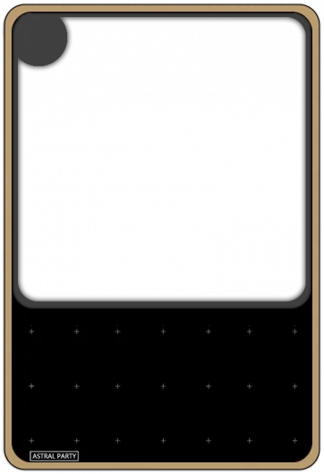

# 魔法学院
> 分类：地图
> 来源：https://wiki.biligame.com/starengine/%E9%AD%94%E6%B3%95%E5%AD%A6%E9%99%A2

## 地图背景

光礼大学是久负盛名的综合大学，与中城大学不分伯仲。与中城大学不同的是，该校拥有古老的魔法部，其历史甚至比整个大学本身还要悠久。是联合城内为数不多的魔法教学与研究机构之一。主校区位于凰区，另一个校区则位于丽岳区的‘南风峡湾’海岸。

### 1

原罪现身

原罪现身
原罪现身

天王寺登场。

任务 击败果冻战士0\1 进入魔法图书馆,所有玩家获得6星币 击败魔法茶壸0\3 所有玩家获得 强化筹码*1 击败魔法茶壸0\8 所有玩家获得 强化筹码*1,进度-1 击败果冻护卫0\2 所有玩家获得 强化筹码*1

学院戒严！
学院戒严！ 刷新1个果冻战士，3个魔法茶壶。 23

明胶追击
明胶追击 刷新1个果冻巫师，1个魔法茶壶。所有的怪物攻击力+1，防御力+1。 56789

茶话会
茶话会 刷新2个果冻护卫，2个魔法茶壶。所有的怪物攻击力+1，防御力+1。 11121314151617

任务 击败果冻战士0\1 进入魔法图书馆,所有玩家获得6星币 击败魔法茶壸0\3 所有玩家获得 强化筹码*1 击败魔法茶壸0\8 所有玩家获得 强化筹码*1,进度-1 击败果冻护卫0\2 所有玩家获得 强化筹码*1 学院戒严！
学院戒严！ 刷新1个果冻战士，3个魔法茶壶。 23 明胶追击
明胶追击 刷新1个果冻巫师，1个魔法茶壶。所有的怪物攻击力+1，防御力+1。 56789 茶话会
茶话会 刷新2个果冻护卫，2个魔法茶壶。所有的怪物攻击力+1，防御力+1。 111213141516

任务 击败果冻战士0\1 进入魔法图书馆,所有玩家获得6星币 击败魔法茶壸0\3 所有玩家获得 强化筹码*1 击败魔法茶壸0\8 所有玩家获得 强化筹码*1,进度-1 击败果冻护卫0\2 所有玩家获得 强化筹码*1 学院戒严！
学院戒严！ 刷新1个果冻战士，3个魔法茶壶。 23 明胶追击
明胶追击 刷新1个果冻巫师，1个魔法茶壶。所有的怪物攻击力+1，防御力+1。 56789 茶话会
茶话会 刷新2个果冻护卫，2个果冻巫师。所有的怪物攻击力+1，防御力+1。 1112131415

任务 击败果冻战士0\1 进入魔法图书馆,所有玩家获得6星币 击败魔法茶壸0\3 所有玩家获得 强化筹码*1 击败魔法茶壸0\8 所有玩家获得 强化筹码*1,进度-1 击败果冻护卫0\2 所有玩家获得 强化筹码*1 学院戒严！
学院戒严！ 刷新1个果冻战士，3个魔法茶壶。 23 明胶追击
明胶追击 刷新1个果冻巫师，1个果冻护卫。所有的怪物攻击力+1，防御力+1。 56789 茶话会
茶话会 刷新2个果冻护卫，2个果冻巫师。所有的怪物攻击力+1，防御力+1。 1112131415

### 2

检举揭发

检举揭发
检举揭发

学院安全官登场，所有玩家获得一张【是他干的】。 任务 击败果冻战士0\1 进入魔法图书馆,所有玩家获得6星币 击败果冻护卫0\4 所有玩家获得 强化筹码*1 击败魔法茶壶0\3 所有玩家获得 强化筹码*1,进度-1 击败果冻护卫0\2 所有玩家获得 强化筹码*1

严阵以待
严阵以待 刷新1个果冻战士，2个果冻护卫。 23 明胶追击
明胶追击 刷新1个果冻巫师，1个魔法茶壶。所有的怪物攻击力+1，防御力+1。 56789 茶话会
茶话会 刷新2个果冻护卫，2个魔法茶壶。所有的怪物攻击力+1，防御力+1。 11121314151617 任务 击败果冻战士0\1 进入魔法图书馆,所有玩家获得6星币 击败果冻护卫0\4 所有玩家获得 强化筹码*1 击败魔法茶壶0\3 所有玩家获得 强化筹码*1,进度-1 击败果冻护卫0\2 所有玩家获得 强化筹码*1 严阵以待
严阵以待 刷新1个果冻战士，2个果冻护卫。 23 明胶追击
明胶追击 刷新1个果冻巫师，1个魔法茶壶。所有的怪物攻击力+1，防御力+1。 56789 茶话会
茶话会 刷新2个果冻护卫，2个魔法茶壶。所有的怪物攻击力+1，防御力+1。 111213141516 任务 击败果冻战士0\1 进入魔法图书馆,所有玩家获得6星币 击败果冻护卫0\4 所有玩家获得 强化筹码*1 击败果冻巫师0\3 所有玩家获得 强化筹码*1,进度-1 击败果冻护卫0\2 所有玩家获得 强化筹码*1 严阵以待
严阵以待 刷新1个果冻战士，2个果冻护卫。 23 明胶追击
明胶追击 刷新1个果冻巫师，1个魔法茶壶。所有的怪物攻击力+1，防御力+1。 56789 茶话会
茶话会 刷新2个果冻护卫，2个果冻巫师。所有的怪物攻击力+1，防御力+1。 1112131415 任务 击败果冻战士0\1 进入魔法图书馆,所有玩家获得6星币 击败果冻护卫0\4 所有玩家获得 强化筹码*1 击败果冻巫师0\3 所有玩家获得 强化筹码*1,进度-1 击败果冻护卫0\2 所有玩家获得 强化筹码*1 严阵以待
严阵以待 刷新1个果冻战士，2个果冻护卫。 23 明胶追击
明胶追击 刷新1个果冻巫师，1个果冻护卫。所有的怪物攻击力+1，防御力+1。 56789 茶话会
茶话会 刷新2个果冻护卫，2个果冻巫师。所有的怪物攻击力+1，防御力+1。 1112131415

### 怪物属性

|  |  |
| --- | --- |
|  | 0

 0

 6

 0

 0

 6

 0

 0

 6

 0

 0

 6

 0

 0

 6 |
|  | 2

 1

 99

 2

 1

 110

 3

 2

 120

 4

 2

 140 |
|  | 2

 2

 111

 3

 2

 130

 4

 2

 160

 4

 2

 200 |
|  | 2

 6

 35

 2

 6

 36

 3

 8

 38

 4

 10

 40 |
|  | 3

 4

 15

 3

 4

 16

 4

 4

 18

 4

 4

 20 |
|  | 2

 1

 15

 3

 1

 16

 3

 1

 17

 3

 1

 21 |
|  | 3

 1

 10

 3

 1

 11

 4

 1

 11

 4

 1

 12 |
|  | 4

 2

 7

 5

 2

 7

 6

 3

 7

 6

 3

 8 |

### 行动顺序

行动顺序 小偷 果冻巫师 代理院长 学院安全官 魔法茶壶 变异茶壶 果冻战士 果冻护卫 召唤的魔法茶壶 召唤的变异茶壶

## 地图专属筹码

佐茶蛋糕
攻击力 +1，攻击茶壶时，攻击力 +1，防御力 +1，持续1轮。 古老法杖
效果牌射程 +3，出牌数 +1。 精品剑盾
攻击力 +4，拥有【问题学生】时，防御力 +4。

## 地图专有卡牌

 是他干的
是他干的 选择一个友方角色，造成1点伤害并施加【问题学生】，随后自身获得3星币。回合结束时如果本卡在手牌中，则自身受到1点伤害

## 地图特殊效果/状态

 丨 指示 丨 场上其他角色每打出3张【是他干的】，雅央永久增加1点攻击力并召唤一个果冻护卫。  丨 【问题学生】 丨 正在被追击

### 2025年04月03日

光礼大学魔法学院的食堂发生了暴乱？学生们为何要攻占食堂？是饥饿的驱使还是另有隐情？ 
█ 新增 
◆ 地图【魔法学院】 
◆ 怪物 [ 代理院长 ]、[ 果冻战士 ]、[ 果冻护卫 ]、[ 果冻巫师 ]、[ 魔法茶壶 ] 
█ 关键机制 
◆ 该地图添加了全新的双地图机制，击败守卫即可快速前往下张地图面对BOSS。未被击倒的怪物们会全部带往下张地图，是快还是稳，做好抉择吧！

### 2025年04月25日

█ 数值变动 
◆ 噩梦、疯狂难度下，茶话会事件由进度11改为进度10触发。 
◆ 果冻巫师的生命值由14/15/16/18上调至15/16/17/21，主动技能伤害由2上调至3。 
◆ 疯狂难度下，果冻战士的防御由8上调至10。 
◆ 果冻护卫的星币由7上调至9。 
◆ 果冻战士的星币由0上调至6。

### 2025年05月09日

█ 新增 
◆ 地图【魔法学院-甜点空间】 
◆ 怪物 [ 学院安全官 ]、[ 变异茶壶 ] 
◆ 卡牌 [ 是他干的 ] 
◆ 筹码 [ 佐茶蛋糕 ]、[ 古老法杖 ]、[ 精品剑盾 ] 
█ 数值变动 
◆ 疯狂难度1图下，明胶追击事件由“刷新1个果冻巫师，1个魔法茶壶。所有的怪物攻击力+1，防御力+1。”改为“刷新1个果冻巫师，1个果冻护卫。所有的怪物攻击力+1，防御力+1。” 
◆ 噩梦、疯狂难度下，茶话会事件由“刷新2个果冻护卫，2个魔法茶壶。所有的怪物攻击力+1，防御力+1。”改为“刷新2个果冻护卫，2个果冻巫师。所有的怪物攻击力+1，防御力+2。”。

### 2025年10月31日

█ 新增 
◆ 通用事件 [ 取长补短 ] 
◆ 通用筹码 [ 优雅之羽 ]、[ 探天卫星 ] 
 █ 数值变动 
◆ 调整了通用筹码 [ 会员推荐信 ] 稀有度，由紫色调整为蓝色，并修改描述由“轮次奖励卡牌数量 +2”，调整为“轮次奖励卡牌数量 +1”。

### 2025年11月21日

█ 数值变动 
◆ 怪物 [ 学院安全官 ] 普通模式下 
2188 调整为 
2199↑ 、困难模式下 
2199 调整为 
21110↑ 。 
◆ 怪物 [ 代理院长 ] 普通模式下 
2299 调整为 
22111↑ 、困难模式下 
32120 调整为 
32130↑ 。 
◆ 怪物 [ 果冻战士 ] 普通模式下 
2632 调整为 
2635↑ 。 
◆ 怪物 [ 果冻护卫 ] 普通模式下 
3414 调整为 
3415↑ 。 
◆ 怪物 [ 变异茶壶 ] 普通模式下 
426 调整为 
427↑ 。
