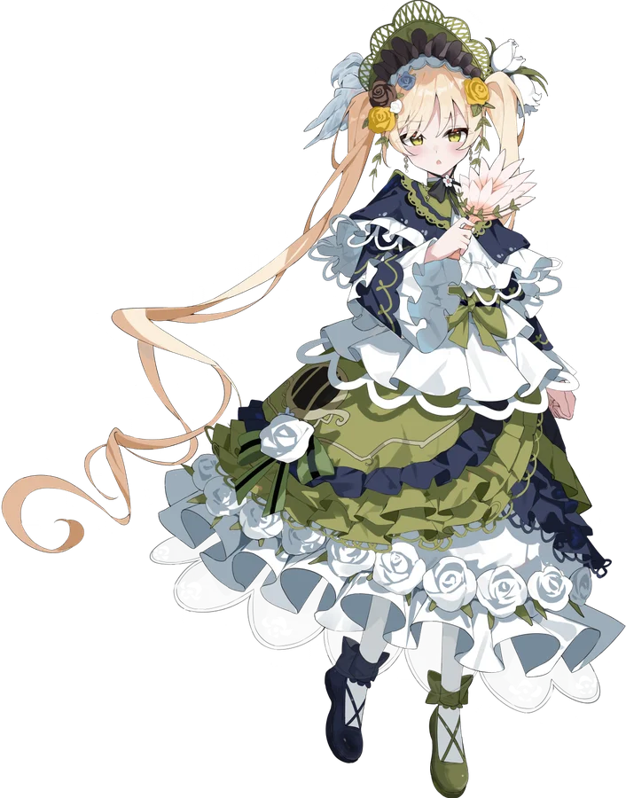
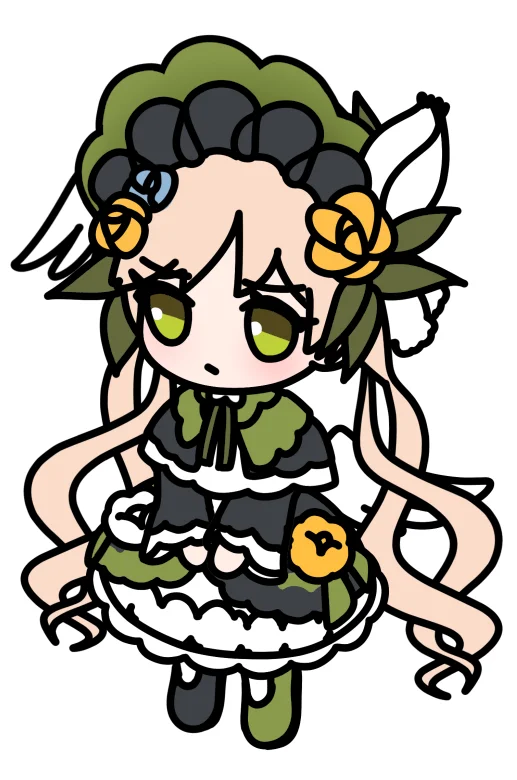
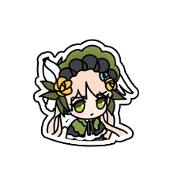
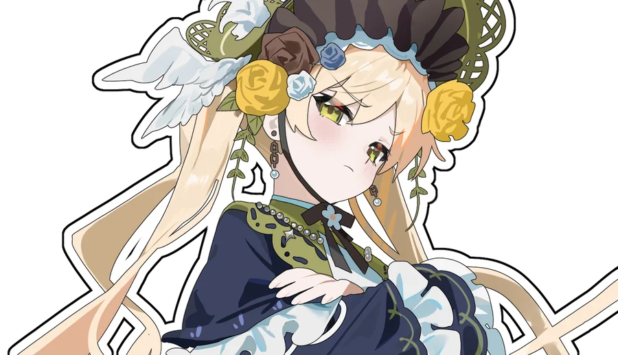
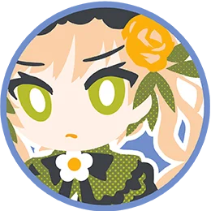

# 远野汉娜（汉娜）
> 分类：角色 · 编号 305 · 时期 联动 · 女
> 来源：https://wiki.biligame.com/starengine/%E8%BF%9C%E9%87%8E%E6%B1%89%E5%A8%9C

说话操着大小姐口吻的少女。

## 战斗数值

| 攻击 | 防御 | 生命 |
| --- | --- | --- |
| 1 | 2 | 9 |

## 技能

### 主动技能：飘浮魔法（冷却 3）

获得飘浮（移动速度+2，不会触发陷阱和路障。被其它），持续1轮。

### 被动技能：幻想千金

移动的最终点数大于等于6时，获得1星币。

**PVE**：移动的最终点数大于等于6时，获得1星币。

经过友方角色时，获得1星币和1层人偶制作（到达7层时，转变为【人偶完成】）。如果此时拥有飘浮（移动速度+2，不会触发陷阱和路障。被其它）且自身星币足够，向该友方角色转账3星币。

当人偶制作（到达7层时，转变为【人偶完成】）达到7层时，远野汉娜获得人偶完成（精心制作的玩偶。）：经过友方角色时，使该友方角色获得下次移动速度+2。

### 被动技能：挚友祝福

经过橘雪莉时，使橘雪莉获得下次移动速度+2和1层推理时间（每层使自身攻击力+1。回合结束时减少1层）。

## 基础资料

- 姓名：远野汉娜
- 英文名：Hanna
- 日文名：遠野ハンナ
- 从属组织：魔法少女的魔女审判
- 上线时间：202609031400
- 生日：5月15日
- 喜欢食物：未知
- 初始骰子：/
- 礼物：/、/、/
- 徽章：/、/

## PVE 特性

- 达到1星时立刻获得10星币
- 初始星币+6
- 达到3星时攻击力+1、防御力+1、移动速度+1

## 皮肤（共 1 套）

> 皮肤编号取自素材文件名；「默认」「羁绊皮肤」也是独立皮肤。

### 1. 默认（初始）

- 素材编号：305
- 立绘：
- Q版立绘：
- 头像：
- Q版头像：
- 半身像（星币<20）：
- 半身像（星币≥20）：

## 表情（共 8 个）

| # | 名称 | 品质 | 获取方式 | 图片 |
| --- | --- | --- | --- | --- |
| 1 | 表情1 |  |  |  |
| 2 | 表情2 |  |  |  |
| 3 | 表情3 |  |  |  |
| 4 | 表情4 |  |  |  |
| 5 | 表情5 |  |  |  |
| 6 | 表情6 |  |  |  |
| 7 | 表情7 |  |  |  |
| 8 | 表情8 |  |  |  |

## 装扮

官方 wiki 未提供该角色的 /获取 页，头像、名片、卡牌、骰子清单暂缺。

## 人物传记

平常总摆出一副高傲不凡的姿态。

尽管她自称出身名门，但其言行举止多与身份不符。

实际上是出身于相当贫穷的家庭。

## 画廊其他素材

- 起始点：
- 像素头像：
