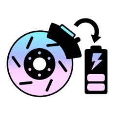

# 能量回收
> 分类：筹码
> 编号：50084
> 品质：蓝
> 类别：充能类筹码
> 来源：https://wiki.biligame.com/starengine/%E8%83%BD%E9%87%8F%E5%9B%9E%E6%94%B6

## 效果

每累计5点移动点数，获得2层充能。充能层数大于5时，移动速度+1。

## 资料

- **品质**：蓝
- **编号**：50084
- **类别**：充能类筹码

## 详解

该筹码属于充能类筹码，详细机制请参考游戏内说明。

## 历史

*2026年9月3日
**引入。

## 图片

