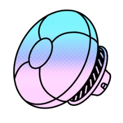

# 安全气囊
> 分类：筹码
> 编号：50086
> 品质：紫
> 类别：充能类筹码
> 来源：https://wiki.biligame.com/starengine/%E5%AE%89%E5%85%A8%E6%B0%94%E5%9B%8A

## 效果

若受到超过当前生命值的伤害，消耗6层充能：使得本次伤害变为0。
受到伤害后获得1充能。

## 资料

- **品质**：紫
- **编号**：50086
- **类别**：充能类筹码

## 详解

该筹码属于充能类筹码，详细机制请参考游戏内说明。

## 历史

*2026年9月3日
**引入。

## 图片

