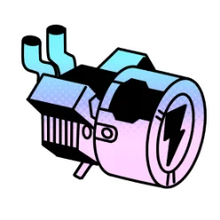

# 电流核心
> 分类：筹码
> 编号：50089
> 品质：紫
> 类别：充能类筹码
> 来源：https://wiki.biligame.com/starengine/%E7%94%B5%E6%B5%81%E6%A0%B8%E5%BF%83

## 效果

使用技能后，本回合出牌数+1，消耗5层充能：主动技能冷却时间-1。

## 资料

- **品质**：紫
- **编号**：50089
- **类别**：充能类筹码

## 详解

该筹码属于充能类筹码，详细机制请参考游戏内说明。

## 历史

*2026年9月3日
**引入。

## 图片

