# 阿尔（暗区少主）
> 分类：角色 · 编号 118 · 时期 第三期 · 男
> 来源：https://wiki.biligame.com/starengine/%E9%98%BF%E5%B0%94

“地窖”的创始人之一，与“凰天会”和恩菲尔德家族有着密切往来，人称“A.L”。兵器“天王”的持有者。“天王落”事件的主因。因为阿尔不知为何原因准备将“天王”摧毁才引发了后面的公司战争。摧毁天王使得一系列的神秘事件重新开始袭扰联合城。也正因此事，神器才又重回大众视野。

## 战斗数值

| 攻击 | 防御 | 生命 |
| --- | --- | --- |
| 1 | 1 | 9 |

## 技能

### 主动技能：强者怜悯（冷却 3）

选择1-3张卡牌给予一个敌方角色，夺取目标给予牌数量*3的星币。

**PVE**：选择1-3张卡牌给予一个友方角色，获取给予牌数量的星币。

### 被动技能：钞能力

获得星币时，攻击力+2，防御力+1，持续1轮。

**PVE**：使友方角色获得卡牌时，双方获得1层星光。自身每拥有6层星光，攻击力+1，防御力+1。

## 基础资料

- 姓名：阿尔·威尔逊
- 英文名：A.L.
- 日文名：アル
- 从属组织：地窖,
- 事件经历：天王落
- 上线时间：202504031730
- 生日：1月2日
- 喜欢食物：奶酪
- 初始骰子：奢侈品骰子
- 礼物：智能手机、小熊玩偶、陈年的红酒
- 徽章：山峦、川河

## PVE 特性

- 达到1星时攻击力+1
- 初始星币+6
- 达到3星时攻击力+1、防御力+1、移动速度+1

## 皮肤（共 3 套）

> 皮肤编号取自素材文件名；「默认」「羁绊皮肤」也是独立皮肤。

### 1. 默认（初始）

- 素材编号：118
- 立绘：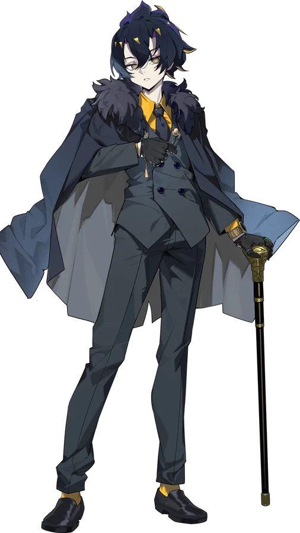
- Q版立绘：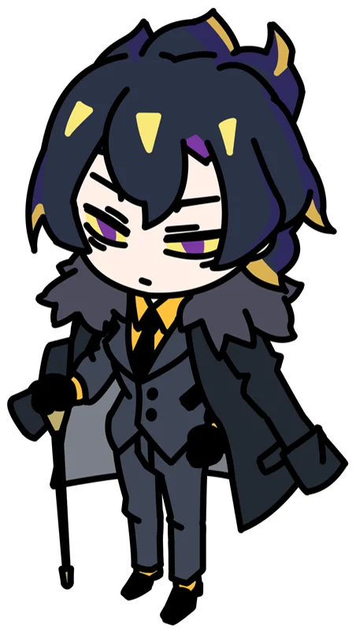
- 头像：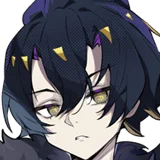
- Q版头像：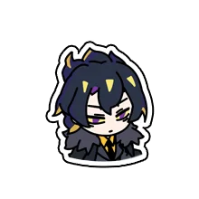
- 半身像（星币<20）：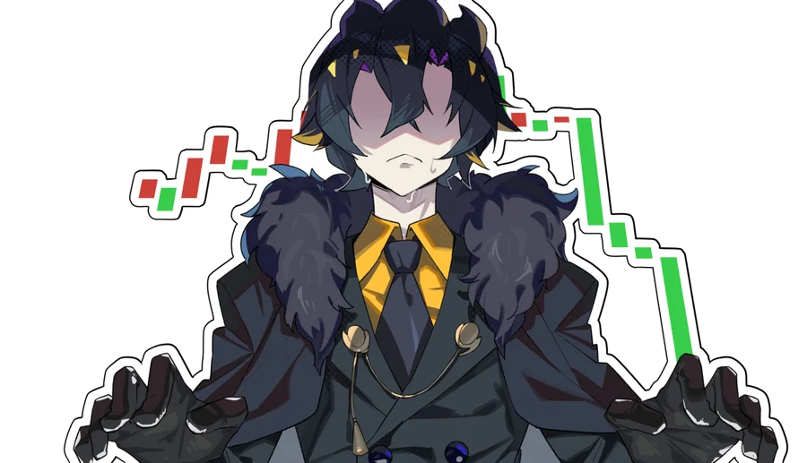
- 半身像（星币≥20）：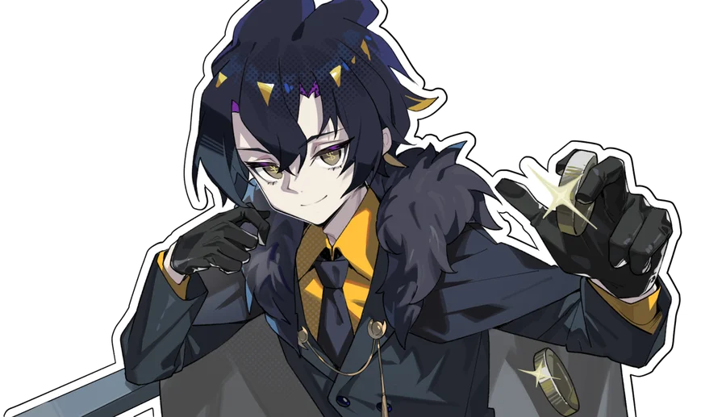

### 2. 羁绊皮肤（羁绊解锁）

- 素材编号：118_Max
- 立绘：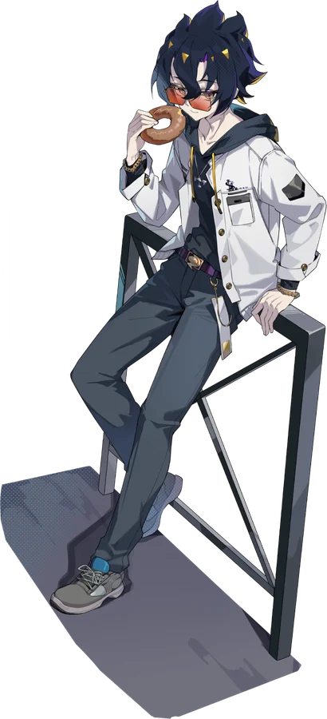
- Q版立绘：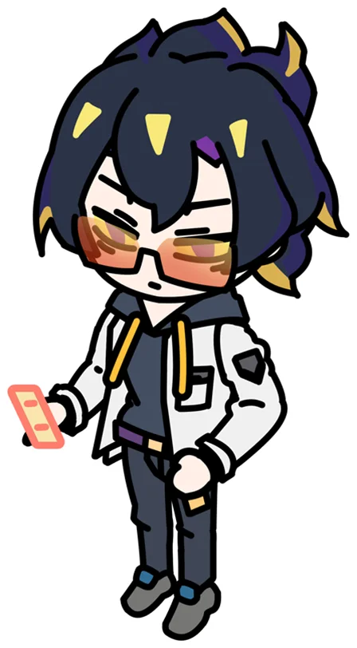
- 头像：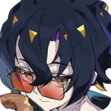
- Q版头像：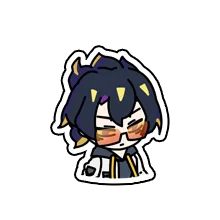
- 半身像（星币<20）：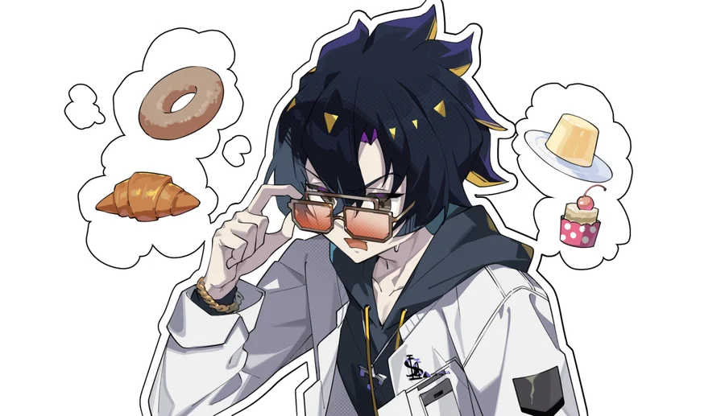
- 半身像（星币≥20）：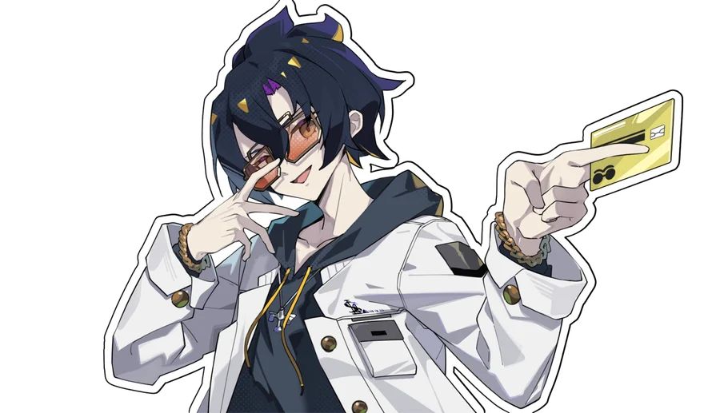

### 3. 番茄酱魔法（蓝品质）

- 素材编号：118_01
- 立绘：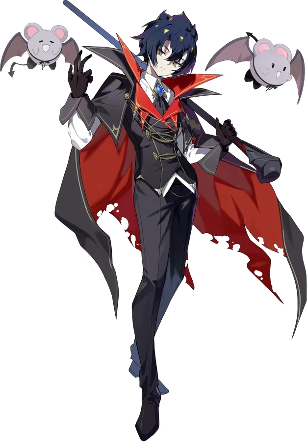
- Q版立绘：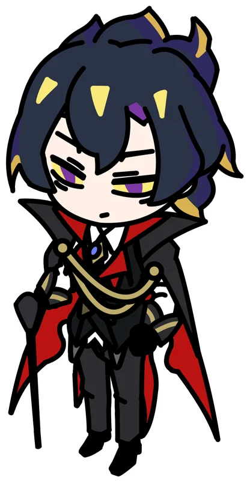
- 头像：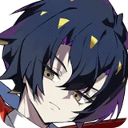
- Q版头像：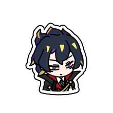
- 半身像（星币<20）：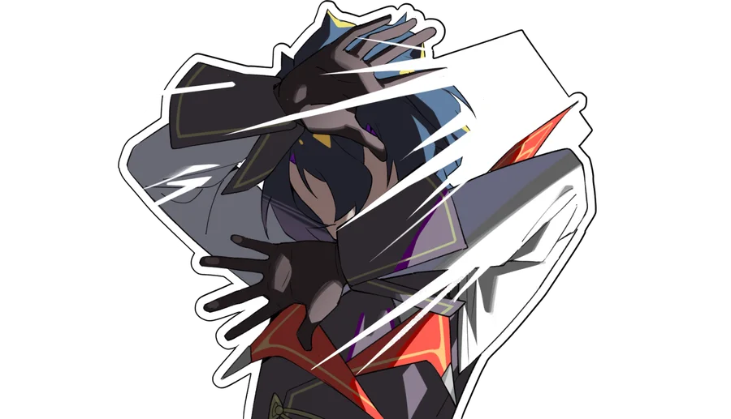
- 半身像（星币≥20）：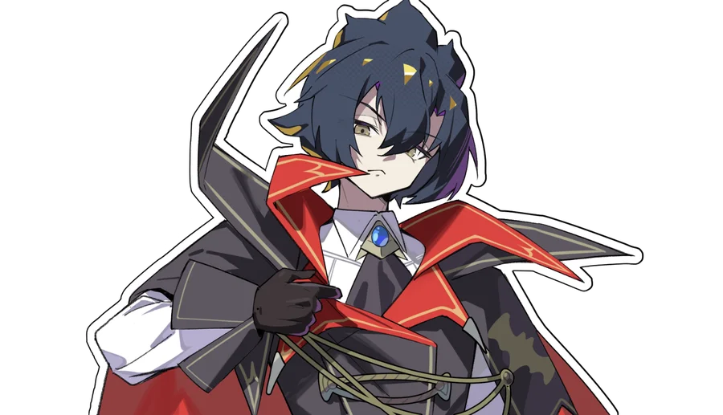

**皮肤故事**：御魂庆典是联合城最重要的节日之一。庆典期间，大家都会涌上街头进行各种角色扮演，阿尔也不例外。

这个时候，作为老板的阿尔会给自己放个假，当然也包括手下的弟兄们。因为后街有盛大的“魔怪舞会”活动，所以相当热闹。

阿尔扮演的是一个古堡伯爵的角色。从外形和标志性装饰来看，这毫无疑问是那个角色了。经典的斗篷，口中露出的尖牙，以及装饰在身边的戴着翅膀的蝙蝠，都完美还原了角色形象。

当然，阿尔还加入了很多特效：红色的液体随着每一次抖动手杖喷溅而出。但仔细一闻，用手沾一点放在嘴里

——该死，这不是番茄酱吗？

我只能说，不愧是有钱人。用带有颜料的水也能达到同样的效果，他偏偏要用番茄酱代替，简直奢侈至极！

不过效果确实非常出色，粘稠度和甜度都恰到好处，还不赖！

## 表情（共 8 个）

| # | 名称 | 品质 | 获取方式 | 图片 |
| --- | --- | --- | --- | --- |
| 1 | 表情1 |  |  |  |
| 2 | 表情2 |  |  | 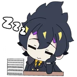 |
| 3 | 表情3 |  |  | 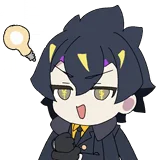 |
| 4 | 表情4 |  |  | 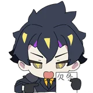 |
| 5 | 表情5 |  |  | 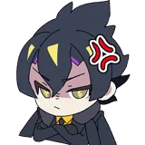 |
| 6 | 表情6 |  |  | 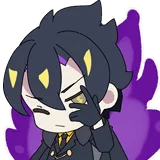 |
| 7 | 表情7 |  |  |  |
| 8 | 表情8 |  |  |  |

## 装扮

官方 wiki 未提供该角色的 /获取 页，头像、名片、卡牌、骰子清单暂缺。

## 人物传记

在“天王落”事件后消失，不知所踪。

## 画廊其他素材

- 起始点：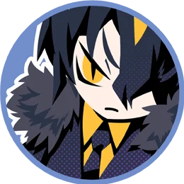
- 像素头像：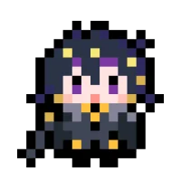
- Lv4羁绊等级奖励：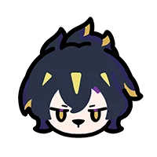
- Lv5羁绊等级奖励：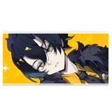
- 缔结契约名片奖励：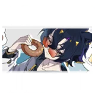
- 番茄酱魔法皮肤名片：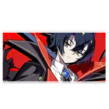
