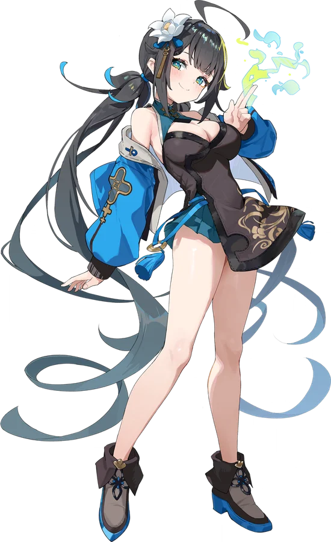
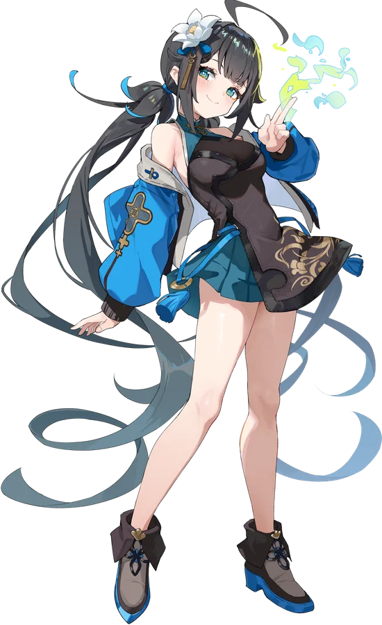
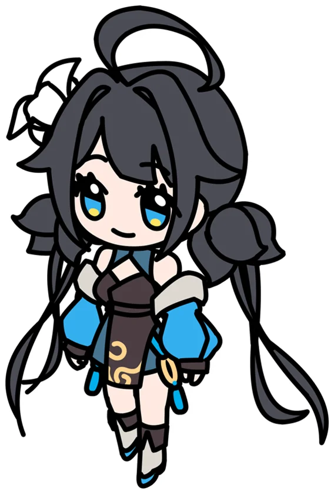
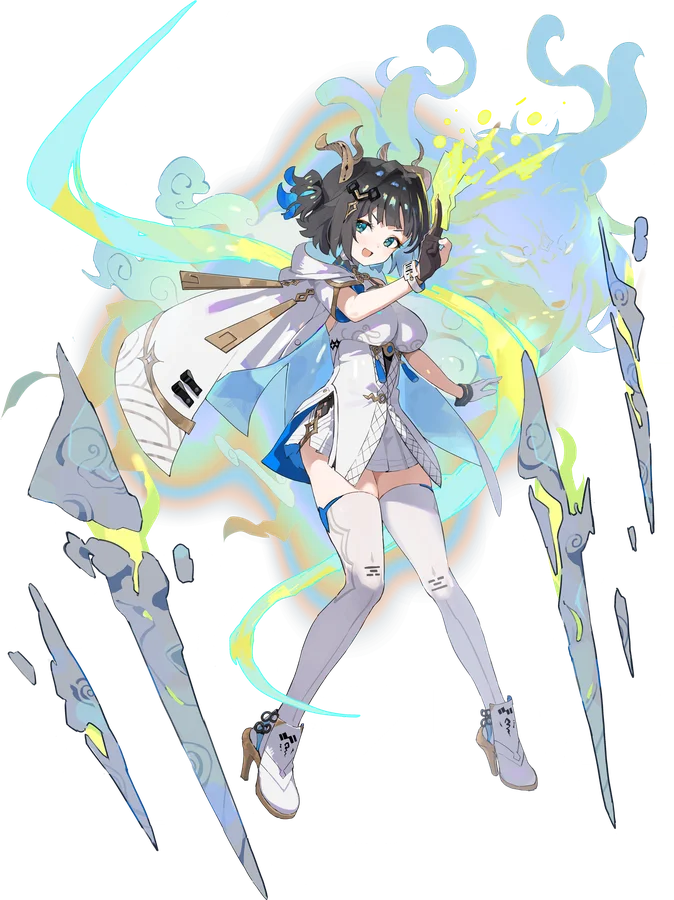
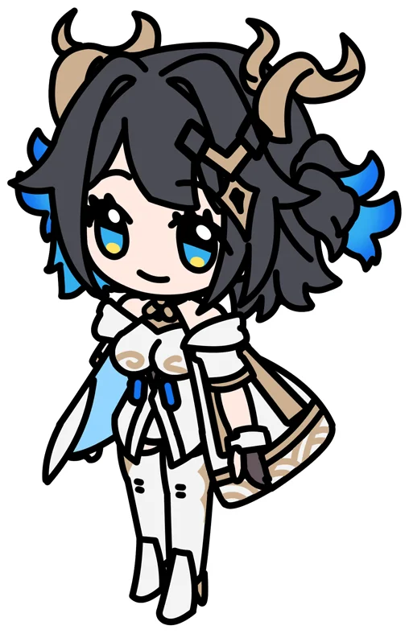
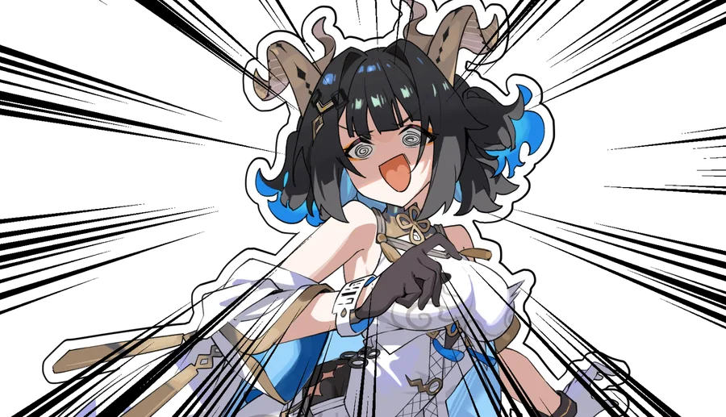
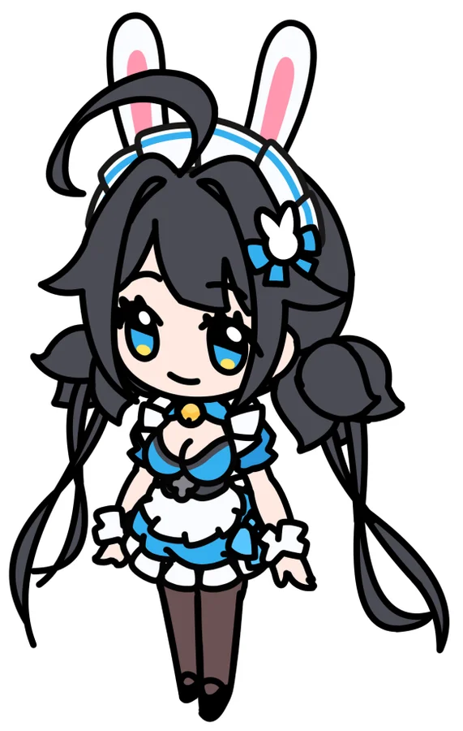
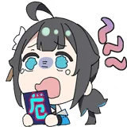
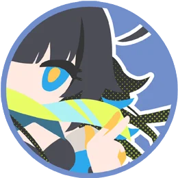

# 姬梦朝（风水师）
> 分类：角色 · 编号 123 · 时期 第三期 · 女
> 来源：https://wiki.biligame.com/starengine/%E5%A7%AC%E6%A2%A6%E6%9C%9D

“隆兴饭店”的二把手。其真实身份是“凰天会”的二当家，也是会里的风水师，道上的人都称她为“二公主”。与姐姐不同，梦朝主要是负责内部事务，在饭店和自己领地出现的次数比姐姐要多的多。

## 战斗数值

| 攻击 | 防御 | 生命 |
| --- | --- | --- |
| 1 | 1 | 10 |

## 技能

### 主动技能：白泽赐福（冷却 3）

自身获得治疗溢出量的星币，持续1回合。获得1张符卡-福并将手牌中所有的符卡-祸转化为符卡-福。

**PVE**：指定一个角色施加白泽祝福（增加治疗溢出量的攻击力），目标增加治疗溢出量的攻击力，持续1回合。获得1张符卡-福且将手牌中所有的符卡-祸转化为符卡-福。

### 被动技能：福祸相倚

骰点为1时，获得1张符卡-祸，骰点为6时，获得1张符卡-福。

### 被动技能：完美帮手

对姬梦枫使用符卡-福时，目标获得1层养精蓄锐（攻击力+2，防御力+2）。

**技能细节**：

PVE模式中，姬梦朝通过主动技能可以给予角色白泽祝福（增加治疗溢出量的攻击力）效果，同时该角色的状态栏内会存在对应的效果图标白泽赐福。

姬梦朝使用符卡-福或符卡-祸后，被治愈/攻击的角色/怪物身上会出现对应的特效（如右图）。姬梦朝自己因为符卡-祸的效果受伤时，自己身上也会出现对应的特效。

姬梦朝被击倒后不会自动丢弃全部的符卡-福与符卡-祸。

<gallery>Fu 01.png</gallery><gallery>Fu 02.png</gallery>

## 基础资料

- 姓名：姬梦朝
- 英文名：Zhao
- 日文名：ユメ
- 从属组织：隆兴饭店,凰天会
- 上线时间：202501241730
- 生日：10月17日
- 喜欢食物：豆腐制品
- 初始骰子：青花瓷骰子
- 礼物：浴室鸭、漂亮的洋装、陈年的红酒
- 徽章：山峦、川河

## PVE 特性

- 达到1星时防御力+1
- 初始星币+6
- 达到3星时攻击力+1、防御力+1、移动速度+1

## 皮肤（共 5 套）

> 皮肤编号取自素材文件名；「默认」「羁绊皮肤」也是独立皮肤。

### 1. 默认（初始）

- 素材编号：123
- 立绘：
- 立绘（和谐版）：
- Q版立绘：
- 头像：
- Q版头像：
- 半身像（星币<20）：
- 半身像（星币≥20）：

### 2. 羁绊皮肤（羁绊解锁）

- 素材编号：123_Max
- 立绘：
- 立绘（和谐版）：
- Q版立绘：
- 头像：
- Q版头像：
- 半身像（星币<20）：
- 半身像（星币≥20）：

### 3. 滨边时光（紫品质）

- 素材编号：123_01
- 立绘：
- 立绘（和谐版）：
- Q版立绘：
- 头像：
- Q版头像：
- 半身像（星币<20）：
- 半身像（星币≥20）：

**皮肤故事**：“姐姐来了啊。”姬梦朝抓着帽檐抬头看着姐姐。

“嗯，刚和老爷子聊了一下，他想让我去趟迷宫祭祖。”

梦枫打开折叠椅坐下，随后从旁边的盒子取出假饵准备挂在鱼竿上。

“有时候我就在想，如果我俩只是普通的姐妹，周末的下午可以在一起悠闲的钓鱼，然后悠闲的在海边烧烤，该多惬意啊。”梦朝熟练的摆弄着钓竿。

“家里的那些事情，迟早是要落到我们头上。”梦枫猛的甩出鱼竿。

“啊啊！姐，快，快帮我一下！”梦朝此时手里的鱼竿剧烈的抖动起来。

“力气好大啊！”此时梦朝的手被鱼竿的压力挤得都没血色了。

“来了来了！看见了，哦好大一条！”此时黑色的大鱼已经露出了水面。

“看样子今天地运气不错呢。”梦朝也很高兴的看着姐姐。

“是啊，感觉我俩今天可以钓很多呢。不管了，今天我要钓到天黑！”梦枫回到了小椅子上重新坐下。

“嗯，我陪着你~”

所以啊，姐妹俩在一起开心最重要，其他的等钓完鱼再说吧。

### 4. 祥瑞天章（彩品质）

- 素材编号：123_02
- 立绘：
- Q版立绘：
- 头像：
- Q版头像：
- 半身像（星币<20）：
- 半身像（星币≥20）：

**皮肤故事**：姬家的孩子在成长过程中都会逐渐觉醒属于自己的神力，这些神力通常与传说中的动物或现实中的生灵相关。

初代创建人姬天女觉醒的神力是凤凰，因此凤凰成为姬家的精神图腾。可以说，正是先有神力的觉醒，才有了“凰天会”的诞生。

如今，姬家迎来了两位女孩的降临。先出生的是姐姐姬梦枫，她顽皮好动，元气满满，充满求知欲；后出生的妹妹姬梦朝则乖巧温柔，温文尔雅，待人和善。

然而，神力的觉醒并非由年龄决定。有时一出生便带有神力，有时则需等到成年，通过自身探索逐渐觉醒。而这姐妹俩正属于后者——妹妹姬梦朝比姐姐更早觉醒神力。

代表祥瑞的白泽神兽成为姬梦朝的觉醒神力。相传，白泽能通晓万物之情，可驱除一切邪祟，是纯粹的瑞兽。

她俩的气质完全契合，以至于许多人认为，这正是为姬梦朝量身定做的神力。

当她穿上白泽赐福的法衣时，她便成为“祥瑞”一词最直观的具象化象征。

### 5. 玉兔挥毫（蓝品质）

- 素材编号：123_03
- 立绘：
- 立绘（和谐版）：
- Q版立绘：
- 头像：
- Q版头像：
- 半身像（星币<20）：
- 半身像（星币≥20）：

**皮肤故事**：“姐姐姐姐！快来啊！别光在那里喝茶，管家让我们写一副超大对联，准备挂出去呢！”

庭院正中铺开了一张大得如同院子般的巨幅宣纸。端着茶杯的姬梦枫刚想问这是在干嘛，穿着古怪服饰的妹妹就已经兴奋地嚷嚷起来：

“今天是丰收节，也是赏月的日子，大家都换上了可爱的衣服，我也给你留了一套！”

看着妹妹头顶上晃晃悠悠的兔耳朵，姬梦枫立刻转身加快了脚步——她可不想沦为妹妹的换装娃娃。

“我就算了，等下还要去和财务开会呢。你挂对联时小心点啊。”

姬梦朝正握着硕大的毛笔饱蘸浓墨，在纸上挥毫狂舞，该说不说还挺像那么回事。只见她身姿矫健地写下几个大字，顺手将巨笔往地上一杵当成拐杖，冲着正准备开溜的姐姐喊道：

“那我回头再把衣服给你送过去！今天可是要轮到我们跑堂的哦！”

看样子，姬梦枫今天是注定逃不掉了。

## 表情（共 17 个）

| # | 名称 | 品质 | 获取方式 | 图片 |
| --- | --- | --- | --- | --- |
| 1 | 表情1 |  |  |  |
| 2 | 表情2 |  |  |  |
| 3 | 表情3 |  |  |  |
| 4 | 表情4 |  |  |  |
| 5 | 表情5 |  |  |  |
| 6 | 表情6 |  |  |  |
| 7 | 表情7 |  |  |  |
| 8 | 表情8 |  |  |  |
| 9 | 表情9 |  |  |  |
| 10 | 表情10 |  |  |  |
| 11 | 表情10 |  |  |  |
| 12 | 表情11 |  |  |  |
| 13 | 表情12 |  |  |  |
| 14 | 表情12 |  |  |  |
| 15 | 表情13 |  |  |  |
| 16 | 表情14 |  |  |  |
| 17 | 表情15 |  |  |  |

## 装扮

官方 wiki 未提供该角色的 /获取 页，头像、名片、卡牌、骰子清单暂缺。

## 人物传记

每周末饭店的例行检查她都会和食客们攀谈，以改善饭店的服务质量。

## 画廊其他素材

- 起始点：
- 像素头像：
- Lv4羁绊等级奖励：
- Lv5羁绊等级奖励：
- 缔结契约名片奖励：
- 滨边时光皮肤名片：
- 祥瑞天章皮肤名片：
- 玉兔挥毫皮肤名片：
