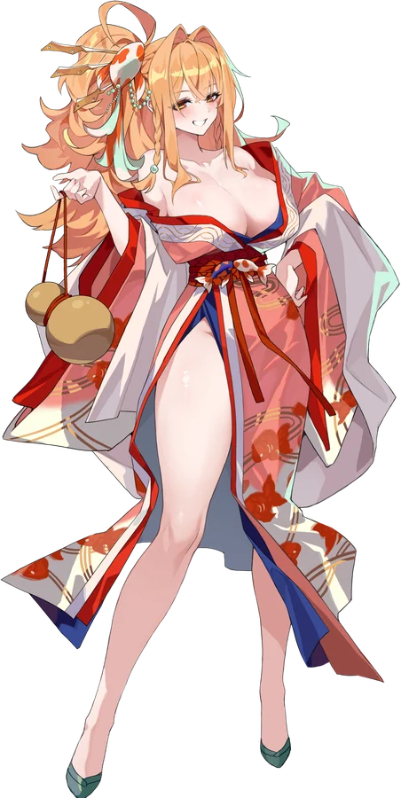
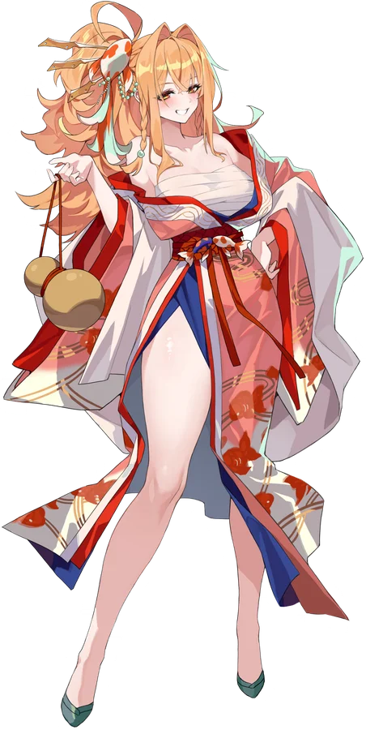
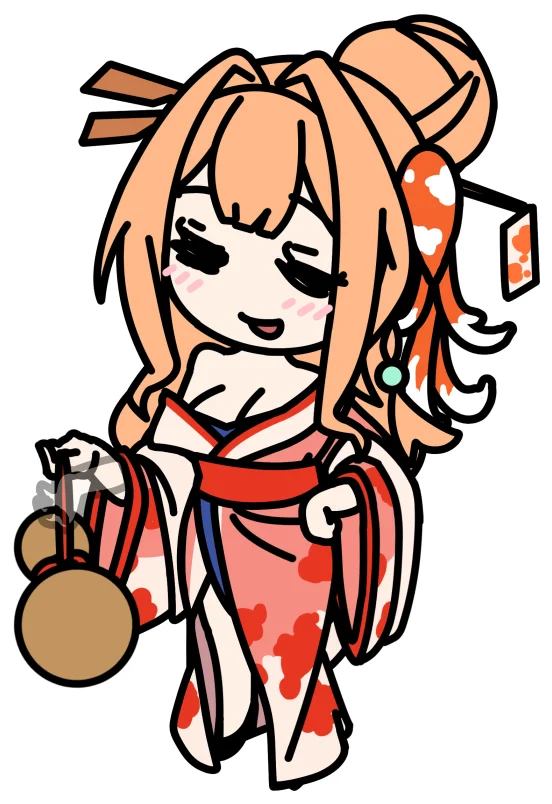
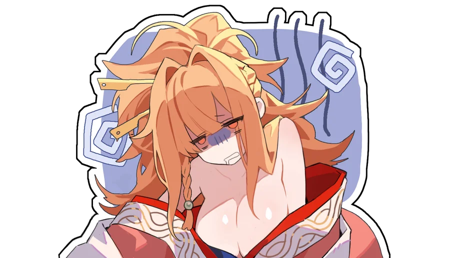

# 苍鲤（金鳞御使）
> 分类：角色 · 编号 130 · 女
> 来源：https://wiki.biligame.com/starengine/%E8%8B%8D%E9%B2%A4

龙崎分家的天川家，一直是三神教中核心的名门望族。作为现任家主的妹妹，她平日里家族事务并不算繁重。她虽出身富贵，却无骄奢纨绔之气；平时对小侄女真梦梓的成长颇为上心，是个不折不扣的“溺爱型”姑姑。

## 战斗数值

| 攻击 | 防御 | 生命 |
| --- | --- | --- |
| 1 | 1 | 9 |

## 技能

### 主动技能：把酒言欢（冷却 3）

指定5格内的一个地块，放置一个葫芦饮，自身获得1层反击。
葫芦饮：经过时停留，回复2点生命值。

**PVE**：指定10格内的一个地块，放置一个葫芦饮，自身获得1层反击。
葫芦饮：经过时停留，恢复2点生命值。获得葫芦饮（攻击力+3），持续2回合。

### 被动技能：不醉不归

任意角色触发葫芦饮后，天川苍鲤获得1层反击。

**PVE**：反击时获得1层金鳞（每层使自身防御力+1最多拥有4层）。

任意角色触发葫芦饮或仙酿后，天川苍鲤获得1层反击。

金鳞（每层使自身防御力+1最多拥有4层）达到4层时，立即获得金鲤化龙（每层【金鳞】额外使自身攻击力+1，主动技）：每层金鳞（每层使自身防御力+1最多拥有4层）额外使自身攻击力+1，主动技能放置葫芦饮改为放置仙酿。

仙酿：经过时停留，恢复3点生命。获得仙酿（攻击力+4），持续2回合。停留结算后触发1次疾行（不可和疾行地块效果叠加）。

### 被动技能：留给你的

真梦梓触发葫芦饮或仙酿后，使真梦梓获得1层觉醒（到达8层时，转变为【真龙形态】）。

## 基础资料

- 姓名：天川苍鲤
- 英文名：Souri
- 日文名：蒼鯉
- 从属组织：天川家族,龙崎家族,三神教
- 上线时间：202611121400
- 生日：5月19日
- 喜欢食物：甜酒团子
- 初始骰子：布丁骰子
- 礼物：普通的饮料、礼盒巧克力、非常牛的电脑配件
- 徽章：川河、山峦

## PVE 特性

- 达到1星时攻击力+1
- 初始星币+6
- 达到3星时攻击力+1、防御力+1、移动速度+1

## 皮肤（共 2 套）

> 皮肤编号取自素材文件名；「默认」「羁绊皮肤」也是独立皮肤。

### 1. 默认（初始）

- 获取方式：抽奖
- 素材编号：130
- 立绘：
- 立绘（和谐版）：
- Q版立绘：
- 头像：
- Q版头像：
- 半身像（星币<20）：
- 半身像（星币≥20）：

### 2. 羁绊皮肤（羁绊解锁）

- 获取方式：苍鲤缔结契约后使用
- 素材编号：130_Max
- 立绘：
- 立绘（和谐版）：
- Q版立绘：
- 头像：
- Q版头像：
- 半身像（星币<20）：
- 半身像（星币≥20）：

## 表情（共 8 个）

| # | 名称 | 品质 | 获取方式 | 图片 |
| --- | --- | --- | --- | --- |
| 1 | 金鳞御使表情1 | 绿 | 获取角色时获取 |  |
| 2 | 金鳞御使表情2 | 绿 | 获取角色时获取 |  |
| 3 | 金鳞御使表情3 | 绿 | 获取角色时获取 |  |
| 4 | 金鳞御使表情4 | 绿 | 获取角色时获取 |  |
| 5 | 金鳞御使表情5 | 绿 | 苍鲤羁绊1级解锁后使用 |  |
| 6 | 金鳞御使表情6 | 绿 | 苍鲤羁绊2级解锁后使用 |  |
| 7 | 金鳞御使表情7 | 绿 | 苍鲤羁绊3级解锁后使用 |  |
| 8 | 金鳞御使表情8 | 绿 | 苍鲤羁绊3级解锁后使用 |  |

## 装扮

### 头像（2）

| 名称 | 品质 | 获取方式 |
| --- | --- | --- |
| 头像-鼠鼠苍鲤 | 紫 | 苍鲤羁绊4级解锁后使用 |
| 头像-秘宝争夺战纪念 | 紫 | 活动龙宫秘宝争夺战结束时苍鲤的支持率高于真梦梓，从邮箱发放 |

### 名片（2）

| 名称 | 品质 | 获取方式 |
| --- | --- | --- |
| 名片-金鳞御使 | 紫 | 苍鲤羁绊5级解锁后使用 |
| 名片-苍鲤缔结契约 | 橙 | 苍鲤缔结契约后使用 |

### 卡牌（1）

| 名称 | 品质 | 获取方式 |
| --- | --- | --- |
| 卡牌-天川家 | 紫 | 在活动龙宫秘宝争夺战中抽奖或以120购入 |

### 骰子（1）

| 名称 | 品质 | 获取方式 |
| --- | --- | --- |
| 陈酿骰子 | 紫 | 苍鲤缔结契约后使用 |

### 主页背景（1）

| 名称 | 品质 | 获取方式 |
| --- | --- | --- |
| 背景：月夜小酌-苍鲤 | 紫 | 苍鲤友情加深后使用 |

## 人物传记

除了周末回家族大宅，她平时都居住在自己经营的小酒馆里，有时也会替大哥与嫂子照看真梦梓。

## 画廊其他素材

- 起始点：
- 像素头像：
- Lv4羁绊等级奖励：
- Lv5羁绊等级奖励：
- 缔结契约名片奖励：
